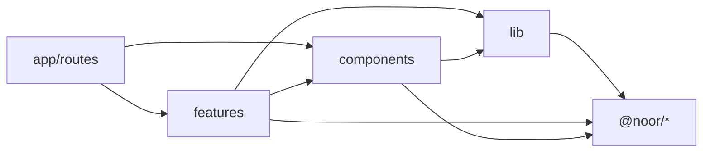

# 03 — Frontend Architecture

| Field | Value |
|---|---|
| ID | DOC-03 |
| Title | Monorepo, feature structure, import boundaries, state, data fetching, routing, i18n/RTL, env/config |
| Status | Draft |
| Owner | Tech lead |
| Last updated | 2026-10-02 |
| Depends on | DOC-01, README (A-01…A-05) |
| Decisions used | ADR-0002, ADR-0003, ADR-0004, ADR-0005, ADR-0006, ADR-0007, ADR-0013, ADR-0015, ADR-0018 |

## 1. Purpose and scope

**Governs:** where frontend code lives, what may import what, where each kind of state lives, how both apps fetch data, routing conventions, i18n wiring, environment config and pinned versions.
**Does not govern:** tokens and components (DOC-04), React coding patterns (DOC-05), per-page behaviour (DOC-06, DOC-07), backend layout (DOC-08), naming and git (DOC-15).

## 2. Pinned versions

Versions are pinned in the root `package.json` (`pnpm.overrides` for shared ones) and bumped only by a PR titled `chore(deps): …`. "Verified" = seen in a source dated within the last 4 months (DOC-02 §4).

| Package | Pin | Verified | Note |
|---|---|---|---|
| Node | `>=22.22` (`engines`); `.nvmrc` = 24 | dev machine has 24.14 | 22.22 is the React Router v8 floor; newer LTS lines are fine |
| pnpm | `11.28.3` (`packageManager` field) | 11.28.3 on 30 Sep 2026 | **Not 12** (Rust rewrite, 26 Aug 2026; revisit after 3 months without a lockfile-breaking fix). Installed with `npm i -g pnpm@11.28.3` where `corepack enable` lacks rights |
| turbo | `^2.11` | 2.11.x, Sep 2026 | `turbo.json` uses `tasks` (the 1.x `pipeline` key is gone) |
| typescript | `~6.0.3` | 6.0.3 | **Not 7.x** (7.0.2 is the native compiler): `typescript-eslint` supports `<6.1` only (ADR-0002 revisit trigger). Move to 7 when `typescript-eslint` supports it |
| react, react-dom | `^19.2.8` | repo `package.json` | Already installed in both apps |
| vite | `^8.3` | repo `package.json` | |
| react-router, @react-router/dev, @react-router/node | `~8.4` | 8.4.0 on 15 Sep 2026 | ESM-only; `react-router-dom` no longer exists; middleware on by default |
| tailwindcss, @tailwindcss/vite | `^4` | tailwindcss.com docs | CSS-first `@theme`; no `tailwind.config.js` |
| @base-ui/react | `~1.8` | 1.8.0 on 4 Sep 2026 | `DirectionProvider` for RTL |
| @tanstack/react-query | `^5.104` | 5.104.0 on 26 Sep 2026 | Admin only |
| @tanstack/react-table | `^9` | v9 stable 4 Aug 2026 | Admin only. New project, so start on v9; v8 tutorials do not apply |
| @tanstack/react-virtual | `^3.14` | 3.14.13 | Admin only |
| react-hook-form | `^7.89` | 7.89.0, Sep 2026 | **Not v8** (8.0.0-beta.4 on 26 Sep 2026) |
| @hookform/resolvers | `^5.9` | 5.9.1 | ≥ 5.1.0 required for Zod 4 |
| zod | `^4` | ADR-0005 | Only via `@noor/contract` re-export in apps |
| zustand | `^5.0` | 5.0.15 | Storefront only |
| i18next, react-i18next, i18next-icu | current majors at M0 | supported-frameworks page | Not version-verified |
| remix-i18next | `>=7` | ≥ 7 targets React Router framework mode | Compatibility with React Router **8** not verified: task `M0-I18N-SPIKE` (§9) |
| storybook, @storybook/react-vite, @storybook/addon-a11y, @storybook/addon-vitest | `^10` | 10.6 in Sep 2026 | ESM-only |
| vitest | `^5` | repo `package.json` | Already used by the admin |
| react-markdown | current major at M1 | not re-verified | Storefront **server only**: CMS page bodies (DOC-06.8) |
| web-vitals | current major at M1 | not re-verified | Storefront field metrics (DOC-06.10 §9) |
| babel-plugin-react-compiler | `^1.0.0` | repo `package.json` | On in every app (DOC-05 §3) |

## 3. Repository layout

```
noor/
  apps/
    api/                    DOC-08
    admin/                  Vite SPA (staff)
    storefront/             React Router v8 framework mode (customers)
  packages/
    contract/               @noor/contract  Zod schemas, route table, typed client, Money helpers
    ui/                     @noor/ui        tokens.css, components, Storybook
    i18n/                   @noor/i18n      locales/*.json, formatters
    config/                 @noor/config    tsconfig.base.json, eslint.config.js, vitest preset
  plan/                     this documentation set
  scripts/                  check-logical.mjs, ts-ratio.mjs
  turbo.json  pnpm-workspace.yaml  package.json  .nvmrc
```

The existing folders map as: `admin-panel/` → `apps/admin/` (moved with `git mv`, migrated in place, ADR-0002); `ecommerce-website/` → rewritten as `apps/storefront/`; `mock-api/` → deleted when `apps/api` serves the same routes (DOC-16 orders this).

`pnpm-workspace.yaml`:
```yaml
packages: ["apps/*", "packages/*"]
```

`turbo.json`:
```json
{
  "$schema": "https://turborepo.dev/schema.json",
  "tasks": {
    "build": { "dependsOn": ["^build"], "outputs": ["dist/**", "build/**"] },
    "typecheck": { "dependsOn": ["^build"] },
    "lint": {},
    "test": { "dependsOn": ["^build"] },
    "dev": { "cache": false, "persistent": true }
  }
}
```

Root scripts (the only commands a developer or agent needs):

| Command | Does |
|---|---|
| `pnpm dev` | API + admin + storefront (`turbo run dev`) |
| `pnpm build` / `pnpm typecheck` / `pnpm lint` / `pnpm test` | All workspaces, cached |
| `pnpm --filter @noor/admin dev` | One workspace |
| `pnpm storybook` | `@noor/ui` Storybook on :6006 |
| `pnpm check` | `typecheck` + `lint` + `test` + `node scripts/check-logical.mjs` (the pre-PR gate) |

## 4. Package rules

| Package | May depend on | Must not contain |
|---|---|---|
| `@noor/contract` | `zod` only | React, Node APIs, `fetch` wrappers with app config |
| `@noor/i18n` | `i18next`, `i18next-icu`, `@noor/contract` (types) | React components |
| `@noor/ui` | `react`, `@base-ui/react`, `tailwindcss`, `lucide-react`, `@noor/i18n` (for built-in labels such as "Close") | Data fetching, routing, app state, `@noor/contract` runtime schemas (types only) |
| `@noor/config` | dev tooling | Runtime code |
| `apps/*` | any `@noor/*` package | Each other |

Packages are consumed **as TypeScript source** (`"exports": { ".": "./src/index.ts" }`), compiled by the consuming app's Vite. No per-package build step until a package is published outside the repo (it will not be in v1). `@noor/contract` and `@noor/i18n` expose one `index.ts`; `@noor/ui` exposes one entry per component (`@noor/ui/button`) so an app never pulls the whole library through a barrel.

## 5. App structure

Adopted from bulletproof-react: features are independent, the app layer composes them, imports flow one way. Feature-Sliced Design was rejected (seven layers is more ceremony than a 2–3 person team needs); its one useful idea, that a business object and a user action are different things, is covered by `@noor/contract` holding the objects.

### 5.1 Admin (`apps/admin`)

```
apps/admin/src/
  app/
    main.tsx              createRoot, providers
    providers.tsx         QueryClientProvider, DirectionProvider, ToastProvider, AuthProvider
    router.tsx            createBrowserRouter; every page is lazy
    routes/               one thin file per URL: products.tsx, products.$id.tsx, orders.tsx …
  features/
    products/
      api.ts              query-key factory, queryOptions, mutations (DOC-05 §8)
      components/         ProductTable.tsx, ProductForm.tsx …
      hooks/              only if reused inside this feature
      schemas.ts          form-only schemas that refine contract schemas
      utils.ts
    orders/  catalog/  promos/  reviews/  content/  shipping/  settings/  staff/  audit/  auth/  dashboard/
  components/             app-level shared UI that is not generic enough for @noor/ui: AppShell, Sidebar, PageHeader
  lib/
    api.ts                the typed client instance (§7)
    query-client.ts
    env.ts
  index.css               @import "@noor/ui/tokens.css"; data-brand is set in index.html
```

### 5.2 Storefront (`apps/storefront`)

```
apps/storefront/app/
  root.tsx                <html lang dir>, theme <style>, providers, error boundary
  routes.ts               the route table (ADR-0004)
  entry.server.tsx  entry.client.tsx
  routes/                 thin route modules: loader, action, meta, headers, default component
    _shell.tsx  home.tsx  category.tsx  product.tsx  cart.tsx  checkout.tsx  track.tsx  page.tsx …
  features/
    catalog/   components/ (ProductCard, FilterPanel, Gallery)  server/ (catalog.server.ts)
    cart/      components/  server/  store.ts (Zustand: drawer open, optimistic qty)
    checkout/  components/  server/  schemas.ts
    orders/  wishlist/  cms/  seo/  layout/
  lib/
    api.server.ts         typed client instance bound to API_INTERNAL_URL
    env.server.ts
    i18n.server.ts  i18n.ts
    cache.ts              Cache-Control helpers per route class (ADR-0004)
  app.css                 @import "@noor/ui/tokens.css"
```

A route module contains no markup beyond composing feature components and no fetch logic beyond calling a `features/*/server/*.server.ts` function. Files ending in `.server.ts` never reach the browser bundle.

### 5.3 Import boundaries



| Rule | Enforced by |
|---|---|
| `features/a` never imports `features/b`. Compose in a route | ESLint, generated per feature (below) |
| `components/` and `lib/` never import `features/` or `app/` | ESLint `no-restricted-imports` |
| Apps import `@noor/ui/<component>`, never `@base-ui/react` or `@radix-ui/*` | ESLint `no-restricted-imports` |
| Apps import `z` and schemas from `@noor/contract`, never from `zod` | ESLint `no-restricted-imports` |
| No deep imports into another package's `src/` | package `exports` map (unlisted paths do not resolve) |
| No `index.ts` barrel files inside an app | Review (DOC-15 §7); barrels defeat Vite code splitting |

`packages/config/eslint.js` exports `appRules({ alias, featuresDir, cwd })`, used by each app's `eslint.config.js`. It returns one **complete** `no-restricted-imports` rule per path (shared patterns + that path's own), because ESLint flat config replaces, not merges, the options of the same rule when several entries match a file (found by the M0-02 fixture test: a feature-only rule had silently dropped the `zod`/Radix ban). The same package exports `base` (TypeScript baseline, `no-explicit-any`, `ts-ignore`, non-null, `.only`/`.skip`, task-id-on-TODO rule), `noProcessEnv` (API) and a Vitest `base`. Fixture tests in `packages/config/test` prove each rule fails on forbidden code.

Path aliases: `@/` → `apps/admin/src`, `~/` → `apps/storefront/app` (the React Router template default).

## 6. Where state lives

| State | Storefront | Admin |
|---|---|---|
| Server data (catalog, orders, settings) | Route `loader` data; mutated by `action`s | TanStack Query cache |
| Cart contents and totals | Server (`nc_cart` cookie holding the cart token); read in loaders (ADR-0020, DOC-06.5 §2) | — |
| Cart UI (drawer open, optimistic quantity) | Zustand `features/cart/store.ts` | — |
| Filters, sort, page, search text, active tab | URL search params | URL search params |
| Form state | React Hook Form | React Hook Form |
| Wishlist | Cookie `nc_wishlist` of product ids; no customer accounts in v1 (DOC-06.7) | — |
| Session / current staff user | — | `GET /api/v1/admin/me` via TanStack Query (`staleTime: Infinity`, reset on 401) |
| Theme (light/dark), sidebar collapsed, table column widths | — (light only in v1, DOC-04 tokens §6) | `localStorage` key `noor.admin.prefs`, parsed with Zod |
| Locale | URL prefix | fixed `en` |

`localStorage` holds UI preferences only. No domain data, no `apiEnabled` branches, no seed fallback (ADR-0015).

## 7. Data fetching

One typed client, generated from the route table in `@noor/contract` (ADR-0005):

```ts
// packages/contract/src/client.ts
export function createClient(opts: { baseUrl: string; fetch?: typeof fetch; headers?: () => HeadersInit }) {
  return async function call<K extends RouteKey>(key: K, input: RouteInput<K>): Promise<RouteOutput<K>> {
    const r = routes[key]
    const res = await (opts.fetch ?? fetch)(opts.baseUrl + buildPath(r.path, input), {
      method: r.method,
      credentials: 'include',
      headers: { 'content-type': 'application/json', ...opts.headers?.() },
      body: 'body' in r ? JSON.stringify(input.body) : undefined,
    })
    if (!res.ok) throw ApiError.from(await res.json()) // RFC 9457 problem+json with `code`
    return r.response.parse(await res.json())           // every response is parsed, never cast
  }
}
```

| | Storefront | Admin |
|---|---|---|
| Instance | `lib/api.server.ts`, `baseUrl = API_INTERNAL_URL`; forwards the `nc_cart` cookie as `X-Cart-Token`, the locale, `X-Internal-Key` and the client IP | `lib/api.ts`, `baseUrl = VITE_API_URL`; cookie session, CSRF header from `GET /admin/me` (ADR-0012) |
| Called from | `*.server.ts` only | `features/*/api.ts` only |
| Reads | `loader` | `useQuery(queryOptions)` |
| Writes | `action` + `<Form>` / `useFetcher` | `useMutation`, then invalidate by key prefix |
| Errors | `ApiError.code` → localised message (`errors.<code>` key); unknown code → `errors.unknown` | Same mapping; field errors (`issues[]`) go to `form.setError` |
| Never | `fetch` in a component; `useEffect` fetching | `fetch` in a component; server data copied into `useState` |

There is exactly one `ApiError` class, in `@noor/contract` (removes the two diverging ones, K3).

## 8. Routing

**Storefront.** `app/routes.ts` is the single route list; DOC-06 sitemap owns the full URL set. Conventions fixed here:
- Product, category and collection URLs use `handle`: `/p/:handle`, `/c/:handle`, `/collections/:handle`.
- Locale prefix: none for English, `/ur/…` for Urdu. Routes are declared once and wrapped: `...prefix(':locale?', shellRoutes)` with the root loader rejecting any `:locale` not in `supportedLocales` (404).
- Every route module exports `headers` using `lib/cache.ts` so `Cache-Control` is explicit (ADR-0004).
- Every route module exports `meta` (title, description, canonical, OG); DOC-06 SEO specifies the values.

**Admin.** `app/router.tsx` with `createBrowserRouter`; every route uses `lazy: () => import('./routes/products')`. The shell route's loader calls `GET /admin/me`; a 401 redirects to `/login?next=…`. Route files export `Component` and optionally `ErrorBoundary`. Admin URLs keep today's paths (`/products`, `/products/:id`, `/orders/:id` …; DOC-07 IA owns the list).

## 9. i18n and RTL wiring

- Catalogs: `packages/i18n/locales/{en,ur}/{common,storefront,errors}.json`. `ur` may be incomplete; missing keys fall back to `en`.
- Library: `i18next` + `react-i18next` + `i18next-icu` (ICU plurals/select). Storefront SSR integration through `remix-i18next`.
- **`M0-I18N-SPIKE` (half a day, before any storefront page):** confirm `remix-i18next` works on React Router 8.4 middleware. Fallback if it does not: a 30-line `i18n.server.ts` that creates one i18next instance per request from the catalogs and passes it through root loader data; no other code changes, because components only call `useTranslation()`.
- Key naming: `<area>.<element>[.<state>]`, e.g. `cart.empty.title`, `checkout.submit`, `errors.insufficient_stock`. Keys are static strings (no template-built keys) so unused keys can be found by grep.
- Storefront and `@noor/ui`: no user-visible string literals in JSX (`react/jsx-no-literals`, with `noStrings: true, ignoreProps: true`). Admin: English literals are allowed (ADR-0018: staff UI is English-only in v1).
- `<html lang dir>` comes from the root loader; `dir` is `rtl` for `ur`. The root wraps the tree in `<DirectionProvider direction={dir}>` (`@noor/ui/direction`).
- Formatting lives in `@noor/i18n`: `formatMoney(money, locale, priceDisplay)`, `formatDate`, `formatNumber`. All use `Intl.*` with `en-PK` / `ur-PK` and `numberingSystem: 'latn'`.
- Order numbers, SKUs, phone numbers and prices are wrapped in `<bdi dir="ltr">` (the `<Ltr>` component in `@noor/ui`).

## 10. Environment and config

Each app validates its environment once at boot with Zod and exports a typed object. A missing or malformed variable stops the process with the variable's name.

| Variable | App | Example | Notes |
|---|---|---|---|
| `VITE_API_URL` | admin | `http://localhost:3000` | Public. **No admin key variable exists** (ADR-0012) |
| `API_INTERNAL_URL` | storefront server | `http://localhost:3000` | Never sent to the browser |
| `PUBLIC_SITE_URL` | storefront server | `http://localhost:5174` | Canonical URLs, sitemap, OG |
| `PUBLIC_IMG_URL` | storefront server | `http://localhost:3000/img` | Image transform base (ADR-0011) |
| `PORT` | storefront server | `5174` | |
| `NODE_ENV` | all | `development` | |

```ts
// apps/storefront/app/lib/env.server.ts
import { z } from '@noor/contract'
export const env = z.object({
  API_INTERNAL_URL: z.url(),
  PUBLIC_SITE_URL: z.url(),
  PUBLIC_IMG_URL: z.url(),
  PORT: z.coerce.number().int().default(5174),
}).parse(process.env)
```

Values the browser needs on the storefront (`PUBLIC_*`) are passed through root loader data, not through `import.meta.env`, so one build runs in every environment. Committed `.env.example` per app; real `.env` files are gitignored (DOC-14 owns secrets).

Local ports: API 3000, admin 5173, storefront 5174, Storybook 6006.

## 11. Rules

**Always**
- Put a new file in the feature that owns it; move it to `components/` or a package the moment a second feature needs it, in the same PR.
- Parse every network response, URL param, cookie and `localStorage` read with a Zod schema.
- Add the route to the contract route table before writing the handler or the call.

**Never**
- Import one feature from another, or an app from a package.
- Call `fetch` outside `lib/api*.ts` and `@noor/contract`.
- Read `localStorage`, `window` or `document` during render in the storefront (SSR).
- Add a dependency that this document does not list without an ADR or a DOC-03 changelog row saying why.

**Common mistakes**
- Creating `features/shared/`. Shared code lives in `components/`, `lib/` or a package.
- Putting a contract-shaped type in an app "temporarily".
- Reading `import.meta.env` in storefront components (bakes one environment into the build).

## 12. Acceptance checklist

- [ ] `pnpm install && pnpm check` passes on a clean clone.
- [ ] ESLint fails on a cross-feature import, a direct `@base-ui/react` import in an app, and a direct `zod` import in an app (one fixture test each in `packages/config`).
- [ ] `grep -rE "apiEnabled|API_MODE|VITE_ADMIN_KEY" apps` returns nothing.
- [ ] `grep -r "localStorage" apps/storefront/app` returns nothing; in `apps/admin/src` only `lib/prefs.ts` matches.
- [ ] Starting the storefront without `API_INTERNAL_URL` exits with an error naming the variable.
- [ ] `M0-I18N-SPIKE` result recorded in §14.

## 13. Open questions and assumptions

| # | Item | Assumption | Revisit trigger |
|---|---|---|---|
| Q-03-1 | `remix-i18next` on React Router 8 | Works; fallback defined in §9 | Spike fails |
| Q-03-2 | TanStack Table v9 is two months old | Stable enough for a new build | Two blocking bugs in M1 → pin v8 and record here |
| Q-03-3 | Exact TypeScript pin | `~6.0.3`, see §2 | `typescript-eslint` supports TypeScript 7 |
| Q-03-4 | Packages consumed as source | Fine while nothing is published | A package is published or build time exceeds 60 s |

## 14. Changelog

| Date | Change |
|---|---|
| 2026-10-02 | Phase 2: wishlist row in §6 corrected to cookie-only; `react-markdown` and `web-vitals` added to §2 |
| 2026-10-02 | Initial version (Phase 1). Research added to DOC-02 §4: Tailwind v4, Base UI RTL, TanStack, RHF, pnpm, Turborepo, React Router 8.4, i18n, bulletproof-react, FSD |
| 2026-10-02 | Phase 7 consistency review: cart cookie and forwarded headers match DOC-10.0 §3 |
| 2026-10-02 | M0-01: Node and pnpm rows updated to what is installed |
| 2026-10-02 | M0-02: TypeScript pinned to ~6.0.3; `appRules` replaces the separate boundary helpers (§5.3); `typescript-eslint` pinned to ~8.70.1 because pnpm's 7-day release-age gate refuses 8.71.0 (published 28 Sep 2026) |
