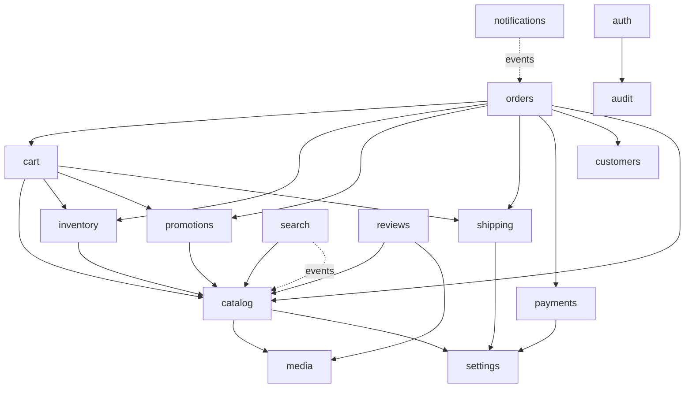

# 08 — Backend Architecture

| Field | Value |
|---|---|
| ID | DOC-08 |
| Title | Modules, layering, inter-module rules, events and outbox, jobs, caching, storage, logging |
| Status | Draft |
| Owner | Tech lead |
| Last updated | 2026-10-02 |
| Depends on | DOC-01, DOC-03 §2–4, DOC-06, DOC-07, README (A-03, A-06 … A-10) |
| Decisions used | ADR-0001, ADR-0002, ADR-0005, ADR-0008, ADR-0009, ADR-0010, ADR-0011, ADR-0012, ADR-0013, ADR-0016, ADR-0017, ADR-0020 |

## 1. Purpose and scope

**Governs:** the structure of `apps/api`: processes, module list and boundaries, request lifecycle, transactions, the outbox and job system, caching and CDN purge, media storage, configuration, errors and logging.
**Does not govern:** tables and columns (DOC-09), endpoints and schemas (DOC-10), authentication and authorisation rules (DOC-11), provider integrations (DOC-12), tests and monitoring (DOC-13), environments and deployment (DOC-14).

Replaces `mock-api/server.js` (one 212-line file with in-memory arrays).

## 2. Stack and pinned versions

| Package | Pin | Verified | Use |
|---|---|---|---|
| Node.js | 22.22 | DOC-03 §2 | Runtime |
| fastify | `^5.12` | 5.12.5 on 16 Sep 2026 | HTTP framework (ADR-0016). Not 6.0 (alpha) |
| fastify-type-provider-zod | `>=5 <7` | README of the package: v5–6 support Zod 4; v7 needs Zod ≥ 4.2 | Zod validation/serialisation compilers and JSON-schema transform |
| @fastify/cookie | `^11.1` | 11.1.2 | Session cookie |
| @fastify/helmet | `^13.1` | 13.1.1 | Security headers |
| @fastify/rate-limit | `^11.2` | 11.2.0 | Per-route rate limits |
| @fastify/cors | current 11.x at M0 | not version-verified | CORS for the admin origin |
| @fastify/swagger | current at M0 | not version-verified | OpenAPI 3.1 document from route schemas |
| drizzle-orm, drizzle-kit | `0.45.x` (ADR-0008) | 0.45.2 in Sep 2026 | ORM and migrations, `drizzle-orm/mysql2` |
| mysql2 | `^3` | not version-verified | Driver, pooled |
| zod | `^4` via `@noor/contract` | ADR-0005 | Schemas |
| pino | bundled with Fastify | — | Logging |
| @node-rs/argon2 | `^2.2` | 2.2.1, Sep 2026 | Password hashing: prebuilt binaries, no compiler toolchain needed (matters on Windows dev machines). Node's built-in `crypto.argon2` exists only from Node 24.7 |
| otplib | `^13.5` | 13.5.0 | TOTP |
| @aws-sdk/client-s3, @aws-sdk/s3-request-presigner | `^3` | not version-verified | S3-compatible storage |
| sharp | current at M0 | not version-verified | Image inspection, EXIF strip, LQIP, fallback renditions |
| nodemailer | current major at M4 | not version-verified | SMTP channel (DOC-12 §7) |
| dependency-cruiser | current major at M0 | not version-verified | Module boundary check in CI (§5.1) |
| vitest | `^5` | repo | Tests |

No DI container, no ORM other than Drizzle, no Redis, no message broker in v1 (ADR-0009).

## 3. Processes

One codebase, three entry points. All are stateless; all read the same config.

| Process | Entry | Does | Instances (production) |
|---|---|---|---|
| `api` | `src/main.ts` | Serves HTTP | 2 (ADR-0019) |
| `worker` | `src/worker.ts` | Outbox relay + job runner + scheduled jobs | 1 (safe to run 2: jobs are claimed with `SKIP LOCKED`) |
| `cli` | `src/cli.ts` | `db:migrate`, `db:seed`, `owner:create`, `jobs:retry <id>`, `cache:purge <tag>` | on demand |

Locally, `pnpm dev` runs `api` and `worker` in one process (`DEV_INLINE_WORKER=1`) so one terminal is enough.

## 4. Folder layout

```
apps/api/
  drizzle/                      generated SQL migrations (committed)
  drizzle.config.ts
  src/
    main.ts  worker.ts  cli.ts
    app.ts                      buildApp(): Fastify instance, plugins, routes from the contract
    platform/
      config.ts                 Zod-parsed process.env (the only reader of process.env)
      db.ts                     mysql2 pool + drizzle instance + transaction helper
      errors.ts                 DomainError, problem+json renderer
      logger.ts                 pino options, redaction list
      http/                     plugins: request-id, session, csrf, rate-limit, cors, helmet, route-registrar
      outbox.ts                 emit(tx, event)
      jobs.ts                   enqueue(tx, job), runner, backoff
      cache.ts                  in-process TTL cache + purgeTags()
      storage.ts                S3 client, presign, signed image URLs
      ids.ts                    uuidv7(), token()
      clock.ts                  now() (injectable in tests)
    modules/
      <name>/
        index.ts                PUBLIC API of the module
        routes.ts               handlers keyed by contract route key
        service.ts              business rules, transactions
        repository.ts           the only file that imports Drizzle tables
        schema.ts               Drizzle table definitions for this module
        events.ts               events emitted + handlers for events consumed
        jobs.ts                 job handlers owned by this module
        *.test.ts
    seed/                       seed data (DOC-14 §5)
```

## 5. Modules

| Module | Owns (tables in DOC-09) | Public functions (examples) | May call |
|---|---|---|---|
| `auth` | staff users, roles, sessions, invites, login attempts, 2FA | `requireSession`, `can(user, perm)` | `audit` |
| `audit` | audit log | `record(tx, entry)` | — |
| `settings` | store settings, site content (home), menus, pages | `getStoreConfig()`, `getPage(slug)` | `media`, `audit` |
| `media` | media records, upload tickets | `createUpload`, `confirmUpload`, `imageUrl(key, opts)` | — |
| `catalog` | products, variants, options, categories, collections, attributes, size systems/charts, form schemas, handle redirects | `getVariantsForPricing(tx, ids)`, `getProductPublic(handle)` | `media`, `settings`, `audit` |
| `inventory` | inventory levels, movements, reservations | `reserve(tx, lines)`, `release(tx, orderId)`, `commit(tx, orderId)`, `adjust(tx, …)` | `catalog` |
| `search` | product search rows, synonyms, zero-result log | `search(query)`, `reindexProduct(id)` | `catalog` |
| `shipping` | zones, methods, cities, couriers | `quote(tx, city, methodId, subtotal)` | `settings` |
| `promotions` | promo codes, redemptions | `evaluate(tx, cart, code)`, `redeem(tx, …)`, `unredeem(tx, orderId)` | `catalog` |
| `cart` | carts, cart lines | `getCart`, `price(tx, cartId, ctx)` | `catalog`, `inventory`, `promotions`, `shipping` |
| `customers` | customers, customer notes/flags | `upsertByPhone(tx, …)` | `audit` |
| `payments` | payments, payment events | `createSession`, `recordManual`, provider adapters | `settings` |
| `orders` | orders, order lines, order events, idempotency keys, counters | `createOrder`, `transition`, `getPublicByToken` | `cart`, `inventory`, `promotions`, `shipping`, `payments`, `customers`, `catalog`, `audit` |
| `reviews` | reviews, review tokens | `createForOrderLine`, `moderate` | `catalog`, `media` |
| `notifications` | notification log, templates | handlers only (consumes events) | `settings` (+ reads via other modules' `index.ts`) |
| `reporting` | `web_vitals_daily` (DOC-13 §8.6); otherwise reads only | `dashboardSummary`, `todoCounts` | read-only repository over orders/catalog tables through their modules' query functions |



### 5.1 Inter-module rules

| Rule | Enforced by |
|---|---|
| A module imports another module **only** from its `index.ts` | ESLint `no-restricted-imports` (pattern `modules/*/!(index)`) + `dependency-cruiser` in CI (ADR-0016) |
| The dependency graph is acyclic and matches the "May call" column | `dependency-cruiser` rule file lists the allowed edges; a new edge is a reviewed change to that file |
| Only `repository.ts` imports `schema.ts` and Drizzle query builders | ESLint pattern on `drizzle-orm` imports |
| A module never queries another module's tables. It calls that module's function, passing the open `tx` | Review + the rule above |
| Cross-module **reactions** (send a message, reindex, purge cache) go through events, not direct calls | §8 |
| `platform/` contains no business rules and imports no module | ESLint |
| No ORM type leaves a module: `index.ts` exports functions and contract/plain types | Review |
| `reporting` is the one module allowed read-only SQL across orders and catalog tables, through query functions those modules export for it (`orders.queryForReporting`) | Listed edge in the dependency file |

## 6. Request lifecycle

```
request
  → request-id (accept inbound X-Request-Id from our CDN/storefront, else generate; echo in response)
  → helmet headers, CORS
  → rate-limit (route's bucket; DOC-11)
  → session load (admin routes) → CSRF check (mutating admin routes)
  → permission check (route.auth from the contract)
  → validate params / query / body with the route's Zod schemas  (400 problem on failure)
  → handler: routes.ts → service.ts → repository.ts
  → response: validated against the route's response schema in dev and test; serialised
  → error handler: DomainError → RFC 9457 problem+json; unknown → 500 with request id, logged
  → access log line
```

### 6.1 Route registration from the contract (ADR-0005)

The contract route table is the only list of routes. Each module's `routes.ts` exports a map from route key to handler; `platform/http/route-registrar.ts` walks the table and registers each route with its schemas, auth and rate-limit bucket. A key in the table without a handler, or a handler without a key, fails startup and a test.

```ts
// modules/catalog/routes.ts
import type { Handlers } from '../../platform/http/route-registrar'
import * as service from './service'

export const handlers = {
  'catalog.listProducts': async ({ query }) => service.listProducts(query),
  'catalog.getProduct': async ({ params }) => service.getProductPublic(params.handle),
  'admin.products.update': async ({ params, body, actor }) => service.updateProduct(actor, params.id, body),
} satisfies Handlers<'catalog'>
```

```ts
// platform/http/route-registrar.ts (shape)
for (const [key, r] of Object.entries(routes)) {
  app.withTypeProvider<ZodTypeProvider>().route({
    method: r.method, url: r.path,
    schema: { params: r.params, querystring: r.query, body: r.body, response: { [r.status ?? 200]: r.response } },
    config: { auth: r.auth, permission: r.permission, rateLimit: buckets[r.rateLimit ?? 'default'], idempotent: r.idempotent },
    handler: async (req, reply) => reply.code(r.status ?? 200).send(await handlers[key]({ ...pick(req), actor: req.actor })),
  })
}
```

The same schemas feed `@fastify/swagger`, which emits OpenAPI 3.1; CI compares it to the committed snapshot (ADR-0005). This resolves ADR-0005's open question: **the helper is `fastify-type-provider-zod` plus the 40-line registrar; no other routing library.**

Rules for handlers: no SQL, no `fetch`, no `process.env`; at most parse → one service call → return.

## 7. Services, repositories and transactions

| Rule | Detail |
|---|---|
| Transaction owner | The **service** opens `db.transaction(async (tx) => …)`; repositories take `tx` as their first argument. Read-only service functions may pass the pool |
| One transaction per command | A state-changing command does all its writes, its outbox events and its audit entry in one transaction (ADR-0009, ADR-0012) |
| Isolation | InnoDB default `REPEATABLE READ`. Rows that will be updated based on what was read are locked with `SELECT … FOR UPDATE` in a fixed order: variants ascending by id, then `counters` (ADR-0020) |
| Deadlocks | `platform/db.ts` retries the whole transaction on MySQL errors 1213 (deadlock) and 1205 (lock wait timeout), up to 3 times with 20–100 ms jitter. The service function must therefore be safe to re-run: no external call inside |
| No external I/O inside a transaction | No HTTP call, no S3 call, no email. Emit an event; a job does it after commit |
| Time | `platform/clock.now()`; stored as UTC `datetime(3)` (ADR-0008) |
| IDs | `uuidv7()` in the app; tokens from `crypto.randomBytes(32)` base64url |
| Money | Integer paisa; arithmetic only through `@noor/contract` money helpers (ADR-0013) |
| Optimistic locking | Editable aggregates (product, order, settings documents, menus) carry `version int`; updates run `… WHERE id = ? AND version = ?` and throw `stale_write` when 0 rows change (DOC-07.3 §9) |
| Queries | Explicit column lists; every list query has `LIMIT`; every `WHERE`/`ORDER BY` column of a list endpoint is indexed (DOC-09) |

```ts
// modules/orders/service.ts (shape of the critical path, ADR-0020)
export async function createOrder(input: CreateOrderInput, idemKey: string) {
  return withIdempotency('orders.create', idemKey, input, () =>
    db.transaction(async (tx) => {
      const cart = await cartApi.price(tx, input.cartId /* resolved from X-Cart-Token by the route */, { city: input.shippingAddress.city, methodId: input.shippingMethodId, paymentMethod: input.paymentMethod })
      if (cart.changedSinceQuote) throw new DomainError('price_changed', 409, { cart })
      await inventory.reserve(tx, cart.lines)                 // locks variants ascending, aggregates per variant
      const promo = cart.promo ? await promotions.redeem(tx, cart, input.customer.phone) : null
      const customer = await customers.upsertByPhone(tx, input.customer)
      const orderNo = await repo.nextCounter(tx, 'order_number')
      const order = await repo.insertOrder(tx, snapshot({ cart, promo, customer, orderNo, input }))
      await payments.createInitial(tx, order)
      await outbox.emit(tx, { type: 'order.placed', orderId: order.id })
      return toOrderCreated(order)
    }))
}
```

## 8. Events and the outbox

Events are facts in the past tense, written to `outbox_events` in the same transaction as the change (ADR-0009). Handlers run in the worker, are idempotent, and receive `{ eventId, type, payload, occurredAt }`.

| Event | Emitted by | Handlers (module → effect) |
|---|---|---|
| `order.placed` | orders | notifications → customer confirmation + staff alert; reporting cache bust |
| `order.confirmed` | orders | notifications → customer |
| `order.dispatched` | orders | notifications → customer with tracking |
| `order.delivered` | orders | notifications → customer + review links (reviews) |
| `order.cancelled` | orders | notifications → customer; (stock release and promo unredeem happen **inside** the transition transaction, not here) |
| `order.returned` | orders | notifications → customer |
| `payment.captured`, `payment.failed`, `payment.expired` | payments | orders → `applyPaymentEvent` (may confirm or keep pending) |
| `product.published`, `product.updated`, `product.archived` | catalog | search → reindex; platform → purge tags `product:<handle>`, `category:<id>`, `listing` |
| `inventory.changed` | inventory | search → update availability; purge `product:<handle>`; notifications → low-stock alert when crossing the threshold |
| `variant.back_in_stock` | inventory | notifications → subscribers |
| `content.updated` (page, menu, home) | settings | purge `page:<slug>`, `menus`, `home` |
| `settings.updated` | settings | purge `store-config` |
| `review.approved`, `review.rejected` | reviews | catalog → recompute rating; purge `product:<handle>` |
| `staff.invited`, `staff.password_reset_requested` | auth | notifications → email (when a provider exists) |
| `export.requested` | any | owning module's job builds the file |

Payload rule: ids and the minimum needed to act, never a copy of the entity (handlers load current state) and never personal data (payloads are stored).

**Relay:** every 1 s (and immediately after `api` commits, via an in-process nudge when the inline worker is on) the worker selects unprocessed outbox rows in `created_at` order, inserts one job per (event, handler) with a unique key `event:<eventId>:<handler>`, and marks the event processed, in one transaction. A duplicate insert is ignored, so the relay is safe to repeat.

## 9. Jobs

### 9.1 Table and claiming (specified here; DDL in DOC-09 platform)

`jobs(id, type, payload json, unique_key, run_at, attempts, max_attempts, locked_at, locked_by, last_error, created_at)`, unique index on `unique_key`, index on `(locked_at, run_at)`.

```sql
-- claim (worker, in a short transaction)
SELECT id FROM jobs
 WHERE run_at <= NOW(3) AND (locked_at IS NULL OR locked_at < NOW(3) - INTERVAL 10 MINUTE)
 ORDER BY run_at LIMIT 10
 FOR UPDATE SKIP LOCKED;
UPDATE jobs SET locked_at = NOW(3), locked_by = ?, attempts = attempts + 1 WHERE id IN (…);
```

| Rule | Detail |
|---|---|
| Polling | Every 1 s when the last poll found work, backing off to 5 s when idle |
| Concurrency | 5 jobs at a time per worker |
| Success | Row deleted |
| Failure | `run_at = now + min(2^attempts × 15 s, 1 h)`, `last_error` stored (message only, no payload), lock cleared |
| Dead letter | At `max_attempts` (8) the row moves to `jobs_dead` and an audit entry `job_failed` is written (DOC-07.2 "Failed jobs", DOC-07.13) |
| Stuck jobs | A lock older than 10 minutes is reclaimable (covers a crashed worker) |
| Idempotency | Handlers must tolerate running twice: side effects carry an idempotency key (`notification_log.unique_key`, provider merchant reference) |
| Timeouts | A handler is aborted after 60 s (exports: 10 min) |
| Shutdown | `SIGTERM`: stop claiming, wait up to 30 s for running jobs, exit |

### 9.2 Job catalogue

| Job type | Trigger | Owner | Notes |
|---|---|---|---|
| `notify.customer` | order events | notifications | One per (order, template, channel); provider chosen in DOC-12; while no provider is configured the job records the rendered message in `notification_log` with status `skipped` so staff can copy it |
| `notify.staff` | `order.placed`, low stock | notifications | Email when configured; otherwise only the admin badge counts |
| `search.reindex_product` | product/inventory events | search | Rebuilds one `product_search` row |
| `cache.purge` | content/product/settings events | platform | Calls the CDN purge API by tag (DOC-14); no-op locally |
| `media.process` | `media.confirm` | media | Validate magic bytes, strip EXIF, record dimensions, generate LQIP |
| `export.build` | `export.requested` | requesting module | Writes CSV to private storage, records a signed link |
| `bulk.run` | bulk action over 500 items | requesting module | Calls the same service function per item, stores per-item results |
| `review.issue_tokens` | `order.delivered` | reviews | |
| `payments.reconcile` | schedule, daily 03:00 PKT | payments | ADR-0017 (inactive while only COD exists) |
| `inventory.expire_reservations` | schedule, every 5 min | inventory | Releases reservations of unpaid online orders older than 30 min (ADR-0020); inactive while only COD exists |
| `catalog.publish_scheduled` | schedule, every 1 min | catalog | `scheduled` products whose `publish_at` has passed → `active` + `product.published` |
| `cart.cleanup` | schedule, daily | cart | Deletes carts idle for 30 days |
| `idempotency.cleanup` | schedule, hourly | orders | Deletes keys past their 24 h TTL |
| `outbox.cleanup` | schedule, daily | platform | Deletes processed events older than 7 days |
| `audit.retention` | schedule, monthly | audit | DOC-11 retention |
| `reporting.sales_counts` | schedule, nightly | reporting | Updates per-product sales counts used by the `bestselling` sort |

**Scheduling without a cron service:** `platform/jobs.ts` holds a static list `{ type, cron }`. Each minute the worker enqueues due jobs with `unique_key = schedule:<type>:<minute bucket>`; the unique index makes this safe with two workers.

## 10. Caching

| Layer | What | Rule |
|---|---|---|
| CDN | Storefront HTML for L and S routes (DOC-06.1 §2) and public API GETs the storefront server does not proxy | Purge by tag through the `cache.purge` job. Tags are sent on responses in the CDN's tag header (name set in DOC-14) |
| Storefront server | Store config, site settings, menus, category tree | 30 s in-process TTL (DOC-06.1 §3) |
| API in-process | `getStoreConfig()`, category tree, shipping zones, role → permission map | `platform/cache.ts`: `Map` with 30 s TTL, cleared on the matching `*.updated` event in that process; other instances catch up within the TTL |
| Database | Nothing cached | Indexes instead (DOC-09) |
| Redis | Not provisioned | ADR-0009 |

Tag vocabulary: `home`, `listing`, `category:<id>`, `collection:<id>`, `product:<handle>`, `page:<slug>`, `menus`, `size-charts`, `store-config`. A price or stock change purges `product:<handle>` and `listing`; with `s-maxage=60` the worst-case staleness without a purge is one minute.

Never cached anywhere: carts, orders, quotes, anything under `/admin`, any response that depends on a cookie.

## 11. Media storage (ADR-0011)

| Topic | Decision |
|---|---|
| Store | One private S3-compatible bucket. Keys: `media/<yyyy>/<mm>/<uuidv7>.<ext>` (originals), `exports/<uuid>.csv`, `proofs/<uuid>.<ext>` (payment proofs) |
| Upload | `admin.media.createUpload` → presigned `PUT` (10 min, content-length ≤ 10 MB, content-type pinned) + an upload ticket row → browser uploads → `admin.media.confirm` → `media.process` job: read the first bytes and reject anything that is not JPEG/PNG/WebP/AVIF; reject over 8000 px per side; strip EXIF; store `width`, `height`, `lqip`; mark the media `ready`. Unconfirmed tickets are deleted after 24 h with their objects |
| Delivery | **imgproxy** (open source) as the transform service at `img.<domain>`, behind the CDN, reading the private bucket. URLs are signed (HMAC) by `media.imageUrl(key, { width, format? })`; only widths from the allow-list `320, 480, 640, 828, 1080, 1600` (ADR-0011) are ever signed, so arbitrary sizes cannot be requested |
| URL format | imgproxy's native signed URL format replaces the illustrative path in ADR-0011. The contract's image fields carry ready-made `src` and `srcset` strings built by the API, so no client constructs transform URLs |
| Formats | imgproxy negotiates AVIF/WebP from `Accept`, JPEG fallback |
| Fallback | If no transform service is available in an environment (`IMAGE_TRANSFORM=none`), `media.process` pre-generates the six widths in WebP and JPEG with `sharp` and `imageUrl` returns those object URLs (ADR-0011 option B) |
| SVG logos | Not processed by imgproxy; sanitised on upload (scripts, event attributes and external references removed) and served as-is. If sanitising proves unreliable, logos are PNG only (DOC-07.11 Q-07.11-2) |
| Local development | MinIO container, same code path (DOC-14) |

## 12. Configuration

`platform/config.ts` parses `process.env` once with Zod and exports a frozen object; a missing or invalid variable exits with the variable's name (ADR-0016). Variable list and per-environment values are in DOC-14 §4. No other file reads `process.env` (ESLint `no-process-env` outside `config.ts`).

## 13. Errors

```ts
// platform/errors.ts
export class DomainError extends Error {
  constructor(public code: string, public status: number, public details?: Record<string, unknown>) { super(code) }
}
```

| Rule | Detail |
|---|---|
| Throwing | Services throw `DomainError('insufficient_stock', 409, { variantId, available })`. Repositories throw only on programming errors |
| Rendering | One Fastify error handler → `application/problem+json` (RFC 9457): `{ type, title, status, code, detail?, issues?, requestId, …details }` (exact shape in DOC-10 conventions) |
| Validation | Zod failures → `400 validation_failed` with `issues[{ path, code }]` |
| Unknown errors | `500 internal_error` with `requestId`; the stack goes to the log, never to the client |
| Codes | Stable `snake_case`; the full registry lives in `@noor/contract` (`errorCodes`) so client and server share it and a typo is a compile error |
| MySQL errors | Duplicate key (1062) on a known unique index is mapped to its domain code (`sku_taken`, `handle_taken`) in the repository; deadlock handled in §7 |

## 14. Logging and request tracing

| Topic | Rule |
|---|---|
| Format | pino JSON to stdout; one line per request: `time, level, requestId, method, route (the pattern, not the raw URL), status, durationMs, actorId?, ip` |
| Request id | UUID; propagated storefront → API via `X-Request-Id`; put on jobs created by the request (`payload.requestId`) so a notification can be traced to the order request |
| Redaction | pino `redact` paths: `req.headers.cookie`, `req.headers.authorization`, `*.password`, `*.token`, `*.phone`, `*.email`, `*.address`, `*.landmark`, `*.secret`, `*.code`. Request and response **bodies are never logged** (ADR-0016) |
| Levels | `error` (5xx, job dead-lettered), `warn` (4xx that indicate abuse: rate limited, CSRF failure, invalid transition), `info` (requests, job results), `debug` (off in production) |
| Slow queries | Any query over 200 ms is logged at `warn` with the statement text and no parameters |
| Query URLs | Query strings are logged without values for `phone`, `q`, `token` |
| Health | `GET /healthz` (process up) and `GET /readyz` (DB reachable with `SELECT 1`, migrations at head); neither is logged at `info` |
| Metrics and alerts | DOC-13 |

## 15. Spikes scheduled by this document

| Task | Size | Proves |
|---|---|---|
| `M0-API-SPIKE-1` | 1 day | Route table → Fastify registration with `fastify-type-provider-zod`, OpenAPI snapshot, one public and one admin route |
| `M0-API-SPIKE-2` | 1 day | Jobs table: claim with `SKIP LOCKED` from two worker processes, crash recovery, unique-key dedupe, on MySQL 8.4 |
| `M0-API-SPIKE-3` | half a day | Drizzle `mysql-core`: `datetime(3)`, `json`, table-level `CHECK`, `FOR UPDATE`, transaction retry on error 1213; migration generated and applied |
| `M0-API-SPIKE-4` | half a day | imgproxy reading MinIO with signed URLs and AVIF negotiation |

Results are recorded in §18. A failed spike changes this document before any module is built.

## 16. Rules

**Always:** register routes from the contract; open the transaction in the service; emit events through the outbox in the same transaction; make handlers idempotent; pass `tx` to other modules' functions.
**Never:** import another module's internals; call an external service inside a transaction; put SQL in a route or business rules in a repository; read `process.env` outside `config.ts`; log bodies or personal data; add a table without an owning module.
**Common mistakes:** "just one query" in a route; publishing an event after commit from application code (lost on crash); a job that is not safe to run twice; a handler that reads the event payload as if it were current state.

## 17. Acceptance checklist

- [ ] `dependency-cruiser` passes with the allowed-edges file matching §5; adding an import of `modules/orders/repository` from `modules/cart` fails CI.
- [ ] Startup fails when a contract route has no handler (test) and when a required env var is missing (test).
- [ ] OpenAPI generated in CI equals the committed snapshot.
- [ ] Killing the worker mid-job and restarting neither loses nor duplicates a notification (integration test, ADR-0009).
- [ ] Two workers never run the same job (integration test with 1,000 jobs).
- [ ] A forced deadlock (two transactions locking variants in opposite order via a test hook) is retried and both orders resolve correctly.
- [ ] `grep -rn "process.env" apps/api/src` matches only `platform/config.ts`.
- [ ] A log capture of a full checkout contains no phone, address or email.
- [ ] Uploading a renamed HTML file as `.jpg` ends with the media rejected and the object deleted.

## 18. Open questions and assumptions

| # | Item | Assumption | Revisit trigger |
|---|---|---|---|
| Q-08-1 | Drizzle `mysql-core` supports `.for('update', { skipLocked: true })` and table-level `check()` in 0.45 | Yes; otherwise those two statements use the `sql` template | `M0-API-SPIKE-3` |
| Q-08-2 | `fastify-type-provider-zod` major to pin | The highest major that supports the Zod 4 minor we install (v5/6 for Zod 4.0–4.1, v7 for ≥ 4.2) | `M0-API-SPIKE-1` |
| Q-08-3 | imgproxy current version, AVIF support in the open-source build, URL signing details | Not researched in this phase | `M0-API-SPIKE-4`; fallback is ADR-0011 option B |
| Q-08-4 | `@fastify/swagger` output for Zod 4 schemas | Works through the type provider's JSON-schema transform | `M0-API-SPIKE-1`; fallback: build OpenAPI directly with `z.toJSONSchema` |
| Q-08-5 | Job throughput | Far below ADR-0009's revisit trigger (50 jobs/s) at A-03 scale | Queue latency p95 over 30 s |
| Q-08-6 | Rate-limit counters are per instance (in memory) | Acceptable with 2 instances; login and tracking limits use database counters (DOC-11) | More than 2 instances |

## 19. Changelog

| Date | Change |
|---|---|
| 2026-10-02 | Initial version (Phase 4). Resolves ADR-0005 (route helper) and ADR-0009 (worker design) open questions; amends ADR-0011's URL example (imgproxy native format) |
| 2026-10-02 | Phase 7 consistency review: reporting owns `web_vitals_daily`; `nodemailer` and `dependency-cruiser` listed in §2 |
