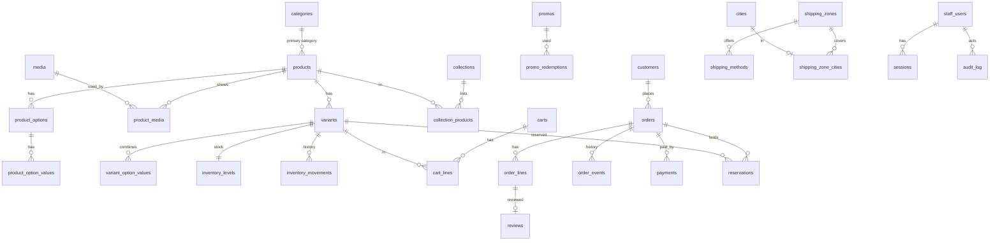

# 09.0 — Data Model: Conventions, Overview and Contract Changes

| Field | Value |
|---|---|
| ID | DOC-09.0 |
| Title | Database conventions, table ownership, overview ERD, enum registry, contract changes |
| Status | Draft |
| Owner | Tech lead |
| Last updated | 2026-10-02 |
| Depends on | DOC-08 §5, §7, DOC-15 §2.4 |
| Decisions used | ADR-0008, ADR-0009, ADR-0013, ADR-0014, ADR-0018, ADR-0020 |

## 1. Purpose and scope

**Governs:** rules every table follows, which module owns which table, the enum values stored in the database, and the list of changes the current Zod contract needs so that it matches this model.
**Does not govern:** the tables themselves (DOC-09.1 … 09.9), endpoint shapes (DOC-10).

Database: MySQL 8.4, InnoDB, `utf8mb4` / `utf8mb4_0900_ai_ci`, server time zone UTC (ADR-0008, DOC-14 §3.2). One schema, `rubaya`.

## 2. Conventions (apply to every table unless a table says otherwise)

| Topic | Rule |
|---|---|
| Names | Tables plural `snake_case`; columns `snake_case`; FK column `<entity>_id` |
| Primary key | `id char(36)` holding a UUIDv7 generated by the application. Join tables use a composite primary key |
| Collation of ids and codes | `id`, `*_id`, `handle`, `slug`, `sku`, `code`, `key`, hashes and enum-like `varchar`s use `ascii_bin` or `utf8mb4_bin` where noted "(bin)" so comparisons are exact and indexes are compact. Human text keeps the default accent- and case-insensitive collation |
| Time | `datetime(3)` in UTC; names end in `_at`. `created_at` and `updated_at` are set by the application (`clock.now()`), not by `DEFAULT CURRENT_TIMESTAMP`/`ON UPDATE`, so tests can control time |
| Money | `bigint` integer paisa, name ends in `_minor`. PKR only, so no currency column in v1 (ADR-0013). Never `decimal`, `float` or `double` |
| Percentages | Integer basis points, name ends in `_bps` (12.5% = 1250) |
| Booleans | `boolean` (`tinyint(1)`), names `is_*`, `has_*` or an adjective (`enabled`, `visible`) |
| Enumerations | `varchar(32)` (bin) with a named `CHECK (col IN (…))`; no native `ENUM` (ADR-0008). Values are the `snake_case` strings of §5 |
| JSON | `json` only for data that is stored and returned whole and never filtered or sorted on. Each JSON column names the Zod schema that validates it on write |
| Translations | English lives in the normal columns. Other locales live in one `i18n json` column per translatable table: `{ "ur": { "title": "…", "subtitle": "…" } }`. Missing keys fall back to English (ADR-0018). This avoids a translation table per entity while Urdu is not yet live |
| Soft delete | Not used. Rows are deleted, or carry a status (`archived`, `deactivated`). History that must survive lives in snapshot columns (order lines) |
| Optimistic locking | Aggregates edited from forms carry `version int NOT NULL DEFAULT 1`, incremented on every update (DOC-08 §7) |
| Foreign keys | Always declared, with an index. `ON DELETE` is `RESTRICT` unless the table says `CASCADE` (children that cannot exist alone) or `SET NULL` |
| Indexes | Named `<table>_<cols>_idx`, unique `<table>_<cols>_uq`, checks `<table>_<rule>_chk`, FKs `<table>_<col>_fk`. Every FK, and every column used in a list endpoint's `WHERE` or `ORDER BY`, is indexed (ADR-0008) |
| Nullable unique | MySQL allows many `NULL`s in a unique index; where "unique when present" is intended this is relied on and stated |
| Text sizes | Names/titles `varchar(160)`; short labels `varchar(60)`; handles/slugs `varchar(80)`; URLs/keys `varchar(500)`; long text `text` (≤ 64 kB) |
| Snapshots | Orders copy what they need (titles, prices, address, method labels). A later change to a product, promo or shipping method never changes a placed order |

In the table definitions of DOC-09.1 … 09.9: **NN** = `NOT NULL`, **PK** = primary key, **FK →** = foreign key, **UQ** = unique index, **IX** = non-unique index.

## 3. Table ownership

Only the owning module's `repository.ts` reads or writes a table (DOC-08 §5.1).

| Doc | Module(s) | Tables |
|---|---|---|
| 09.1 platform | platform | `outbox_events`, `jobs`, `jobs_dead`, `counters`, `idempotency_keys`, `rate_limit_hits`, `exports` |
| 09.2 auth-audit | auth, audit | `staff_users`, `sessions`, `auth_tokens`, `recovery_codes`, `login_attempts`, `audit_log` |
| 09.3 catalog | catalog, media | `media`, `categories`, `attributes`, `attribute_values`, `category_attributes`, `size_systems`, `size_system_values`, `size_charts`, `form_schemas`, `products`, `product_categories`, `product_media`, `product_options`, `product_option_values`, `variants`, `variant_option_values`, `product_attribute_values`, `collections`, `collection_products`, `bundle_items`, `product_related`, `handle_redirects` |
| 09.4 inventory | inventory | `inventory_levels`, `inventory_movements`, `reservations`, `stock_subscriptions` |
| 09.5 search | search | `product_search`, `search_synonyms`, `search_misses` |
| 09.6 cart-promotions | cart, promotions | `carts`, `cart_lines`, `promos`, `promo_targets`, `promo_redemptions` |
| 09.7 orders-payments | orders, payments, customers | `customers`, `customer_notes`, `orders`, `order_lines`, `order_events`, `payments`, `payment_events` |
| 09.8 reviews-notifications | reviews, notifications | `reviews`, `review_photos`, `review_invites`, `notification_log` |
| DOC-13 §8.6 | reporting | `web_vitals_daily` |
| 09.9 settings-shipping-content | settings, shipping | `settings`, `pages`, `menus`, `cities`, `shipping_zones`, `shipping_zone_cities`, `shipping_methods`, `couriers` |

67 tables.

## 4. Overview ERD

Only the main relationships; each module file has its own detailed diagram.

## 5. Enum registry

The single list of stored enum values. The same literals are the Zod enums in `@noor/contract`; a value is added in the contract and in the table's `CHECK` in the same PR.

| Enum | Values | Used by |
|---|---|---|
| `product_status` | `draft`, `scheduled`, `active`, `archived` | `products.status` |
| `product_kind` | `stitched`, `unstitched`, `made_to_order`, `footwear`, `accessory`, `bundle`, `home`, `beauty` | `products.kind` |
| `stock_mode` | `counted`, `made_to_order`, `preorder` | `variants.stock_mode` |
| `stock_status` (derived, never stored on variants) | `in_stock`, `low_stock`, `sold_out`, `made_to_order`, `preorder` | API output; `products.stock_status` cache |
| `option_role` | `size`, `color`, `material`, `other` | `product_options.role` |
| `option_display` | `buttons`, `swatch`, `select` | `product_options.display` |
| `option_value_kind` | `standard`, `custom` | `product_option_values.kind` |
| `media_kind` | `image`, `video` | `media.kind` |
| `media_status` | `pending`, `ready`, `rejected` | `media.status` |
| `media_role` | `model`, `flat`, `detail`, `lifestyle` | `product_media.role` |
| `color_family` | `black`, `white`, `grey`, `beige`, `brown`, `red`, `pink`, `orange`, `yellow`, `green`, `blue`, `purple`, `gold`, `silver`, `multi` | `products.color_family` |
| `attribute_type` | `enum`, `number`, `boolean`, `color` | `attributes.type` |
| `attribute_display` | `checkbox`, `swatch`, `buttons`, `range` | `attributes.display` |
| `collection_status` | `draft`, `active` | `collections.status` |
| `movement_reason` | `initial`, `restock`, `correction`, `damaged`, `return_restock`, `return_damaged`, `sale`, `other` | `inventory_movements.reason` |
| `reservation_status` | `active`, `committed`, `released` | `reservations.status` |
| `promo_type` | `percent`, `fixed`, `free_shipping` | `promos.type` |
| `promo_target_type` | `category`, `product` | `promo_targets.target_type` |
| `order_status` | `pending`, `pending_confirmation`, `confirmed`, `dispatched`, `delivered`, `cancelled`, `returned` | `orders.status` |
| `order_channel` | `storefront`, `admin` | `orders.channel` |
| `payment_method` | `cod`, `bank_transfer`, `wallet`, `card`, `bnpl` | `orders.payment_method`, `payments.method` |
| `payment_status` (order level) | `unpaid`, `deposit_paid`, `paid`, `refund_due`, `partially_refunded`, `refunded` | `orders.payment_status` |
| `payment_state` (one payment) | `initiated`, `pending_confirmation`, `authorized`, `captured`, `failed`, `expired`, `refunded` | `payments.state` |
| `payment_kind` | `deposit`, `balance`, `full`, `refund` | `payments.kind` |
| `cancel_reason` | `customer_request`, `unreachable`, `duplicate`, `out_of_stock`, `suspected_fake`, `payment_expired`, `other` | `orders.cancel_reason` |
| `return_type` | `refused_at_door`, `undelivered`, `customer_return` | `order_events.data` |
| `attempt_outcome` | `no_answer`, `busy`, `wrong_number`, `call_later`, `declined` | `order_events.data` |
| `review_status` | `pending`, `approved`, `rejected` | `reviews.status` |
| `review_reject_reason` | `offensive`, `personal_data`, `not_about_product`, `spam`, `other` | `reviews.reject_reason` |
| `fit_note` | `runs_small`, `true_to_size`, `runs_large` | `products.fit` JSON, `reviews.fit` |
| `page_status` | `draft`, `active` | `pages.status` |
| `staff_role` | `owner`, `manager`, `catalog`, `fulfilment`, `support`, `viewer` | `staff_users.role` |
| `staff_status` | `invited`, `active`, `deactivated` | `staff_users.status` |
| `auth_token_type` | `invite`, `password_reset` | `auth_tokens.type` |
| `actor_type` | `staff`, `system`, `storefront` | `audit_log.actor_type`, `order_events.actor_type` |
| `notification_channel` | `whatsapp`, `sms`, `email` | `notification_log.channel` |
| `notification_status` | `queued`, `sent`, `failed`, `skipped` | `notification_log.status` |
| `export_status` | `queued`, `running`, `done`, `failed` | `exports.status` |

Two renames against today's contract: product kind `made-to-order` → `made_to_order` (all stored enum values are `snake_case`, DOC-15 §2.2), and order-level payment status is split from the per-payment state (the GLOSSARY's single "Payment status" list becomes these two).

## 6. Changes the current contract needs

`admin-panel/src/contract/schemas.js` becomes `packages/contract` (ADR-0005). These are the differences between that file and this data model; DOC-10 writes the resulting schemas and Phase 7 checks every name.

| Area | Change | Why |
|---|---|---|
| Product | `kind` value `made-to-order` → `made_to_order` | §5 |
| Product | `media[]` and `images[]` merged into one `media[]` (`ProductImage` removed) | One gallery (DOC-06.4 Q-06.4-1, DOC-07.3 Q-07.3-5) |
| Product | `collectionIds` removed; membership lives only on the collection | Single source (DOC-07.4 §3) |
| Product | `version` added; `badges` limited to `new`, `bestseller`, `limited` on input, with `sale`, `sold_out`, `made_to_order` derived on output | DOC-07.3 §4, §9 |
| Product | Translatable fields become `{ en, ur? }` on output only when a second locale is enabled; input carries an optional `i18n` object | ADR-0018 |
| Variant | `stock: { status, quantity, maxPerOrder }` → input `stockMode`, `maxPerOrder`, `enabled`; output adds derived `stockStatus`, `available` | Stock changes only through movements (DOC-07.3 §7.1) |
| Category | Adds `description`, `sortOrder`, `visible`, `seo`; `filterSchema: string[]` → `attributes: [{ attributeId, seoIndexable, required }]` | DOC-07.4 §2 |
| Collection | Adds `image`, `featured`, `startsAt`, `endsAt`, `seo`; `productIds` stays (ordered) | DOC-07.4 §3 |
| AttributeDefinition | Gets an `id`; `key` stays as the immutable code | FK target |
| Promo | `value: number` → `valueBps` (percent) or `valueMinor` (fixed); adds `maxDiscountMinor`, `excludeSaleItems`, `firstOrderOnly`, `enabled`, `note`; `status` becomes derived; `appliesTo` → `targets[]`; type `flat` → `fixed` | DOC-07.7, ADR-0013 |
| Order | `orderNo: string` stays as the display value; statuses add `pending_confirmation`; adds `paymentStatus`, `depositDue`, `amountPaid`, `channel`, `shippingMethod`, `trackingToken` (never in `OrderPublic` lists), `allowedActions[]`, `version`; `history[]` → `events[]`; `internalNotes` → note events | DOC-07.5, ADR-0020 |
| OrderLine | Adds `id`, `lineTotal`, `kind`, `returnedQty`; `qty` → `quantity` (positive int; fixes the admin/mock drift, K2) | DOC-01 K2 |
| Order input | New `CreateOrderBody` with **no money fields**; `OrderInput` removed | ADR-0020 |
| Review | Adds `orderLineId`, `displayName` (replaces `author`), `rejectReason` | DOC-07.8 |
| StoreConfig + SiteSettings | Become the `settings` documents `store`, `theme`, `home`, `payments`, `checkout` (DOC-09.9); `shipping.zones` moves to tables; `locale.currency`, `locale.direction`, `features.findMySize/compare/multiCurrency` removed | DOC-07.10, DOC-07.11 |
| Menu | Fixed handles `main`, `footer`; adds `version` | DOC-07.9 §4 |
| CmsPage | Adds `locked`, `version` | DOC-06.8 §3 |
| PageTemplate, Section, Block | Kept in the contract, no table in v1 | DOC-06.2 §2 |
| New schemas | `Money` helpers, `ApiError`/problem, `Page<T>`, `ProductSummary`, `Cart`, `OrderPublic`, `PkMobile`, `ListingQuery`, bulk result, error-code registry | DOC-06, DOC-07.14 |

## 7. Rules

**Always:** add the column to the owning module's `schema.ts`, generate the migration, and update the contract in the same PR; give every FK and list-filter column an index; snapshot into orders.
**Never:** store money as anything but integer paisa; use a native `ENUM`, `timestamp`, `float` or `decimal` for money; put filterable data in JSON; let one module's repository touch another module's table; add a table not listed in §3 without updating it.
**Common mistakes:** relying on `ON UPDATE CURRENT_TIMESTAMP`; a case-insensitive collation on a handle or SKU column (two SKUs differing only in case would collide or, worse, match); forgetting that a unique index treats `NULL`s as distinct.

## 8. Acceptance checklist

- [ ] `db:migrate` on an empty database creates exactly the 67 tables of §3.
- [ ] A schema test asserts: every `*_id` column has a foreign key and an index; every `*_minor` column is `bigint`; no column is `float`, `double`, `decimal`, `enum` or `timestamp`.
- [ ] Every enum `CHECK` list equals the corresponding Zod enum (test generated from the contract).
- [ ] Every JSON column has a named Zod schema and a write-path test that rejects an invalid document.

## 9. Open questions and assumptions

| # | Item | Assumption | Revisit trigger |
|---|---|---|---|
| Q-09.0-1 | `char(36)` vs `binary(16)` ids | `char(36)` for readability (ADR-0008); at A-03 scale the size cost is negligible | Tables beyond 50 M rows |
| Q-09.0-2 | Translations in a JSON column | Adequate until Urdu content must be searched or sorted in Urdu | Urdu launch date set → evaluate translation tables for products and categories |
| Q-09.0-3 | Collation `utf8mb4_0900_ai_ci` treats "é" = "e" and ignores case in search and uniqueness of names | Desired for names; codes use binary collations | A naming clash reported by staff |

## 10. Changelog

| Date | Change |
|---|---|
| 2026-10-02 | Initial version (Phase 5, part 1) |
| 2026-10-02 | Phase 6: `web_vitals_daily` added (DOC-13 §8.6); 67 tables |
| 2026-10-02 | M0-04: the enum registry of section 5 exists in `@noor/contract` (`enums`, `Enum`); a test asserts unique snake_case values |
