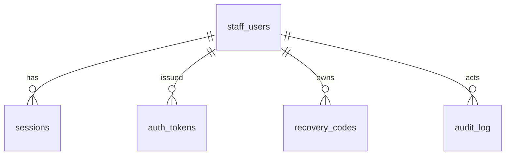

# 09.2 — Data Model: Staff, Sessions and Audit

| Field | Value |
|---|---|
| ID | DOC-09.2 |
| Title | Staff users, sessions, invite/reset tokens, recovery codes, login attempts, audit log |
| Status | Draft |
| Owner | Tech lead |
| Last updated | 2026-10-02 |
| Depends on | DOC-09.0, DOC-11 §3–6, DOC-07.12, DOC-07.13 |
| Decisions used | ADR-0012 |

## 1. Purpose and scope

**Governs:** tables of the `auth` and `audit` modules.
**Does not govern:** the role → permission matrix (code, DOC-11 §4.1: there is deliberately **no** roles or permissions table in v1 because roles are fixed).

## 2. Tables

### 2.1 `staff_users`

| Column | Type | Null | Default | Notes |
|---|---|---|---|---|
| `id` | char(36) | NN | | PK |
| `email` | varchar(254) | NN | | UQ `staff_users_email_uq`. Stored lower-cased |
| `name` | varchar(100) | NN | | |
| `role` | varchar(32) (bin) | NN | | `staff_role`, CHECK |
| `status` | varchar(32) (bin) | NN | `'invited'` | `staff_status`, CHECK |
| `password_hash` | varchar(255) | NULL | | Argon2id PHC string; NULL until the invite is accepted |
| `totp_secret_enc` | varbinary(255) | NULL | | `keyId ‖ nonce ‖ ciphertext ‖ tag` (AES-256-GCM, DOC-11 §3.3); NULL = 2FA off |
| `totp_last_step` | bigint | NULL | | Last accepted time step (replay protection) |
| `totp_enabled_at` | datetime(3) | NULL | | |
| `lock_count` | int | NN | 0 | Consecutive lockouts (escalation) |
| `locked_until` | datetime(3) | NULL | | |
| `last_login_at` | datetime(3) | NULL | | |
| `last_seen_at` | datetime(3) | NULL | | |
| `version` | int | NN | 1 | |
| `created_at`, `updated_at` | datetime(3) | NN | | |
| `created_by` | char(36) | NULL | | FK → `staff_users.id` (NULL for the first owner) |

Indexes: `staff_users_role_idx (role, status)`.
Invariant enforced in the service inside a transaction that locks owner rows `FOR UPDATE`: at least one row with `role='owner' AND status='active'` always exists.

### 2.2 `sessions`

| Column | Type | Null | Default | Notes |
|---|---|---|---|---|
| `id_hash` | char(64) (bin) | NN | | PK. SHA-256 hex of the cookie value |
| `staff_user_id` | char(36) | NN | | FK → `staff_users.id` ON DELETE CASCADE |
| `kind` | varchar(16) (bin) | NN | `'full'` | `pending_2fa`, `enrol_2fa`, `full` |
| `csrf_token` | char(43) (bin) | NN | | DOC-11 §5.1 |
| `two_factor` | boolean | NN | false | Completed with a second factor |
| `created_at` | datetime(3) | NN | | Absolute timeout base (14 d) |
| `last_seen_at` | datetime(3) | NN | | Idle timeout base (8 h); written at most once a minute |
| `last_auth_at` | datetime(3) | NN | | Step-up base (15 min) |
| `expires_at` | datetime(3) | NN | | `min(created_at + 14 d, last_seen_at + 8 h)`; 5 min for `pending_2fa` |
| `ip` | varchar(45) | NN | | |
| `user_agent` | varchar(300) | NN | | Truncated |

Indexes: `sessions_user_idx (staff_user_id)`, `sessions_expires_idx (expires_at)`. Expired rows are deleted hourly.

### 2.3 `auth_tokens`

| Column | Type | Null | Default | Notes |
|---|---|---|---|---|
| `token_hash` | char(64) (bin) | NN | | PK. SHA-256 of the token in the link |
| `type` | varchar(32) (bin) | NN | | `auth_token_type` |
| `staff_user_id` | char(36) | NN | | FK → `staff_users.id` ON DELETE CASCADE |
| `expires_at` | datetime(3) | NN | | Invite 7 d, reset 60 min |
| `used_at` | datetime(3) | NULL | | Single use |
| `created_by` | char(36) | NULL | | FK → `staff_users.id` |
| `created_at` | datetime(3) | NN | | |

Index: `auth_tokens_user_idx (staff_user_id, type)`. Issuing a new token of a type deletes that user's earlier unused tokens of the same type.

### 2.4 `recovery_codes`

| Column | Type | Null | Default | Notes |
|---|---|---|---|---|
| `id` | char(36) | NN | | PK |
| `staff_user_id` | char(36) | NN | | FK → `staff_users.id` ON DELETE CASCADE; IX |
| `code_hash` | varchar(255) | NN | | Argon2id |
| `used_at` | datetime(3) | NULL | | |
| `created_at` | datetime(3) | NN | | |

Ten rows per user; regenerating deletes and recreates all ten.

### 2.5 `login_attempts`

| Column | Type | Null | Default | Notes |
|---|---|---|---|---|
| `id` | char(36) | NN | | PK |
| `email_hash` | char(64) (bin) | NN | | SHA-256 of the lower-cased email attempted (unknown emails are counted too, without storing them) |
| `ip` | varchar(45) | NN | | |
| `succeeded` | boolean | NN | | |
| `created_at` | datetime(3) | NN | | |

Indexes: `login_attempts_email_idx (email_hash, created_at)`, `login_attempts_ip_idx (ip, created_at)`. Rows older than 30 days are deleted.

### 2.6 `audit_log`

| Column | Type | Null | Default | Notes |
|---|---|---|---|---|
| `id` | char(36) | NN | | PK (UUIDv7: id order = time order, used as the list cursor) |
| `at` | datetime(3) | NN | | |
| `actor_type` | varchar(16) (bin) | NN | | `actor_type`, CHECK |
| `actor_id` | char(36) | NULL | | Staff id; NULL for `system`/`storefront`. **No FK** so the log is never blocked by, or cascaded from, staff changes |
| `actor_label` | varchar(120) | NN | | Name at the time, or job name |
| `actor_role` | varchar(32) | NULL | | Role at the time |
| `action` | varchar(64) (bin) | NN | | `<entity>.<verb>`: `product.updated`, `order.confirmed`, `auth.login_failed`, `staff.role_changed`, `export.created`, `job.failed` |
| `entity_type` | varchar(32) (bin) | NN | | DOC-07.13 §2 list |
| `entity_id` | varchar(64) (bin) | NULL | | |
| `entity_label` | varchar(200) | NULL | | Title, order number, email at the time |
| `diff` | json | NULL | | `{ field: [before, after] }`, redacted (DOC-11 §6). Schema `AuditDiff` |
| `reason` | varchar(500) | NULL | | |
| `category` | varchar(16) (bin) | NN | `'general'` | `general`, `security`, `money` (drives presets and retention) |
| `ip` | varchar(45) | NULL | | |
| `user_agent` | varchar(300) | NULL | | |
| `request_id` | char(36) | NULL | | |

Indexes: `audit_log_entity_idx (entity_type, entity_id, id)`, `audit_log_actor_idx (actor_id, id)`, `audit_log_action_idx (action, id)`, `audit_log_category_idx (category, id)`, `audit_log_at_idx (at)`.

Privileges: the application database user has `INSERT, SELECT` only on this table (DOC-11 §6). Retention deletes run as the migration user in monthly batches of 10,000 rows.

## 3. Rules

**Always:** store hashes of anything that works as a credential (session id, tokens, recovery codes); lower-case emails before storing or hashing; write `audit_log` rows in the mutating transaction.
**Never:** add an `UPDATE` or `DELETE` path for `audit_log` in application code; store a TOTP secret unencrypted; put the cookie value in any table or log.
**Common mistakes:** a foreign key from `audit_log` to `staff_users` (would block history or cascade it away); updating `last_seen_at` on every request (a write per request).

## 4. Acceptance checklist

- [ ] A database dump contains no session id, token or recovery code that works when replayed.
- [ ] Deactivating the last active owner fails inside the service transaction even under two concurrent requests.
- [ ] `UPDATE audit_log …` as the application user fails with a privilege error.
- [ ] Audit list pagination by `id` cursor returns stable pages while new rows are inserted.

## 5. Open questions and assumptions

| # | Item | Assumption | Revisit trigger |
|---|---|---|---|
| Q-09.2-1 | Roles in code, not tables | Fixed six roles (ADR-0012) | Custom roles requested → add `roles`, `role_permissions` |
| Q-09.2-2 | `audit_log` growth | About 300 rows/day at A-03; under 250,000 rows in two years | Table over 5 M rows → partition by month |

## 6. Changelog

| Date | Change |
|---|---|
| 2026-10-02 | Initial version (Phase 5, part 1) |
