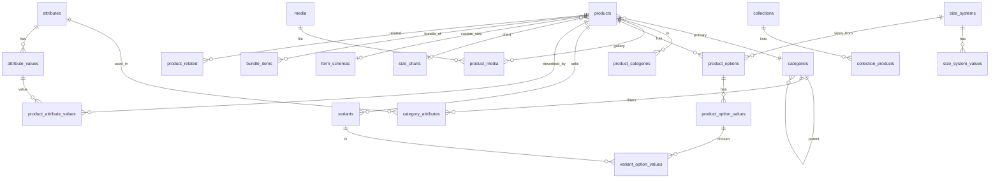

# 09.3 — Data Model: Catalog and Media

| Field | Value |
|---|---|
| ID | DOC-09.3 |
| Title | Media, categories, attributes, sizes, products, options, variants, collections, bundles |
| Status | Draft |
| Owner | Tech lead |
| Last updated | 2026-10-02 |
| Depends on | DOC-09.0, DOC-06.3, DOC-06.4, DOC-07.3, DOC-07.4, DOC-08 §11 |
| Decisions used | ADR-0008, ADR-0010, ADR-0011, ADR-0013, ADR-0014, ADR-0018 |

## 1. Purpose and scope

**Governs:** the 22 tables of the `media` and `catalog` modules.
**Does not govern:** stock quantities (DOC-09.4), search rows (DOC-09.5), API shapes (DOC-10).

## 2. Media

### 2.1 `media`

| Column | Type | Null | Default | Notes |
|---|---|---|---|---|
| `id` | char(36) | NN | | PK |
| `kind` | varchar(16) (bin) | NN | `'image'` | `media_kind` |
| `status` | varchar(16) (bin) | NN | `'pending'` | `media_status`. Only `ready` media can be attached to a published entity |
| `object_key` | varchar(500) (bin) | NN | | UQ. `media/<yyyy>/<mm>/<uuid>.<ext>` |
| `content_type` | varchar(60) (bin) | NN | | Verified by magic bytes when processed |
| `bytes` | int | NN | | |
| `width`, `height` | int | NULL | | Set by `media.process` |
| `lqip` | varchar(1500) | NULL | | Blurred data URI |
| `duration_sec` | int | NULL | | Video |
| `poster_media_id` | char(36) | NULL | | FK → `media.id` ON DELETE SET NULL (video poster) |
| `alt` | varchar(300) | NN | `''` | Default alt text; usage tables may override |
| `i18n` | json | NULL | | `{ ur: { alt } }` |
| `reject_reason` | varchar(100) | NULL | | |
| `uploaded_by` | char(36) | NULL | | FK → `staff_users.id` ON DELETE SET NULL; NULL for customer review photos |
| `confirmed_at` | datetime(3) | NULL | | Set by `admin.media.confirm`. A `pending` row with no `confirmed_at` is an upload slot nobody used: `media.cleanup` removes it with its object after 24 h (added at M1-05) |
| `created_at` | datetime(3) | NN | | |

Indexes: `media_status_idx (status, created_at)` (cleanup of stale `pending`). A media row is deleted only when no table references it (FKs are `RESTRICT`); the object is removed by a job after the row.

## 3. Taxonomy

### 3.1 `categories`

| Column | Type | Null | Default | Notes |
|---|---|---|---|---|
| `id` | char(36) | NN | | PK |
| `parent_id` | char(36) | NULL | | FK → `categories.id` RESTRICT. Depth ≤ 3 (service) |
| `handle` | varchar(80) (bin) | NN | | UQ `categories_handle_uq` |
| `name` | varchar(60) | NN | | |
| `description` | varchar(600) | NN | `''` | |
| `image_media_id` | char(36) | NULL | | FK → `media.id` |
| `sort_order` | int | NN | 0 | Among siblings |
| `visible` | boolean | NN | true | |
| `seo_title` | varchar(60) | NULL | | |
| `seo_description` | varchar(160) | NULL | | |
| `i18n` | json | NULL | | `{ ur: { name, description } }` |
| `version` | int | NN | 1 | |
| `created_at`, `updated_at` | datetime(3) | NN | | |

Indexes: `categories_parent_idx (parent_id, sort_order)`.

### 3.2 `attributes`

| Column | Type | Null | Default | Notes |
|---|---|---|---|---|
| `id` | char(36) | NN | | PK |
| `code` | varchar(30) (bin) | NN | | UQ. The `attr.<code>` URL parameter. Immutable (contract field `key`) |
| `label` | varchar(60) | NN | | |
| `type` | varchar(16) (bin) | NN | | `attribute_type`. Immutable |
| `display` | varchar(16) (bin) | NN | | `attribute_display` |
| `filterable` | boolean | NN | false | |
| `group_label` | varchar(60) | NULL | | PDP grouping |
| `sort_order` | int | NN | 0 | |
| `i18n` | json | NULL | | |
| `created_at`, `updated_at` | datetime(3) | NN | | |

### 3.3 `attribute_values`

| Column | Type | Null | Default | Notes |
|---|---|---|---|---|
| `id` | char(36) | NN | | PK |
| `attribute_id` | char(36) | NN | | FK → `attributes.id` CASCADE |
| `code` | varchar(40) (bin) | NN | | URL value (`cotton`). UQ `(attribute_id, code)`. Immutable |
| `label` | varchar(60) | NN | | |
| `swatch` | json | NULL | | `Swatch` (hex list or media id) for `color` type |
| `sort_order` | int | NN | 0 | |
| `i18n` | json | NULL | | |

Index: `attribute_values_attr_idx (attribute_id, sort_order)`.

### 3.4 `category_attributes`

| Column | Type | Null | Default | Notes |
|---|---|---|---|---|
| `category_id` | char(36) | NN | | PK part; FK → `categories.id` CASCADE |
| `attribute_id` | char(36) | NN | | PK part; FK → `attributes.id` RESTRICT (an attribute in use by a category cannot be deleted) |
| `sort_order` | int | NN | 0 | Facet order |
| `seo_indexable` | boolean | NN | false | DOC-06.9 §5 |
| `required` | boolean | NN | false | Required to publish (DOC-07.3 §8) |

A category with no rows inherits its nearest ancestor's rows (resolved in the service, cached).

## 4. Sizes and forms

### 4.1 `size_systems`

`id` PK · `name varchar(60)` NN UQ · `created_at`, `updated_at`.

### 4.2 `size_system_values`

| Column | Type | Null | Default | Notes |
|---|---|---|---|---|
| `id` | char(36) | NN | | PK |
| `size_system_id` | char(36) | NN | | FK → `size_systems.id` CASCADE |
| `label` | varchar(10) | NN | | UQ `(size_system_id, label)` |
| `sort_order` | int | NN | | |

### 4.3 `size_charts`

| Column | Type | Null | Default | Notes |
|---|---|---|---|---|
| `id` | char(36) | NN | | PK |
| `title` | varchar(100) | NN | | |
| `size_system_id` | char(36) | NULL | | FK → `size_systems.id` SET NULL |
| `unit` | varchar(2) (bin) | NN | | `in`, `cm` |
| `tables` | json | NN | | Schema `SizeChartTables`: `[{ id, title, columns: string[], rows: [{ label, values: number[] }] }]`, 1–4 tables |
| `guide_media_id` | char(36) | NULL | | FK → `media.id` |
| `notes` | varchar(400) | NULL | | |
| `i18n` | json | NULL | | |
| `version` | int | NN | 1 | |
| `created_at`, `updated_at` | datetime(3) | NN | | |

### 4.4 `form_schemas`

| Column | Type | Null | Default | Notes |
|---|---|---|---|---|
| `id` | char(36) | NN | | PK |
| `title` | varchar(100) | NN | | |
| `fields` | json | NN | | Schema `FormField[]` (contract) |
| `allow_notes` | boolean | NN | false | |
| `i18n` | json | NULL | | |
| `version` | int | NN | 1 | |
| `created_at`, `updated_at` | datetime(3) | NN | | |

## 5. Products

### 5.1 `products`

| Column | Type | Null | Default | Notes |
|---|---|---|---|---|
| `id` | char(36) | NN | | PK |
| `handle` | varchar(80) (bin) | NN | | UQ `products_handle_uq` |
| `status` | varchar(16) (bin) | NN | `'draft'` | `product_status` |
| `publish_at` | datetime(3) | NULL | | For `scheduled` |
| `published_at` | datetime(3) | NULL | | First time it became `active`; the `newest` sort key |
| `kind` | varchar(16) (bin) | NN | | `product_kind` |
| `title` | varchar(120) | NN | | |
| `subtitle` | varchar(160) | NULL | | |
| `brand` | varchar(60) | NULL | | |
| `description_md` | text | NULL | | ≤ 5,000 characters |
| `highlights` | json | NULL | | `string[]` ≤ 6 |
| `care` | json | NULL | | `string[]` ≤ 8 |
| `components` | json | NULL | | Schema `Component[]` (contract): pieces of an unstitched set. Display-only, so JSON |
| `primary_category_id` | char(36) | NN | | FK → `categories.id` RESTRICT |
| `style_id` | varchar(80) (bin) | NULL | | Groups colourway siblings |
| `colorway_label` | varchar(40) | NULL | | Required when `style_id` is set (CHECK) |
| `color_family` | varchar(16) (bin) | NULL | | `color_family`; the `color` facet |
| `colorway_swatch` | json | NULL | | `Swatch` |
| `size_chart_id` | char(36) | NULL | | FK → `size_charts.id` SET NULL |
| `custom_size_schema_id` | char(36) | NULL | | FK → `form_schemas.id` RESTRICT |
| `fit` | json | NULL | | Schema `Fit` (contract) |
| `mto_lead_min_days`, `mto_lead_max_days` | smallint | NULL | | Made-to-order lead time |
| `mto_lead_label` | varchar(80) | NULL | | |
| `mto_returnable` | boolean | NULL | | |
| `mto_deposit_bps` | int | NULL | | 0–10000; NULL = no deposit |
| `badges` | json | NULL | | Subset of `new`, `bestseller`, `limited` |
| `seo_title` | varchar(60) | NULL | | |
| `seo_description` | varchar(160) | NULL | | |
| `i18n` | json | NULL | | `{ ur: { title, subtitle, descriptionMd, highlights, care, colorwayLabel } }` |
| `price_min_minor`, `price_max_minor` | bigint | NN | 0 | **Derived** from enabled variants |
| `compare_at_min_minor` | bigint | NULL | | **Derived**: compare-at of the cheapest variant; non-NULL = "on sale" |
| `stock_status` | varchar(16) (bin) | NN | `'sold_out'` | **Derived** aggregate `stock_status` |
| `sales_count` | int | NN | 0 | **Derived** nightly (units in delivered orders, last 90 days): `bestselling` sort |
| `rating_avg_x100` | smallint | NULL | | **Derived**: average × 100 |
| `rating_count` | int | NN | 0 | **Derived** |
| `featured_rank` | int | NN | 0 | Manual boost for the `featured` sort (higher first) |
| `version` | int | NN | 1 | |
| `created_at`, `updated_at` | datetime(3) | NN | | |

Checks: `products_mto_chk` (`mto_lead_min_days <= mto_lead_max_days`), `products_colorway_chk` (`style_id IS NULL OR colorway_label IS NOT NULL`), `products_price_chk` (`price_min_minor <= price_max_minor`).

Indexes: `products_status_published_idx (status, published_at)`, `products_status_price_idx (status, price_min_minor)`, `products_status_sales_idx (status, sales_count)`, `products_primary_category_idx (primary_category_id, status)`, `products_style_idx (style_id)`, `products_kind_idx (kind, status)`, `products_publish_at_idx (status, publish_at)`, `products_updated_idx (updated_at)`.

Derived columns are written only by `catalog.recomputeProductCache(tx, productId)`, called after any variant, stock or review change (stock via the `inventory.changed` handler). They exist so listings sort and filter without joining variants or stock.

### 5.2 `product_categories`

`product_id` + `category_id` PK (both FK, CASCADE from product, RESTRICT from category) · index `product_categories_category_idx (category_id, product_id)`. Contains the primary category too, so a category listing is one indexed lookup. A listing for a category matches products in it **or any descendant** (descendant ids resolved from the cached tree).

### 5.3 `product_media`

| Column | Type | Null | Default | Notes |
|---|---|---|---|---|
| `product_id` | char(36) | NN | | PK part; FK CASCADE |
| `media_id` | char(36) | NN | | PK part; FK → `media.id` RESTRICT |
| `sort_order` | int | NN | | 0 = primary/card image |
| `role` | varchar(16) (bin) | NULL | | `media_role` |
| `alt` | varchar(300) | NULL | | Overrides `media.alt` |
| `option_value_id` | char(36) | NULL | | FK → `product_option_values.id` SET NULL: "show for this option value" |

Index: `product_media_order_idx (product_id, sort_order)`. 1–12 rows per product; at most one video.

### 5.4 `product_options`

| Column | Type | Null | Default | Notes |
|---|---|---|---|---|
| `id` | char(36) | NN | | PK |
| `product_id` | char(36) | NN | | FK CASCADE |
| `name` | varchar(40) | NN | | "Size" |
| `role` | varchar(16) (bin) | NN | | `option_role` |
| `display` | varchar(16) (bin) | NN | `'buttons'` | `option_display` |
| `size_system_id` | char(36) | NULL | | FK → `size_systems.id` RESTRICT; set when `role='size'` |
| `sort_order` | int | NN | | |
| `i18n` | json | NULL | | |

Index `product_options_product_idx (product_id, sort_order)`. Max 3 per product (service).

### 5.5 `product_option_values`

| Column | Type | Null | Default | Notes |
|---|---|---|---|---|
| `id` | char(36) | NN | | PK |
| `option_id` | char(36) | NN | | FK → `product_options.id` CASCADE |
| `label` | varchar(40) | NN | | UQ `(option_id, label)` |
| `kind` | varchar(16) (bin) | NN | `'standard'` | `option_value_kind`; `custom` = custom size |
| `size_system_value_id` | char(36) | NULL | | FK → `size_system_values.id` RESTRICT (keeps size order and blocks deleting a size in use) |
| `swatch` | json | NULL | | |
| `sort_order` | int | NN | | |
| `i18n` | json | NULL | | |

### 5.6 `variants`

| Column | Type | Null | Default | Notes |
|---|---|---|---|---|
| `id` | char(36) | NN | | PK |
| `product_id` | char(36) | NN | | FK CASCADE (a product with order lines cannot be deleted: `order_lines.variant_id` is RESTRICT) |
| `sku` | varchar(40) (bin) | NN | | UQ `variants_sku_uq` |
| `option_key` | varchar(120) (bin) | NN | `''` | Sorted option-value ids joined by `_`; UQ `(product_id, option_key)` prevents duplicate combinations |
| `price_minor` | bigint | NN | | CHECK `> 0` |
| `compare_at_minor` | bigint | NULL | | CHECK `IS NULL OR > price_minor` |
| `stock_mode` | varchar(16) (bin) | NN | `'counted'` | `stock_mode` |
| `preorder_ships_at` | date | NULL | | For `preorder` |
| `max_per_order` | smallint | NN | 10 | 1–99 |
| `enabled` | boolean | NN | true | |
| `sort_order` | int | NN | 0 | |
| `created_at`, `updated_at` | datetime(3) | NN | | |

Index: `variants_product_idx (product_id, sort_order)`.

### 5.7 `variant_option_values`

`variant_id` + `option_value_id` PK (both FK CASCADE) · index `variant_option_values_value_idx (option_value_id)`. Drives the size facet: products with an enabled, available variant whose option value maps to the requested size label.

### 5.8 `product_attribute_values`

| Column | Type | Null | Default | Notes |
|---|---|---|---|---|
| `product_id` | char(36) | NN | | PK part; FK CASCADE |
| `attribute_id` | char(36) | NN | | PK part; FK RESTRICT |
| `value_id` | char(36) | NN | | PK part; FK → `attribute_values.id` RESTRICT. For `boolean` attributes the attribute has two values (`yes`, `no`); for `number` see below |
| `value_number` | int | NULL | | Only for `number` attributes: the product carries one row whose `value_id` is the attribute's single placeholder value and whose `value_number` holds the figure (e.g. pieces = 3) |

Index: `product_attribute_values_facet_idx (attribute_id, value_id, product_id)`: the facet-count and filter index (ADR-0010).

## 6. Collections, bundles, related, redirects

### 6.1 `collections`

| Column | Type | Null | Default | Notes |
|---|---|---|---|---|
| `id` | char(36) | NN | | PK |
| `handle` | varchar(80) (bin) | NN | | UQ |
| `title` | varchar(80) | NN | | |
| `description` | varchar(600) | NN | `''` | |
| `image_media_id` | char(36) | NULL | | FK → `media.id` |
| `status` | varchar(16) (bin) | NN | `'draft'` | `collection_status` |
| `featured` | boolean | NN | false | Max 3 true (service) |
| `starts_at`, `ends_at` | datetime(3) | NULL | | Publish window |
| `seo_title`, `seo_description` | varchar(60) / varchar(160) | NULL | | |
| `i18n` | json | NULL | | |
| `version` | int | NN | 1 | |
| `created_at`, `updated_at` | datetime(3) | NN | | |

### 6.2 `collection_products`

`collection_id` + `product_id` PK (FK CASCADE both) · `sort_order int NN` · indexes `collection_products_order_idx (collection_id, sort_order)`, `collection_products_product_idx (product_id)`.

### 6.3 `bundle_items`

`bundle_product_id` + `child_product_id` PK (FK → `products.id`; CASCADE from the bundle, RESTRICT from the child) · `sort_order int NN`. CHECK `bundle_product_id <> child_product_id`. A child must not itself be a bundle (service). 2–6 rows.

### 6.4 `product_related`

`product_id` + `related_product_id` PK (FK CASCADE both) · `sort_order int NN`. Max 8.

### 6.5 `handle_redirects`

| Column | Type | Null | Default | Notes |
|---|---|---|---|---|
| `entity_type` | varchar(16) (bin) | NN | | PK part: `product`, `category`, `collection`, `page` |
| `old_handle` | varchar(80) (bin) | NN | | PK part |
| `entity_id` | char(36) | NN | | Current owner of the redirect; no FK (polymorphic). Deleted by the service when the entity is deleted |
| `created_at` | datetime(3) | NN | | |

When a handle changes, the old one is inserted here. If a new entity later takes a handle that exists here, the redirect row is deleted in the same transaction (the live entity wins).

## 7. Derived values and where they come from

| Value | Rule |
|---|---|
| Variant `stockStatus` (API) | `stock_mode='made_to_order'` → `made_to_order`; `'preorder'` → `preorder`; else from `inventory_levels`: `available = on_hand − reserved`; `0` → `sold_out`; `≤ low-stock threshold` → `low_stock`; else `in_stock` |
| `products.stock_status` | Best status among enabled variants in the order `in_stock` > `low_stock` > `made_to_order` > `preorder` > `sold_out` |
| Output badge `sale` | `compare_at_min_minor IS NOT NULL` |
| Output badge `sold_out` | `stock_status='sold_out'` |
| Output badge `made_to_order` | `kind='made_to_order'` |
| Output badge `new` | Staff badge `new`, or `published_at` within the last 30 days |
| Listing `priceFrom` / `priceTo` | `price_min_minor`, `price_max_minor` (`priceTo` omitted when equal) |
| Siblings | Products with the same `style_id` and `status='active'`, ordered by `colorway_label` |

## 8. Rules

**Always:** call `recomputeProductCache` in the same transaction as any change to variants, enabled flags or prices; keep `handle`, `code` and `sku` columns binary-collated; write a redirect when a handle changes.
**Never:** filter listings on JSON columns; store stock on `variants`; delete a variant, option value, size value or attribute value that is referenced (the FKs are `RESTRICT` on purpose: disable instead); keep collection membership anywhere but `collection_products`.
**Common mistakes:** forgetting the primary category row in `product_categories`; treating a colourway as an option value; updating a derived column by hand.

## 9. Acceptance checklist

- [ ] Two variants with the same option combination cannot be inserted (`(product_id, option_key)` unique).
- [ ] Deleting a size-system value used by a variant fails with an FK error mapped to `409 in_use` (DOC-10.0 §6.1).
- [ ] After a price change, `price_min_minor`/`price_max_minor`/`compare_at_min_minor` match a fresh aggregate query (property test over random edits).
- [ ] `EXPLAIN` for the category listing with one attribute filter and `newest` sort uses `product_attribute_values_facet_idx` and a `products_status_*` index, with no full scan of `products` (DOC-13 keeps this query set).
- [ ] Changing a product handle makes the old URL resolve through `handle_redirects`; creating a new product with that old handle removes the redirect.
- [ ] The 3,000-product seed (DOC-13 load data) returns a filtered listing page in under 100 ms on the reference database.

## 10. Open questions and assumptions

| # | Item | Assumption | Revisit trigger |
|---|---|---|---|
| Q-09.3-1 | Components as JSON | Display-only; never filtered | A filter on component fabric is wanted → use attributes |
| Q-09.3-2 | `number` attributes via a placeholder value row | Keeps one facet index; range filters use `value_number` | Many numeric attributes → own table |
| Q-09.3-3 | Derived columns on `products` | Kept consistent by one function in-transaction | Drift found by the property test |
| Q-09.3-4 | Bundle price | The bundle's own single variant price; children's prices are not summed | Owner wants computed bundle discounts |

## 11. Changelog

| Date | Change |
|---|---|
| 2026-10-02 | Initial version (Phase 5, part 1) |
| 2026-10-02 | Phase 7 consistency review: error code `in_use` |
