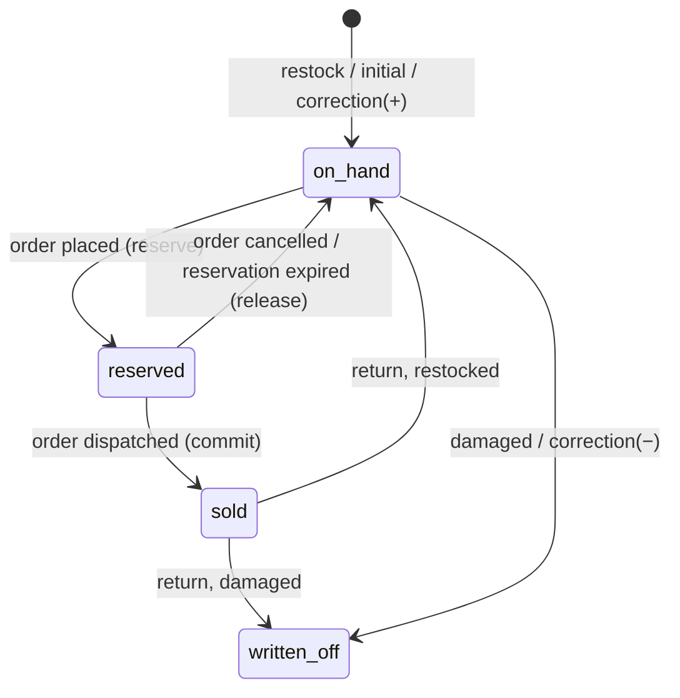

# 09.4 — Data Model: Inventory

| Field | Value |
|---|---|
| ID | DOC-09.4 |
| Title | Stock levels, movements, reservations, back-in-stock subscriptions |
| Status | Draft |
| Owner | Tech lead |
| Last updated | 2026-10-02 |
| Depends on | DOC-09.0, DOC-09.3, DOC-07.3 §7.1, DOC-07.5 §4 |
| Decisions used | ADR-0014, ADR-0020 |

## 1. Purpose and scope

**Governs:** the four tables of the `inventory` module and the rules that keep stock correct under concurrency.
**Does not govern:** the stock mode of a variant (`variants.stock_mode`, DOC-09.3) or how stock is displayed (DOC-06.4 §6).

Fixes K10: today a stock check is per cart line (two lines of one variant can oversell), there is no reservation, and cancel/return never restocks.

## 2. Tables

### 2.1 `inventory_levels`

One row per variant with `stock_mode='counted'`. Created with the variant (quantity 0).

| Column | Type | Null | Default | Notes |
|---|---|---|---|---|
| `variant_id` | char(36) | NN | | PK; FK → `variants.id` CASCADE |
| `on_hand` | int | NN | 0 | Physical units we hold |
| `reserved` | int | NN | 0 | Units promised to open orders |
| `updated_at` | datetime(3) | NN | | |

Table check `inventory_levels_chk`: `on_hand >= 0 AND reserved >= 0 AND reserved <= on_hand` (table-level, ADR-0020).
**Available to sell** = `on_hand − reserved`.

### 2.2 `inventory_movements`

Append-only ledger. `on_hand` always equals the sum of `delta` for the variant.

| Column | Type | Null | Default | Notes |
|---|---|---|---|---|
| `id` | char(36) | NN | | PK |
| `variant_id` | char(36) | NN | | FK → `variants.id` RESTRICT |
| `delta` | int | NN | | Signed change to `on_hand`; CHECK `<> 0` |
| `reason` | varchar(16) (bin) | NN | | `movement_reason` |
| `note` | varchar(300) | NULL | | Required by the service for `other` and `damaged` |
| `order_id` | char(36) | NULL | | FK → `orders.id` SET NULL; set for `sale`, `return_restock`, `return_damaged` |
| `staff_user_id` | char(36) | NULL | | FK → `staff_users.id` SET NULL; NULL for system movements |
| `on_hand_after` | int | NN | | Balance after this movement (audit aid) |
| `created_at` | datetime(3) | NN | | |

Indexes: `inventory_movements_variant_idx (variant_id, id)`, `inventory_movements_order_idx (order_id)`.

`return_damaged` records a returned unit that is **not** put back: it is written with `delta = +1` immediately followed by a `damaged` movement of `−1`, so the ledger shows both facts and `on_hand` is unchanged.

### 2.3 `reservations`

| Column | Type | Null | Default | Notes |
|---|---|---|---|---|
| `id` | char(36) | NN | | PK |
| `order_id` | char(36) | NN | | FK → `orders.id` CASCADE |
| `order_line_id` | char(36) | NN | | FK → `order_lines.id` CASCADE |
| `variant_id` | char(36) | NN | | FK → `variants.id` RESTRICT |
| `quantity` | int | NN | | CHECK `> 0` |
| `status` | varchar(16) (bin) | NN | `'active'` | `reservation_status` |
| `expires_at` | datetime(3) | NULL | | Only for unpaid online-payment orders (30 min, ADR-0020); NULL for COD |
| `created_at`, `updated_at` | datetime(3) | NN | | |

Indexes: `reservations_order_idx (order_id)`, `reservations_variant_idx (variant_id, status)`, `reservations_expiry_idx (status, expires_at)`.

Invariant: `inventory_levels.reserved` = sum of `quantity` over `active` reservations of that variant. Checked by a nightly consistency job that logs at `error` (and alerts, DOC-13) on any mismatch; it never auto-corrects.

A bundle order line creates one reservation per **child** variant (GLOSSARY "Bundle"). Made-to-order and preorder variants create no reservation.

### 2.4 `stock_subscriptions`

Back-in-stock alerts (`features.notifyMe`).

| Column | Type | Null | Default | Notes |
|---|---|---|---|---|
| `id` | char(36) | NN | | PK |
| `variant_id` | char(36) | NN | | FK → `variants.id` CASCADE |
| `phone` | varchar(16) (bin) | NN | | E.164. UQ `(variant_id, phone)` |
| `locale` | varchar(5) (bin) | NN | `'en'` | |
| `created_at` | datetime(3) | NN | | |
| `notified_at` | datetime(3) | NULL | | |

Rows are deleted 7 days after `notified_at`, or 90 days after creation if never notified (DOC-11 §8.1).

Built at M1-10 (`apps/api/src/db/schema/inventory.js`, migration 0008). `reservations.order_id`, `reservations.order_line_id` and `inventory_movements.order_id` are plain columns until the orders tables exist; M4's migration adds the foreign keys. A variant that has ledger rows cannot be deleted (`inventory_movements.variant_id` is RESTRICT), so removing it from a product is `409 in_use`. Level rows are created with a counted variant (`ensureLevels`, also on demand), and `lowStock` comes from the store setting `thresholds.lowStock`.

## 3. Operations (all inside the caller's transaction)

| Operation | Called by | Steps |
|---|---|---|
| `reserve(tx, lines)` | `orders.createOrder` | 1. Expand bundle lines to child variants. 2. **Aggregate quantity per variant** across all lines. 3. `SELECT … FROM inventory_levels WHERE variant_id IN (…) ORDER BY variant_id FOR UPDATE`. 4. For each: if `on_hand − reserved < qty` → throw `insufficient_stock` with `{ variantId, available }` (nothing written). 5. `UPDATE … SET reserved = reserved + qty`. 6. Insert `reservations` |
| `release(tx, orderId)` | cancel; reservation expiry | Lock the variants (ascending); `reserved −= quantity` for each `active` reservation; set them `released`. No movement (on-hand never changed) |
| `commit(tx, orderId)` | dispatch | Lock; `on_hand −= q`, `reserved −= q`; reservations → `committed`; insert `sale` movements (`delta = −q`) |
| `restock(tx, orderId, lines)` (`lines`: `{ variantId, quantity, restock }`) | return | Lock; per returned unit: restock → `on_hand += q` + `return_restock` movement; not restocked → the `return_damaged` pair |
| `adjust(tx, variantId, mode, qty, reason, note, staff)` | admin | Lock; compute the delta (`add`, `remove`, `set`); reject if the result would make `on_hand < reserved` (`stock_below_reserved`, with the reserved count); update; insert the movement |
| `editReserved(tx, orderId, changes)` | order edit before dispatch | Release the old quantities and reserve the new ones in one locked pass |

After any of these the service emits `inventory.changed { variantIds }` through the outbox; when a variant goes from 0 to > 0 available it also emits `variant.back_in_stock`.

**Lock order everywhere:** `inventory_levels` rows ascending by `variant_id`, then `counters` (ADR-0020). No other module locks these rows.

## 4. State of one unit

## 5. Rules

**Always:** aggregate per variant before checking; lock in ascending variant id order; write a movement for every `on_hand` change; keep `on_hand` and `reserved` changes in the same transaction as the order change that causes them.
**Never:** set `on_hand` or `reserved` outside this module; decrement stock at order placement (it is reserved then, decremented at dispatch); auto-repair a ledger mismatch; reserve for made-to-order or preorder variants.
**Common mistakes:** checking each cart line separately (K10); releasing a reservation twice (guard on `status='active'`); restocking a damaged return.

## 6. Acceptance checklist

- [ ] Cart with two lines of one variant (2 + 2) and 3 available → `409 insufficient_stock`, `reserved` unchanged (ADR-0020 test).
- [ ] 50 concurrent orders for the last unit → exactly one succeeds; `reserved = 1`, `on_hand = 1`.
- [ ] Place → cancel leaves `on_hand` and `reserved` as before and writes no movement.
- [ ] Place → dispatch → return (restock) ends with the original `on_hand` and three ledger rows netting to zero.
- [ ] `adjust` "remove 5" with `on_hand 6, reserved 3` is rejected with `stock_below_reserved`.
- [ ] For every variant after a randomised test run: `on_hand = Σ delta` and `reserved = Σ active reservations`.
- [ ] A direct `UPDATE inventory_levels SET reserved = on_hand + 1` is rejected by the check constraint.

## 7. Open questions and assumptions

| # | Item | Assumption | Revisit trigger |
|---|---|---|---|
| Q-09.4-1 | Single stock location | One warehouse | A second location or shop stock → add `location_id` to levels, movements and reservations |
| Q-09.4-2 | Cart does not reserve | Stock is held only from order placement | Oversell complaints during drops → short cart holds |
| Q-09.4-3 | `stock_subscriptions.phone` stored in clear | Needed to send the alert; short retention | — |

## 8. Changelog

| Date | Change |
|---|---|
| 2026-10-02 | Initial version (Phase 5, part 1) |
