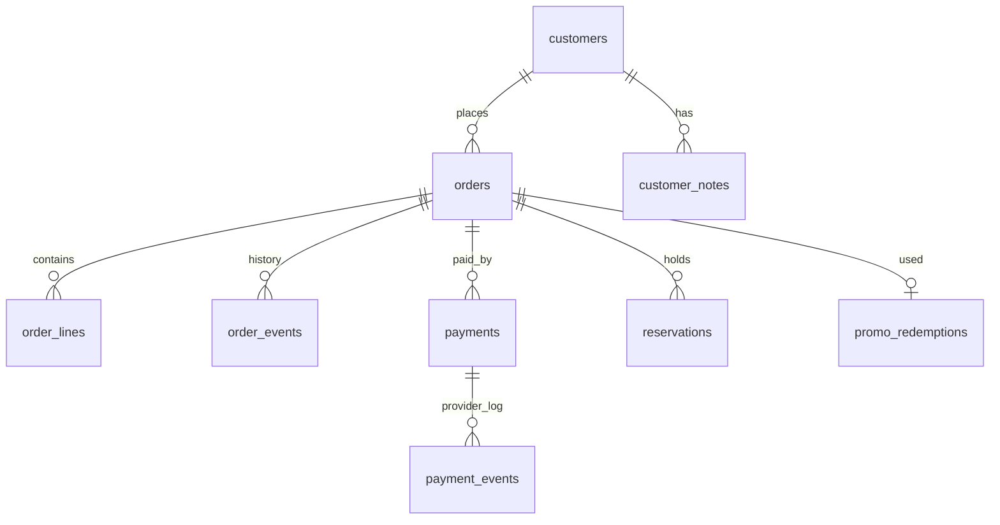
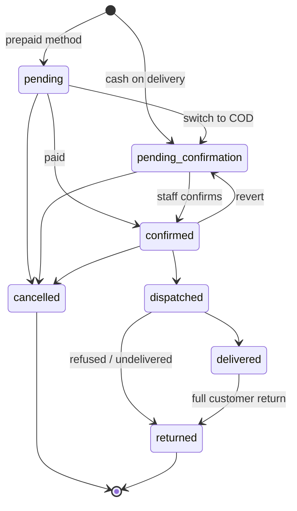

# 09.7 — Data Model: Customers, Orders and Payments

| Field | Value |
|---|---|
| ID | DOC-09.7 |
| Title | Customers, orders, order lines, order events, payments; order and payment state machines |
| Status | Draft |
| Owner | Tech lead |
| Last updated | 2026-10-02 |
| Depends on | DOC-09.0, DOC-09.1, DOC-09.4, DOC-09.6, DOC-06.5, DOC-06.6, DOC-07.5, DOC-07.6, README (A-07, A-10) |
| Decisions used | ADR-0012, ADR-0013, ADR-0014, ADR-0017, ADR-0020 |

## 1. Purpose and scope

**Governs:** tables of the `customers`, `orders` and `payments` modules, and the transition tables that are the only way an order or payment changes state.
**Does not govern:** stock effects (DOC-09.4 §3), pricing (DOC-09.6 §4), the screens (DOC-06.6, DOC-07.5), provider adapters (DOC-12).

## 2. Customer tables

### 2.1 `customers`

| Column | Type | Null | Default | Notes |
|---|---|---|---|---|
| `id` | char(36) | NN | | PK |
| `phone` | varchar(16) (bin) | NN | | UQ. E.164 (`+923001234567`): the identity (DOC-07.6) |
| `name` | varchar(80) | NN | | Latest used |
| `email` | varchar(254) | NULL | | |
| `city` | varchar(60) | NULL | | Latest delivery city |
| `no_cod` | boolean | NN | false | |
| `no_cod_reason` | varchar(300) | NULL | | Required when `no_cod` |
| `vip` | boolean | NN | false | |
| `marketing_consent` | boolean | NN | false | |
| `consent_note` | varchar(200) | NULL | | How consent was obtained |
| `orders_count` | int | NN | 0 | **Derived**: non-cancelled orders |
| `delivered_count` | int | NN | 0 | **Derived** |
| `refused_count` | int | NN | 0 | **Derived**: returns of type refused/undelivered |
| `cancelled_count` | int | NN | 0 | **Derived** |
| `spent_minor` | bigint | NN | 0 | **Derived**: sum of delivered order totals minus refunds |
| `first_order_at`, `last_order_at` | datetime(3) | NULL | | **Derived** |
| `anonymised_at` | datetime(3) | NULL | | DOC-11 §8.2 |
| `version` | int | NN | 1 | |
| `created_at`, `updated_at` | datetime(3) | NN | | |

Indexes: `customers_last_order_idx (last_order_at)`, `customers_name_idx (name)`, `customers_city_idx (city)`, `customers_refused_idx (refused_count)`.
Derived counters are updated in the order transition transaction by `customers.applyOrderChange(tx, …)`.

### 2.2 `customer_notes`

`id` PK · `customer_id` FK → `customers.id` CASCADE, IX · `body varchar(1000)` NN · `staff_user_id` FK → `staff_users.id` SET NULL · `created_at`. Add-only.

## 3. Order tables

### 3.1 `orders`

| Column | Type | Null | Default | Notes |
|---|---|---|---|---|
| `id` | char(36) | NN | | PK |
| `number` | bigint | NN | | UQ. From `counters` (DOC-09.1 §2.4) |
| `number_prefix` | varchar(4) (bin) | NN | | Snapshot of the store's prefix (`RB`). Display = `<prefix>-<number>` |
| `tracking_token_hash` | char(64) (bin) | NN | | UQ. SHA-256 of the customer's token (DOC-11 §9) |
| `status` | varchar(24) (bin) | NN | | `order_status` |
| `channel` | varchar(16) (bin) | NN | `'storefront'` | `order_channel` |
| `locale` | varchar(5) (bin) | NN | `'en'` | Language for notifications |
| `customer_id` | char(36) | NN | | FK → `customers.id` RESTRICT |
| `customer_name` | varchar(80) | NN | | Snapshot |
| `customer_phone` | varchar(16) (bin) | NN | | Snapshot, E.164 |
| `customer_email` | varchar(254) | NULL | | Snapshot |
| `ship_city_id` | char(36) | NN | | FK → `cities.id` RESTRICT |
| `ship_city` | varchar(60) | NN | | Snapshot of the city name |
| `ship_address` | varchar(250) | NN | | |
| `ship_landmark` | varchar(120) | NULL | | |
| `ship_notes` | varchar(250) | NULL | | Customer's delivery notes |
| `custom_fields` | json | NULL | | Answers to extra checkout fields; schema from the `checkout` settings document at the time |
| `shipping_method_id` | char(36) | NULL | | FK → `shipping_methods.id` SET NULL |
| `shipping_method_label` | varchar(60) | NN | | Snapshot |
| `eta_min_days`, `eta_max_days` | smallint | NN | | Snapshot |
| `subtotal_minor` | bigint | NN | | |
| `discount_minor` | bigint | NN | 0 | |
| `shipping_fee_minor` | bigint | NN | | |
| `total_minor` | bigint | NN | | CHECK `= subtotal_minor − discount_minor + shipping_fee_minor` |
| `deposit_due_minor` | bigint | NN | 0 | |
| `paid_minor` | bigint | NN | 0 | **Derived**: captured payments minus refunds |
| `refunded_minor` | bigint | NN | 0 | **Derived** |
| `promo_code` | varchar(20) (bin) | NULL | | Snapshot |
| `payment_method` | varchar(16) (bin) | NN | | `payment_method` |
| `payment_status` | varchar(24) (bin) | NN | `'unpaid'` | `payment_status` (order level), **derived** (§5.3) |
| `invoice_number` | varchar(20) (bin) | NULL | | UQ when present. `INV-<year>-<6 digits>`, assigned at first dispatch |
| `courier_id` | char(36) | NULL | | FK → `couriers.id` SET NULL |
| `courier_name` | varchar(60) | NULL | | Snapshot |
| `tracking_number` | varchar(60) | NULL | | |
| `cancel_reason` | varchar(24) (bin) | NULL | | `cancel_reason` |
| `placed_at` | datetime(3) | NN | | |
| `confirmed_at`, `dispatched_at`, `delivered_at`, `closed_at` | datetime(3) | NULL | | `closed_at` = cancelled or returned time |
| `status_changed_at` | datetime(3) | NN | | For the "age in status" column |
| `created_by` | char(36) | NULL | | FK → `staff_users.id` SET NULL (staff-created orders) |
| `version` | int | NN | 1 | |
| `created_at`, `updated_at` | datetime(3) | NN | | |

Checks: `orders_total_chk` (above); `orders_money_chk` (all `_minor` ≥ 0, `deposit_due_minor <= total_minor`).

Indexes: `orders_status_placed_idx (status, placed_at)`, `orders_status_changed_idx (status, status_changed_at)`, `orders_customer_idx (customer_id, placed_at)`, `orders_phone_idx (customer_phone)`, `orders_placed_idx (placed_at)`, `orders_city_idx (ship_city_id, placed_at)`, `orders_tracking_idx (tracking_number)`, `orders_promo_idx (promo_code)`, `orders_payment_idx (payment_method, payment_status)`.

Admin search (`q`) uses: exact `number` when the text is digits (with or without the prefix), `customer_phone` prefix match on the normalised digits, `tracking_number` exact, `customer_name` prefix, or SKU through `order_lines_sku_idx`. No full-text search on orders.

### 3.2 `order_lines`

| Column | Type | Null | Default | Notes |
|---|---|---|---|---|
| `id` | char(36) | NN | | PK |
| `order_id` | char(36) | NN | | FK → `orders.id` CASCADE |
| `position` | smallint | NN | | Display order |
| `product_id` | char(36) | NN | | FK → `products.id` RESTRICT |
| `variant_id` | char(36) | NN | | FK → `variants.id` RESTRICT |
| `kind` | varchar(16) (bin) | NN | | Snapshot `product_kind` |
| `title` | varchar(120) | NN | | Snapshot |
| `variant_label` | varchar(120) | NN | `''` | Snapshot ("M", "M / Lawn") |
| `sku` | varchar(40) (bin) | NN | | Snapshot |
| `image_media_id` | char(36) | NULL | | FK → `media.id` SET NULL. The URL is built at read time |
| `quantity` | smallint | NN | | CHECK `> 0` |
| `unit_price_minor` | bigint | NN | | Snapshot |
| `line_subtotal_minor` | bigint | NN | | CHECK `= unit_price_minor × quantity` |
| `discount_minor` | bigint | NN | 0 | This line's share of the promo |
| `deposit_minor` | bigint | NN | 0 | |
| `customization` | json | NULL | | Snapshot of `LineCustomization`, including bundle children with their titles and SKUs |
| `stock_tracked` | boolean | NN | | Whether reservations were made (counted variants) |
| `returned_quantity` | smallint | NN | 0 | CHECK `<= quantity` |
| `lead_min_days`, `lead_max_days` | smallint | NULL | | Snapshot for made-to-order |

Indexes: `order_lines_order_idx (order_id, position)`, `order_lines_variant_idx (variant_id)`, `order_lines_sku_idx (sku)`, `order_lines_product_idx (product_id)`.

### 3.3 `order_events`

Append-only history: transitions, edits, notes, confirmation attempts, notifications, payments. This is the admin timeline and the source of the customer's four-step timeline.

| Column | Type | Null | Default | Notes |
|---|---|---|---|---|
| `id` | char(36) | NN | | PK (UUIDv7: time-ordered) |
| `order_id` | char(36) | NN | | FK → `orders.id` CASCADE |
| `type` | varchar(32) (bin) | NN | | `placed`, `status_changed`, `edited`, `note`, `confirmation_attempt`, `payment_recorded`, `refund_recorded`, `partial_return`, `notification`, `invoice_assigned`, `tracking_updated` |
| `from_status`, `to_status` | varchar(24) (bin) | NULL | | For `status_changed` |
| `actor_type` | varchar(16) (bin) | NN | | `actor_type` |
| `actor_id` | char(36) | NULL | | Staff id |
| `actor_label` | varchar(120) | NULL | | Staff name at the time |
| `data` | json | NULL | | Schema per type, e.g. `{ reason, note }`, `{ channel, outcome, note }`, `{ courier, trackingNumber }`, `{ returnType, lines: [{ lineId, quantity, restock }] }`, `{ changes: { field: [before, after] } }`, `{ template, channel, status }` |
| `public` | boolean | NN | false | Whether the customer timeline may show it (`placed` and status changes only) |
| `created_at` | datetime(3) | NN | | |

Index: `order_events_order_idx (order_id, id)`.

## 4. Payment tables

### 4.1 `payments`

One row per attempt to collect or return money.

| Column | Type | Null | Default | Notes |
|---|---|---|---|---|
| `id` | char(36) | NN | | PK. Also the merchant reference sent to a provider (ADR-0017 idempotency) |
| `order_id` | char(36) | NN | | FK → `orders.id` RESTRICT |
| `kind` | varchar(16) (bin) | NN | | `payment_kind` |
| `method` | varchar(16) (bin) | NN | | `payment_method`; manual entries also use `cash` |
| `provider` | varchar(24) (bin) | NN | | `cod`, `manual`, later `jazzcash`, `easypaisa`, `card` |
| `state` | varchar(24) (bin) | NN | | `payment_state` |
| `amount_minor` | bigint | NN | | CHECK `> 0` (refunds are positive amounts with `kind='refund'`) |
| `provider_ref` | varchar(120) (bin) | NULL | | UQ `(provider, provider_ref)` when present |
| `reference` | varchar(120) | NULL | | Staff-entered reference for manual payments |
| `proof_object_key` | varchar(500) | NULL | | Private object (`proofs/…`) |
| `recorded_by` | char(36) | NULL | | FK → `staff_users.id` SET NULL |
| `expires_at` | datetime(3) | NULL | | Online sessions |
| `created_at`, `updated_at` | datetime(3) | NN | | |

Indexes: `payments_order_idx (order_id)`, `payments_state_idx (state, created_at)` (reconciliation).

A COD order gets one payment row `kind='full'` (or `balance` when a deposit exists), `provider='cod'`, `state='pending_confirmation'` at creation; "Mark delivered" with cash received sets it `captured`.

### 4.2 `payment_events`

Raw provider callbacks (unused while only COD and manual payments exist; created now so adding a gateway needs no migration of history).

| Column | Type | Null | Default | Notes |
|---|---|---|---|---|
| `id` | char(36) | NN | | PK |
| `provider` | varchar(24) (bin) | NN | | |
| `provider_event_id` | varchar(120) (bin) | NN | | UQ `(provider, provider_event_id)`: a repeated delivery is a no-op |
| `payment_id` | char(36) | NULL | | FK → `payments.id` SET NULL |
| `payload` | json | NN | | As received, after signature verification |
| `received_at` | datetime(3) | NN | | |
| `processed_at` | datetime(3) | NULL | | |

## 5. State machines

### 5.1 Order transitions

The only code that writes `orders.status` is `orders.transition(tx, orderId, to, input, actor)`. The table below is a constant in `modules/orders/transitions.ts`; anything not listed is `409 invalid_transition`.

| From | To | Who | Guard (must hold) | Effects (same transaction) |
|---|---|---|---|---|
| — | `pending_confirmation` | storefront, staff | Order created with `cod` (DOC-08 §7) | Reserve stock; redeem promo; event `placed`; outbox `order.placed` |
| — | `pending` | storefront, staff | Order created with a prepaid method | Same; reservations get `expires_at` (+30 min) for online sessions |
| — | `confirmed` | staff | Staff-created order with "customer confirmed" ticked | Same as placed, then as confirmed |
| `pending` | `pending_confirmation` | customer, staff | Switch to COD allowed by payment options | Clear reservation expiry; replace the payment row |
| `pending` | `confirmed` | system, staff | `paid_minor >= total` (or `>= deposit_due` for deposit orders) | `confirmed_at`; outbox `order.confirmed` |
| `pending` | `cancelled` | customer, staff, system (`payment_expired`) | Reason given | Release stock; unredeem promo; `closed_at`; outbox `order.cancelled` |
| `pending_confirmation` | `confirmed` | staff (`orders:confirm`) | `deposit_due_minor = 0` or `paid_minor >= deposit_due_minor`; if the customer is `no_cod`, an override reason | `confirmed_at`; outbox `order.confirmed` |
| `pending_confirmation` | `cancelled` | customer (by token), staff (`orders:cancel`) | Reason given | Release; unredeem; outbox |
| `confirmed` | `pending_confirmation` | staff (`orders:confirm`) | Reason given; not dispatched | Clear `confirmed_at` |
| `confirmed` | `dispatched` | staff (`orders:dispatch`) | Courier given; tracking number unless the courier does not require one | Commit stock (`sale` movements); assign `invoice_number` if NULL; `dispatched_at`; outbox `order.dispatched` |
| `confirmed` | `cancelled` | staff (`orders:cancel`) | Reason given; if `paid_minor > 0`, refund acknowledged | Release; unredeem; `payment_status` may become `refund_due`; outbox |
| `dispatched` | `delivered` | staff (`orders:deliver`) | — | `delivered_at`; if COD and "cash received": capture the COD payment; outbox `order.delivered` |
| `dispatched` | `returned` | staff (`orders:return`) | Return type `refused_at_door` or `undelivered`; per-line restock choice | Restock or write off every line; `returned_quantity = quantity`; cancel the uncaptured COD payment; `closed_at`; customer `refused_count += 1`; outbox `order.returned` |
| `delivered` | `returned` | staff (`orders:return`) | Type `customer_return`; **all** remaining quantities returned | Restock/write off; `payment_status` → `refund_due` if money was captured; outbox |
| `delivered` | `delivered` (partial return) | staff (`orders:return`) | Some but not all quantities | Event `partial_return`; restock/write off those units; `payment_status` → `refund_due` for their value |

`cancelled` and `returned` are final. Every transition: checks `version`, increments it, sets `status_changed_at`, inserts an `order_events` row and an `audit_log` row, updates customer counters.

`allowedActions[]` returned with an order is computed from this table, the order's data (deposit, payments) and nothing else; the UI adds the permission filter (DOC-07.5 §3).

### 5.2 Payment transitions (one `payments` row)

| From | To | Trigger |
|---|---|---|
| — | `pending_confirmation` | COD payment created with the order |
| — | `initiated` | Online session created |
| — | `captured` | Manual payment recorded by staff (`provider='manual'`) |
| `initiated` | `authorized` / `captured` / `failed` / `expired` | Provider event or reconciliation (later) |
| `authorized` | `captured` / `failed` | Provider |
| `pending_confirmation` | `captured` | COD cash received at delivery |
| `pending_confirmation` | `failed` | Order cancelled or refused before cash was received |
| `captured` | `refunded` | Not used: a refund is its **own** row with `kind='refund'`, `state='captured'`, so amounts stay additive |

### 5.3 Order-level `payment_status` (derived by `payments.recompute(tx, orderId)`)

Let `in` = sum of captured non-refund payments, `out` = sum of captured refunds, `owed_back` = value of cancelled/returned goods already paid for.

| Condition (first match) | `payment_status` |
|---|---|
| `out > 0` and `out >= in` | `refunded` |
| `out > 0` | `partially_refunded` |
| `owed_back > out` | `refund_due` |
| `in >= total_minor` | `paid` |
| `deposit_due_minor > 0` and `in >= deposit_due_minor` | `deposit_paid` |
| otherwise | `unpaid` |

`paid_minor = in − out`, `refunded_minor = out`.

## 6. Order editing before dispatch (`orders.edit`)

Allowed in `pending_confirmation` (address, city, method, notes, line quantities, add/remove lines) and `confirmed` (address and notes only). An edit that changes lines, city or method re-runs the pricing computation of DOC-09.6 §4 with the **current** variant prices for added lines and the **snapshot** prices for existing lines, adjusts reservations (`inventory.editReserved`), rewrites the money columns, and records an `edited` event with before/after. The promo is re-evaluated; if it no longer applies the edit response says so before saving.

## 7. Rules

**Always:** change status only through `orders.transition`; snapshot names, prices, labels and address into the order; compute `payment_status`, `paid_minor` and customer counters from rows, never by hand; store a hash of the tracking token.
**Never:** update money columns outside `createOrder` and `orders.edit`; delete an order, line, event or payment; store the tracking token or a provider secret; reuse an order or invoice number.
**Common mistakes:** modelling a refund as a negative payment or as a status flip on the original payment; reading the current product title for an old order; letting `delivered → returned` skip the per-line restock decision.

## 8. Acceptance checklist

- [ ] A table-driven test tries every (from, to) pair: exactly the rows of §5.1 succeed.
- [ ] `total_minor` check constraint rejects an inconsistent update.
- [ ] Renaming a product or changing its price does not change any existing order row.
- [ ] Dispatch twice (retry) assigns one invoice number.
- [ ] Refused-at-door return: COD payment `failed`, stock handled per line, customer `refused_count` + 1.
- [ ] Cancel after a manual deposit payment sets `payment_status = refund_due`; recording a refund of the same amount sets `refunded`.
- [ ] Order lookup by `number` + phone and by token hash each use a unique index (`EXPLAIN`).
- [ ] After a randomised sequence of transitions, `customers` counters equal a fresh aggregate over orders.

## 9. Open questions and assumptions

| # | Item | Assumption | Revisit trigger |
|---|---|---|---|
| Q-09.7-1 | Partial return keeps status `delivered` | Yes (DOC-07.5 Q-07.5-2) | Reporting needs a distinct status |
| Q-09.7-2 | Exchanges | Return + new staff-created order | DOC-07.5 Q-07.5-3 |
| Q-09.7-3 | COD fee or COD surcharge | None | Courier charges one and the owner passes it on → a fee column and pricing step |
| Q-09.7-4 | Order number prefix stored per order | So a later prefix change does not rename old orders | — |
| Q-09.7-5 | Retention of order records | Kept indefinitely for accounts; personal fields removable by anonymisation | Legal advice (DOC-11 Q-11-1) |

## 10. Changelog

| Date | Change |
|---|---|
| 2026-10-05 | M4-01: `customers` and `customer_notes` built (migration 0011). `applyOrderChange` adds signed amounts in one SQL statement (so changes at the same time are all kept; `firstOrderAt` is the least and `lastOrderAt` the greatest order time). The caller (M4-05) decides the deltas: a cancel is `orders -1, cancelled +1`. `createCustomersService({ db, orders })` takes an `orders` view (`openCount`, `addresses`, `anonymise`) that is empty until M4-04. The derived-counter acceptance item waits for orders. |
| 2026-10-02 | Initial version (Phase 5, part 1). Splits the glossary's single payment status into order-level `payment_status` and per-payment `payment_state` |
