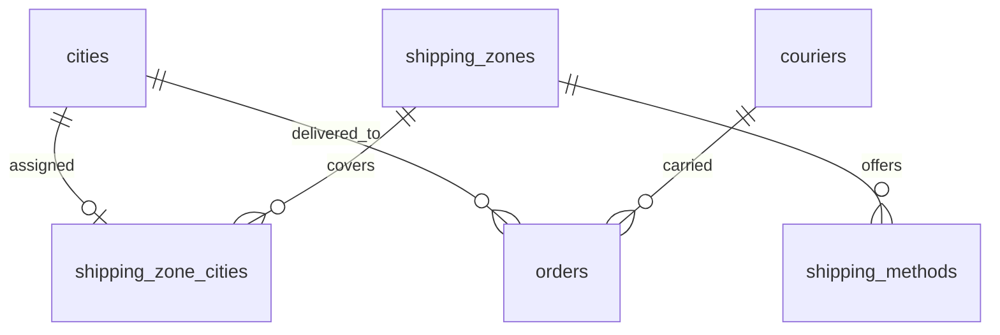

# 09.9 — Data Model: Settings, Shipping and Content

| Field | Value |
|---|---|
| ID | DOC-09.9 |
| Title | Settings documents, pages, menus, cities, shipping zones and methods, couriers |
| Status | Draft |
| Owner | Tech lead |
| Last updated | 2026-10-02 |
| Depends on | DOC-09.0, DOC-06.1, DOC-06.2, DOC-06.8, DOC-07.9, DOC-07.10, DOC-07.11, README (A-06, A-07, A-10) |
| Decisions used | ADR-0006, ADR-0013, ADR-0017, ADR-0018, ADR-0020 |

## 1. Purpose and scope

**Governs:** tables of the `settings` and `shipping` modules, and the shape of each settings document.
**Does not govern:** theme rendering (DOC-04a), Markdown rendering (DOC-06.8).

Design choice: store-wide configuration that is read whole, edited as a form and never queried by field lives as **validated JSON documents** in one `settings` table. Anything the database must join, filter or enforce (cities, zones, methods, couriers, pages) is a real table. This answers DOC-07.11 Q-07.11-1 and DOC-07.9 Q-07.9-1.

## 2. `settings`

| Column | Type | Null | Default | Notes |
|---|---|---|---|---|
| `key` | varchar(32) (bin) | NN | | PK. One of the keys below |
| `value` | json | NN | | Validated on every write by the key's Zod schema in `@noor/contract` |
| `version` | int | NN | 1 | Optimistic lock per document |
| `updated_at` | datetime(3) | NN | | |
| `updated_by` | char(36) | NULL | | FK → `staff_users.id` SET NULL |

Every write records an audit entry with the field-level diff (DOC-11 §6) and emits `settings.updated` or `content.updated`.

### 2.1 Documents

| Key | Schema | Contents | Edited at |
|---|---|---|---|
| `store` | `StoreSettings` | `brand { name, tagline?, logoLightMediaId?, logoDarkMediaId?, faviconMediaId? }`, `contact { whatsapp, phone, email, address, mapUrl?, hours?, socials[{ platform, url }] }`, `priceDisplay { showDecimals, rounding: none\|nearest\|up }`, `orderNumberPrefix`, `locale { default, supported[] }`, `features { wishlist, reviews, notifyMe, customSizing }`, `policies { returnsDays, returns?, shipping?, privacy?, terms? }`, `seo { homeDescription? }`, `notifications { staffEmails[] }`, `thresholds { lowStock, highValueCodMinor }`, `dispatchPromise?` | DOC-07.11 §2, DOC-07.10 §2.4 |
| `theme` | `ThemeTokens` (contract, unchanged) + `preset?: string` | The storefront theme | DOC-07.11 §3 |
| `home` | `HomeContent` | `announcement { text, href? }`, `notices[{ id, text, href?, severity, startsAt?, endsAt? }]` (≤ 5), `heroSlides[{ id, mediaId, alt, heading, subheading, buttonText, buttonHref }]` (≤ 6), `promo { enabled, eyebrow, heading, text, buttonText, buttonHref }`, `editorial { enabled, mediaId?, alt, eyebrow, heading, text, buttonText, buttonHref }`, `footer { about }`, `i18n?` | DOC-07.9 §2 |
| `payments` | `PaymentSettings` | `methods[{ type: payment_method, enabled, label, description?, sortOrder }]`, `codLimitMinor?`, `bankTransfer { accountTitle, bank, accountNumber, instructions }?` | DOC-07.10 §3 |
| `checkout` | `CheckoutSettings` | `extraFields: FormField[]` (≤ 3), `marketingConsent { enabled, label }` | DOC-07.11 §2 |

Seed values: `store.brand.name = "Rubaya"`, `orderNumberPrefix = "RB"`, `locale = { default: "en", supported: ["en"] }`, `thresholds = { lowStock: 3, highValueCodMinor: 2500000 }`, `payments.methods` with only `cod` enabled (A-07), `theme` = the `storefront-gold` preset.

Media ids inside these documents are not foreign keys; the `settings` service verifies on write that each referenced media exists and is `ready`, and the media delete path checks these documents before deleting (the one place a JSON reference is integrity-checked in code).

Validation beyond shape, enforced by the service: at least one enabled payment method; `bankTransfer` present when that method is enabled; theme passes the contrast gate (DOC-04a §9); every `href` passes the link rule (DOC-07.9 §2); `supported` contains `default`.

## 3. Content tables

### 3.1 `pages`

| Column | Type | Null | Default | Notes |
|---|---|---|---|---|
| `id` | char(36) | NN | | PK |
| `slug` | varchar(80) (bin) | NN | | UQ |
| `title` | varchar(100) | NN | | |
| `body_md` | mediumtext | NN | | ≤ 50,000 characters (service) |
| `status` | varchar(16) (bin) | NN | `'draft'` | `page_status` |
| `locked` | boolean | NN | false | Required page: cannot be deleted, unpublished or re-slugged (DOC-06.8 §3) |
| `seo_title`, `seo_description` | varchar(60) / varchar(160) | NULL | | |
| `i18n` | json | NULL | | `{ ur: { title, bodyMd } }` |
| `version` | int | NN | 1 | |
| `updated_by` | char(36) | NULL | | FK → `staff_users.id` SET NULL |
| `created_at`, `updated_at` | datetime(3) | NN | | |

`page_redirects (old_slug PK varchar(80) bin, page_id FK → pages.id CASCADE)` is the one table added at M1-06: changing a page's slug writes the old slug here, so `content.getPage` can answer `{ redirectTo }`; creating a page with a slug that is an old one removes that redirect. A document that was never saved is not a row: the service reads the default of the schema (version 0) and the first write inserts the row.

Seeded locked pages: `shipping-returns`, `privacy`, `terms`, `contact`; unlocked: `about`.

### 3.2 `menus`

| Column | Type | Null | Default | Notes |
|---|---|---|---|---|
| `handle` | varchar(16) (bin) | NN | | PK. `main`, `footer` (both seeded; no others in v1) |
| `items` | json | NN | | Schema `MenuItem[]`: `{ id, label, href, i18n?, children?: MenuItem[] }`; depth and count limits of DOC-07.9 §4 |
| `version` | int | NN | 1 | |
| `updated_at` | datetime(3) | NN | | |
| `updated_by` | char(36) | NULL | | FK SET NULL |

Menus are stored whole (they are read and saved as one tree). "Target not live" (DOC-07.9 §4) is computed at read time by resolving each internal `href`.

## 4. Shipping tables

### 4.1 `cities`

The seed list (`apps/api/src/modules/shipping/cities.js`, 242 cities, 11 of them major) is added by `seedShipping(db)`, which only inserts names that are missing.

| Column | Type | Null | Default | Notes |
|---|---|---|---|---|
| `id` | char(36) | NN | | PK |
| `name` | varchar(60) | NN | | UQ |
| `province` | varchar(40) | NN | | Punjab, Sindh, Khyber Pakhtunkhwa, Balochistan, Islamabad Capital Territory, Azad Jammu and Kashmir, Gilgit-Baltistan |
| `aliases` | json | NULL | | `string[]` of alternate spellings for the checkout search |
| `is_major` | boolean | NN | false | Listed first in the combobox |
| `created_at` | datetime(3) | NN | | |

Cities are never deleted once an order references them (`orders.ship_city_id` is RESTRICT).

### 4.2 `shipping_zones`

`id` PK · `name varchar(60)` NN UQ · `sort_order int` NN · `version int` NN default 1 · `created_at`, `updated_at`.

### 4.3 `shipping_zone_cities`

| Column | Type | Null | Default | Notes |
|---|---|---|---|---|
| `city_id` | char(36) | NN | | **PK** (alone): a city can be in at most one zone. FK → `cities.id` CASCADE |
| `zone_id` | char(36) | NN | | FK → `shipping_zones.id` CASCADE; IX |

A city with no row here is not deliverable (`city_not_served`).

### 4.4 `shipping_methods`

| Column | Type | Null | Default | Notes |
|---|---|---|---|---|
| `id` | char(36) | NN | | PK |
| `zone_id` | char(36) | NN | | FK → `shipping_zones.id` CASCADE |
| `label` | varchar(60) | NN | | Customer-facing |
| `fee_minor` | bigint | NN | | CHECK `>= 0` |
| `free_above_minor` | bigint | NULL | | |
| `eta_min_days`, `eta_max_days` | smallint | NN | | CHECK `0 <= min <= max <= 60` |
| `cod_allowed` | boolean | NN | true | |
| `enabled` | boolean | NN | true | |
| `sort_order` | int | NN | 0 | |
| `i18n` | json | NULL | | `{ ur: { label } }` |
| `created_at`, `updated_at` | datetime(3) | NN | | |

Index: `shipping_methods_zone_idx (zone_id, enabled, sort_order)`. Deleting a method sets `orders.shipping_method_id` to NULL (orders keep their snapshot label and fee).

`shipping.quote(tx, cityId, methodId?, amountAfterDiscount)` → the city's zone → its enabled methods (cheapest first) → the chosen (or cheapest) method's fee, zero when `amountAfterDiscount >= free_above_minor`.

### 4.5 `couriers`

| Column | Type | Null | Default | Notes |
|---|---|---|---|---|
| `id` | char(36) | NN | | PK |
| `name` | varchar(60) | NN | | UQ |
| `tracking_url_pattern` | varchar(300) | NULL | | Must start with `https://` and contain `{tracking}` |
| `tracking_required` | boolean | NN | true | |
| `enabled` | boolean | NN | true | |
| `sort_order` | int | NN | 0 | |

Seed (`apps/api/src/modules/shipping/seed.js`, called by the base seed): TCS, Leopards, M&P, Trax, PostEx (tracking required, patterns left empty until verified in DOC-12), Own rider (tracking not required).

## 5. Rules

**Always:** validate a settings document with its schema and its service rules on every write; snapshot shipping label, fee and ETA into the order; keep a city in at most one zone (the primary key guarantees it).
**Never:** hard-code a fee, threshold, city or courier in code (F-05, F-06); put provider secrets in a settings document (DOC-11 §7); query inside a settings JSON document from another module (call `settings.getStoreConfig()`).
**Common mistakes:** adding a filterable field to a JSON document instead of a column; deleting a media file still referenced by `home` or `store`; a save that leaves no enabled payment method.

## 6. Acceptance checklist

- [ ] Writing an invalid document (unknown key, wrong type, bad hex colour) is rejected and nothing is stored. **Open: not tested for every document.**
- [ ] Two staff saving the same document: the second gets `stale_write`. **Open: tested for shipping zones and products; not for each settings document.**
- [x] Inserting a second zone for a city fails on the primary key. (`apps/api/test/shipping.int.test.js` ("the database refuses a second row").)
- [ ] Changing a method's fee does not change any existing order. **Open: orders copy their fee at creation; no test changes a fee afterwards.**
- [x] `db:seed --base-only` creates the five documents, both menus, the locked pages, the couriers and the city list, and is idempotent. (`apps/api/test/seed.int.test.js` (base layer: creates what a shop needs, nothing twice) and `launch.int.test.js`.)
- [x] Deleting a media item used by a hero slide is refused with `409 in_use`. (`apps/api/test/media.int.test.js` ("a file that something refers to cannot be deleted").)

## 7. Open questions and assumptions

| # | Item | Assumption | Revisit trigger |
|---|---|---|---|
| Q-09.9-1 | City list source | Compiled at M0 (DOC-07.10 Q-07.10-1) | Seed task |
| Q-09.9-2 | Settings as JSON documents | Five documents, each under 20 kB | A field needs querying → promote it to a column or table |
| Q-09.9-3 | Courier tracking URL patterns | Left empty in the seed until checked against each courier's site | DOC-12 |
| Q-09.9-4 | `PageTemplate` storage | No table in v1 | DOC-06.2 trigger |

## 8. Changelog

| Date | Change |
|---|---|
| 2026-10-02 | Initial version (Phase 5, part 1). Resolves DOC-07.11 Q-07.11-1 and DOC-07.9 Q-07.9-1 |
| 2026-10-02 | Phase 7 consistency review: error code `in_use` |
