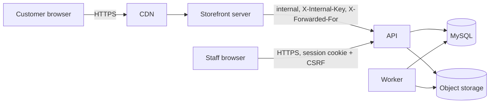
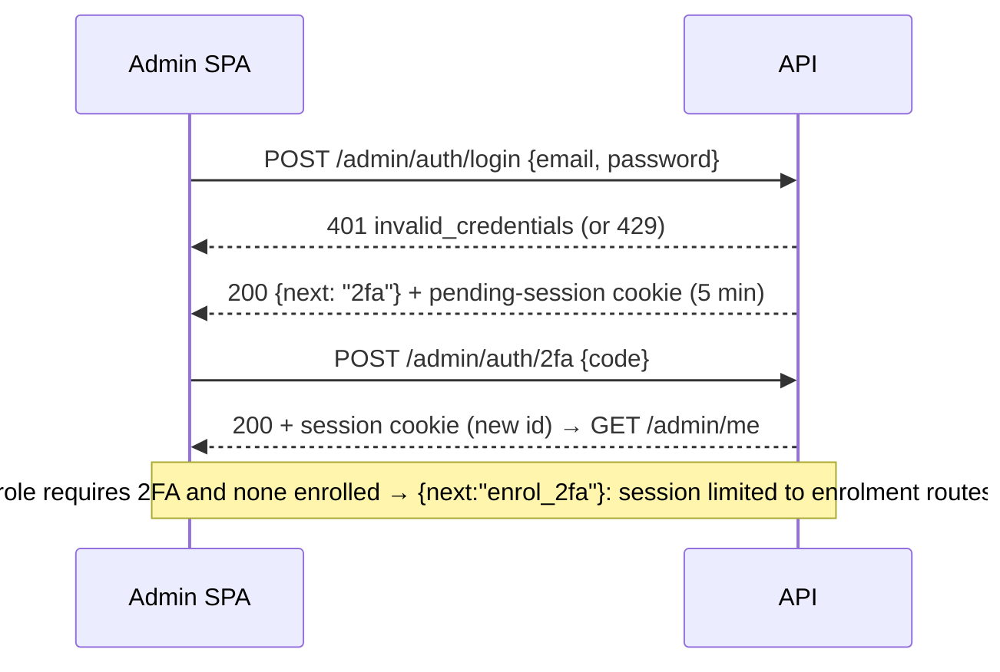

# 11 — Security and Authentication

| Field | Value |
|---|---|
| ID | DOC-11 |
| Title | Staff authentication, sessions, 2FA, RBAC matrix, CSRF/CORS/headers, rate limits, audit trail, secrets, personal data, OWASP checklist |
| Status | Draft |
| Owner | Tech lead |
| Last updated | 2026-10-02 |
| Depends on | DOC-01 (K8, F-07, F-16, F-17, F-18), DOC-07.1, DOC-07.12, DOC-07.13, DOC-08 |
| Decisions used | ADR-0004, ADR-0005, ADR-0011, ADR-0012, ADR-0017, ADR-0019, ADR-0020 |

## 1. Purpose and scope

**Governs:** who can do what and how that is proven and recorded: staff sign-in, sessions, two-factor, permissions, request protections on both the API and the storefront server, rate limits, the audit trail, secrets handling, personal-data rules, and the security checklist a release is reviewed against.
**Does not govern:** the screens (DOC-07.1, 07.12, 07.13), table definitions (DOC-09), infrastructure hardening and backups (DOC-14), payment-provider security (DOC-12, ADR-0017).

Fixes K8/F-16 (shared key in the bundle, no login, no roles, no audit), F-07 (enumerable tracking), F-17 (uploads trusted by header), F-18 (no rate limiting, no headers, CORS `*`).

## 2. Actors and trust boundaries

| Actor | Authenticates with | Reaches |
|---|---|---|
| Customer (browser) | Nothing (guest). Possession of `nc_cart` cookie, an order `trackingToken`, or order number + phone | Storefront server only |
| Storefront server (BFF) | `X-Internal-Key` header (shared secret, env) | API public routes (`/api/v1/*` except admin) over the internal network |
| Staff (browser, admin SPA) | Session cookie + CSRF header | API admin routes (`/api/v1/admin/*`) directly |
| Worker | In-process | Database, storage, providers |
| Payment provider (later) | Signed webhook (ADR-0017) | `/api/v1/webhooks/<provider>` |



The API's public routes are also reachable from the internet (the admin SPA needs the same host). They are safe to expose: they accept no trusted money or identity from the caller (ADR-0020). The internal key only decides **whose IP is rate-limited**: with a valid key the API uses the forwarded client IP; without it, the socket IP.

## 3. Staff authentication

### 3.1 Passwords

| Rule | Value |
|---|---|
| Hash | Argon2id via `@node-rs/argon2`: memory 19,456 KiB, iterations 2, parallelism 1 (the OWASP Password Storage Cheat Sheet minimum). Parameters are stored in the hash string; on a successful login with weaker stored parameters the hash is upgraded |
| Length | 12–128 characters. No composition rules (no forced symbols) |
| Blocklist | Rejected if in the bundled list of the 10,000 most common passwords or if it contains the user's email local part or the store name |
| Storage | Hash only. Never logged, never returned, never emailed |
| Change | Requires the current password; ends all other sessions |
| Reset | Single-use token (32 random bytes, stored hashed), valid 60 minutes; using it ends all sessions. Issued by email when a provider exists (DOC-12), otherwise by an owner from the staff screen (DOC-07.12 §4) |
| Invite | Single-use token, valid 7 days, same storage rule |
| Timing | Login runs the Argon2 verification even when the email is unknown (against a fixed dummy hash) so response time does not reveal which emails exist |

### 3.2 Login flow



| Rule | Value |
|---|---|
| Failure message | One code, `invalid_credentials`, for unknown email, wrong password and deactivated account |
| Throttle per account | 5 failures in 15 minutes → further attempts for that email are refused for 15 minutes (`429 too_many_attempts`, with `retryAfter`). Counted in `login_attempts` (database, so it holds across instances) |
| Throttle per IP | 20 failures in 15 minutes → same refusal for that IP |
| Lockout escalation | Each consecutive lock doubles the wait, capped at 24 h; a successful login resets it. An owner can clear a lock from the staff screen |
| Notification | A lock writes an audit entry `auth.locked`; 3 locks in a day raise a staff alert (DOC-13) |

### 3.3 Two-factor (TOTP)

| Rule | Value |
|---|---|
| Algorithm | TOTP (RFC 6238), SHA-1, 6 digits, 30 s step, ±1 step tolerance, via `otplib` |
| Required for | `owner`, `manager` (ADR-0012). Optional for other roles |
| Secret storage | Encrypted with AES-256-GCM using `DATA_ENCRYPTION_KEY` (env); never returned after enrolment |
| Replay | The last accepted time step is stored per user; a code for that step or earlier is rejected |
| Attempts | 5 wrong codes end the pending session; counted toward the account throttle |
| Recovery codes | 10 codes, 10 characters each from an unambiguous alphabet, stored as Argon2id hashes, single use; regenerating invalidates the rest |
| Reset | By an owner (step-up required), or by the user with a recovery code |

### 3.4 Sessions

| Property | Value |
|---|---|
| Identifier | 32 random bytes, base64url. The database stores only its SHA-256 hash, so a database leak does not yield usable sessions |
| Cookie | `__Host-rb_admin=<id>; Path=/; HttpOnly; Secure; SameSite=Lax` set by the API host (`api.rubaya.pk`). No `Domain` attribute: the admin SPA on `admin.rubaya.pk` calls the API with `credentials: 'include'`, which is same-site, so the browser sends it. This settles the choice ADR-0012 left open in favour of `__Host-` |
| Local development | Same attributes; browsers treat `http://localhost` as secure. If a browser refuses, `SESSION_COOKIE_NAME=rb_admin_dev` drops the prefix in development only |
| Idle timeout | 8 hours without a request (ADR-0012) |
| Absolute timeout | 14 days, then sign-in again |
| Pending session (between password and 2FA) | 5 minutes, can reach only the 2FA and enrolment routes |
| Rotation | New id on login, on 2FA completion, on password change and on role change (all other sessions of that user are ended on the last two) |
| Step-up | Routes marked `stepUp` (staff management, 2FA changes, role changes, anonymise customer, exports of personal data) require `lastAuthAt` within 15 minutes; otherwise `403 step_up_required` and the SPA asks for the password |
| Stored with the session | user id, created, last seen (updated at most once a minute), last auth, IP, user agent, 2FA flag |
| Listing and revocation | A user sees and revokes their own sessions; owners revoke anyone's (DOC-07.12) |
| Logout | Deletes the row and clears the cookie |

The OWASP Session Management Cheat Sheet suggests 15–30 minute idle timeouts for low-risk applications. This plan keeps ADR-0012's 8 hours so staff processing orders through a working day are not signed out repeatedly, and compensates with mandatory 2FA for privileged roles, step-up on sensitive actions, host-only `HttpOnly` cookies and revocable server-side sessions. Revisit trigger: any account takeover, or staff using shared or public computers.

## 4. Authorisation (RBAC)

A permission is a `resource:action` string; a role is a fixed set of them (GLOSSARY "Permission"). The matrix lives in code (`apps/api/src/modules/auth/roles.ts`) and is the single source: the API enforces it and `admin.roles.list` serves it to the UI (DOC-07.12 §2).

### 4.1 Matrix

✓ = granted. `owner` has every permission, including any added later.

| Permission | owner | manager | catalog | fulfilment | support | viewer |
|---|---|---|---|---|---|---|
| `dashboard:read` | ✓ | ✓ | ✓ | ✓ | ✓ | ✓ |
| `products:read` | ✓ | ✓ | ✓ | ✓ | ✓ | ✓ |
| `products:write` | ✓ | ✓ | ✓ | | | |
| `products:publish` | ✓ | ✓ | ✓ | | | |
| `products:delete` | ✓ | ✓ | | | | |
| `products:export` | ✓ | ✓ | ✓ | | | |
| `inventory:adjust` | ✓ | ✓ | ✓ | ✓ | | |
| `catalog:read` | ✓ | ✓ | ✓ | ✓ | ✓ | ✓ |
| `catalog:write` | ✓ | ✓ | ✓ | | | |
| `catalog:delete` | ✓ | ✓ | ✓ | | | |
| `orders:read` | ✓ | ✓ | | ✓ | ✓ | ✓ |
| `orders:note` (notes, confirmation attempts) | ✓ | ✓ | | ✓ | ✓ | |
| `orders:confirm` | ✓ | ✓ | | ✓ | | |
| `orders:edit` (address, items before dispatch, staff-created orders) | ✓ | ✓ | | ✓ | | |
| `orders:dispatch` | ✓ | ✓ | | ✓ | | |
| `orders:deliver` | ✓ | ✓ | | ✓ | | |
| `orders:cancel` | ✓ | ✓ | | ✓ | | |
| `orders:return` | ✓ | ✓ | | ✓ | | |
| `orders:payments` (record manual payments, refunds) | ✓ | ✓ | | ✓ | | |
| `orders:export` | ✓ | ✓ | | | | |
| `customers:read` (full phone, address, email) | ✓ | ✓ | | ✓ | ✓ | |
| `customers:write` (notes, flags) | ✓ | ✓ | | | ✓ | |
| `customers:export` | ✓ | | | | | |
| `customers:anonymise` | ✓ | | | | | |
| `promos:read` | ✓ | ✓ | | | ✓ | |
| `promos:write` | ✓ | ✓ | | | | |
| `promos:delete` | ✓ | ✓ | | | | |
| `reviews:read` | ✓ | ✓ | ✓ | | ✓ | |
| `reviews:moderate` | ✓ | ✓ | | | ✓ | |
| `content:read` | ✓ | ✓ | ✓ | | | |
| `content:write` | ✓ | ✓ | ✓ | | | |
| `content:delete` | ✓ | ✓ | | | | |
| `settings:read` | ✓ | ✓ | | | | |
| `settings:write` | ✓ | ✓ | | | | |
| `settings:manage` (data import/export) | ✓ | ✓ | | | | |
| `staff:read` | ✓ | ✓ | | | | |
| `staff:manage` | ✓ | ✓ (non-owners only, §4.3) | | | | |
| `audit:read` | ✓ | ✓ | | | | |

Changes from the provisional list in DOC-07.1: added `orders:note` and `customers:anonymise`; `fulfilment` may cancel orders (unreachable customers are its daily work). DOC-07.1 §2 and DOC-07.12 §2 are updated to match.

### 4.2 Enforcement

| Rule | Detail |
|---|---|
| Declared in the contract | Every admin route has `auth: 'staff'` and one `permission`. The route registrar refuses to start if an admin route has none (DOC-08 §6.1) |
| Checked in one place | `platform/http/session` middleware: no session → `401 unauthenticated`; session lacks the permission → `403 forbidden` |
| Action-level | Composite endpoints check the specific permission in the service: `admin.orders.transition` maps `to` → `orders:confirm|dispatch|deliver|cancel|return` |
| Data-level | Without `customers:read`, order and customer responses carry masked phone (`0300 ••••567`), no email and city only (the masking function is the one used for `OrderPublic`, DOC-06.6). Sales figures on the dashboard require `orders:read` |
| Object ownership (customers) | `nc_cart` identifies only its own cart; `trackingToken` only its own order; no customer-supplied id is ever trusted to select another customer's data |
| Default deny | A route with no declared auth is a startup error; a permission not in the matrix is a compile error (`Permission` is a string-literal union) |
| Tests | One table-driven test iterates every admin route × every role and asserts 200-class or 403 according to the matrix |

### 4.3 Staff-management guard rails (enforced in `auth` service)

Only an owner may create, edit, deactivate or reset an owner. The last active owner cannot be demoted or deactivated. No user may change their own role or deactivate themselves. A manager cannot grant `owner`. All of these require step-up.

## 5. Request protections

### 5.1 CSRF

| Surface | Protection |
|---|---|
| API admin routes (cookie-authenticated) | (1) `SameSite=Lax` cookie. (2) `Origin` header must equal `ADMIN_ORIGIN` on every non-GET request; missing or different → `403 csrf_failed`. (3) Double-submit: `GET /admin/me` returns `csrfToken` (random, bound to the session row); the SPA sends it as `X-CSRF-Token`; the API compares in constant time |
| API public routes | No cookies are read, so no CSRF surface |
| Storefront actions (`/cart`, `/checkout`, order actions) | Cookies are `SameSite=Lax`; the storefront middleware rejects any non-GET whose `Origin` (or, if absent, `Referer`) is not the storefront's own origin |
| State changes | Never on GET, anywhere |

### 5.2 CORS (API)

`Access-Control-Allow-Origin: <ADMIN_ORIGIN>` (exact, from config, never `*`), `Allow-Credentials: true`, methods `GET, POST, PUT, PATCH, DELETE`, headers `content-type, x-csrf-token, x-request-id, idempotency-key`, max-age 600. Public routes send no CORS headers (the storefront calls them server-side).

### 5.3 Security headers

| Header | API | Storefront HTML | Admin static host |
|---|---|---|---|
| `Strict-Transport-Security` | `max-age=31536000; includeSubDomains` (after go-live verification; DOC-14) | same | same |
| `X-Content-Type-Options` | `nosniff` | `nosniff` | `nosniff` |
| `Referrer-Policy` | `no-referrer` | `strict-origin-when-cross-origin`; `no-referrer` on `/orders/*` (DOC-06.6) | `no-referrer` |
| `X-Frame-Options` / `frame-ancestors` | `DENY` | `frame-ancestors 'none'` | `frame-ancestors 'none'` |
| `Permissions-Policy` | — | `camera=(), microphone=(), geolocation=(), payment=()` | same |
| `Cross-Origin-Opener-Policy` | — | `same-origin` | `same-origin` |
| `Content-Security-Policy` | `default-src 'none'` (JSON only) | below | below |
| `Cache-Control` | `no-store` on every admin and private route | per route class (DOC-06.1) | hashed assets immutable; `index.html` `no-cache` |

Storefront CSP (nonce generated per request in `entry.server.tsx`):
```
default-src 'self';
script-src 'self' 'nonce-<n>';
style-src 'self' 'nonce-<n>';
img-src 'self' https://img.rubaya.pk data:;
font-src 'self';
connect-src 'self';
form-action 'self';
frame-ancestors 'none';
base-uri 'self';
object-src 'none'
```
The inline theme `<style>` and JSON-LD scripts carry the nonce. A cacheable page must not embed a per-request nonce, so for L and S routes the theme CSS is served as a **hash-allowed** inline block instead: the CSP header for those routes lists `'sha256-<hash of the theme CSS>'` (computed when the store config is loaded, cached with it) and JSON-LD blocks need no allowance (`type="application/ld+json"` is not executed). Private routes use the nonce.

Admin CSP: `default-src 'self'; script-src 'self'; style-src 'self' 'unsafe-inline'` (Base UI positions popups with inline styles) `; img-src 'self' https://img.rubaya.pk data: blob:; connect-src 'self' https://api.rubaya.pk https://<storage host>` (presigned uploads) `; frame-ancestors 'none'; base-uri 'self'; object-src 'none'; form-action 'self'`.

Analytics or payment hosts are added to these policies only by the DOC-12 change that introduces them.

### 5.4 Rate limits

Buckets are named in the contract (`rateLimit: 'checkout'`); values live in `platform/http/rate-limit.ts`. Key = client IP (forwarded IP when the internal key is valid) unless stated. Responses: `429 rate_limited` with `Retry-After`.

| Bucket | Routes | Limit | Store |
|---|---|---|---|
| `default` | Public reads (catalog, content, config) | 300 / min / IP | memory |
| `search` | `catalog.listProducts` when `q` is set | 60 / min / IP | memory |
| `cart` | Cart mutations, quote | 60 / min / IP and 120 / min / cart id | memory |
| `checkout` | `orders.create` | 10 / 10 min / IP and 5 / 10 min / phone | database |
| `track` | `orders.track` | 10 / hour / IP and 5 / hour / order number (ADR-0012) | database |
| `orderAction` | Cancel / switch-to-COD by token | 10 / hour / token | memory |
| `notify` | Back-in-stock subscribe | 10 / hour / IP, 3 / day / phone | database |
| `review` | Review submit | 5 / hour / IP | memory |
| `login` | §3.2 | 5 / 15 min / email, 20 / 15 min / IP | database |
| `admin` | All other admin routes | 600 / min / session | memory |
| `adminExport` | Exports, bulk | 10 / min / session | memory |
| `upload` | `admin.media.createUpload` | 60 / min / session | memory |

In-memory buckets are per API instance (DOC-08 Q-08-6); the database-backed ones are the abuse-relevant ones and hold across instances. `trust proxy` is configured with the exact proxy hop count from config (F-19), never `true`.

### 5.5 Input and output handling

| Risk | Control |
|---|---|
| Injection (SQL) | Drizzle parameterised queries only; the `sql` template with interpolated identifiers is forbidden except from allow-listed column maps (sort keys) |
| Mass assignment | Zod schemas are `strict` for request bodies: unknown keys are rejected (`unrecognized_keys`), so `total` in an order body is a 400 (ADR-0020 test) |
| XSS | React escaping; no `dangerouslySetInnerHTML` outside the JSON-LD helper; CMS Markdown through the allow-list renderer (DOC-06.8); admin-supplied URLs validated (DOC-04b `LinkButton`, DOC-07.9 `LinkField`); theme values validated before reaching CSS (DOC-04a §6) |
| Open redirect | `?next=` accepts same-origin paths only; payment return URLs are built server-side |
| File upload | Presigned PUT with pinned type and size; magic-byte check, dimension limit, EXIF strip in `media.process`; objects served only through the image host, never from the API origin (DOC-08 §11) |
| SSRF | The API fetches no user-supplied URLs. imgproxy is configured to read only our bucket |
| CSV injection | Export cells prefixed (DOC-07.14 §6) |
| Idempotency keys | UUID format enforced; scope + request hash stored (ADR-0020) |
| Error detail | Problems carry codes, never stack traces or SQL (DOC-08 §13) |
| Enumeration | Uniform responses for login, password reset, order tracking (DOC-06.6 §3) and customer lookup |
| Body size | 1 MB JSON limit on the API; 100 kB on storefront actions |

## 6. Audit trail

Written by `audit.record(tx, …)` inside the mutating transaction (ADR-0012). Entry: `id, at, actorType (staff | system | storefront), actorId, actorRole, action, entityType, entityId, entityLabel, diff json, reason, ip, userAgent, requestId`.

| Rule | Detail |
|---|---|
| Coverage | Every admin mutation; sign-in success and failure; lock; logout; 2FA enrol/disable/reset; password change/reset; session revocation; role change; invite; export of personal data; bulk action (one entry with counts + per-item entries); customer-initiated order cancel; job dead-letter |
| Diff | Changed fields only, `{ field: [before, after] }`. Redacted always: password hashes, TOTP secrets, recovery codes, tokens, session ids, provider credentials. Customer phone/address changes are stored but masked on read without `customers:read` |
| Enforcement | A test asserts that every admin route with a non-GET method produced exactly one audit row (table-driven over the route table) |
| Immutability | No update or delete route. The API's database user has `INSERT, SELECT` on `audit_log` and **no** `UPDATE`/`DELETE`; the retention job runs under the migration user (DOC-14) |
| Retention | 24 months; `auth.*`, role, money-setting and payment entries 36 months (DOC-07.13 §5) |
| Not logged | Reads (DOC-07.13 Q-07.13-3); request bodies |

## 7. Secrets

| Secret | Where it lives | Rotation |
|---|---|---|
| `DATABASE_URL` (app user), `DATABASE_MIGRATION_URL` (DDL user) | Host secret store / `.env` locally | On staff departure with access; yearly |
| `DATA_ENCRYPTION_KEY` (32 bytes, base64) for TOTP secrets | Host secret store | Versioned: ciphertext is prefixed with a key id so a new key can be introduced and old data re-encrypted by a CLI command |
| `INTERNAL_API_KEY` (storefront → API) | Both services' secret stores | Yearly or on suspicion; two keys accepted during rotation |
| `IMG_SIGNING_KEY`, `IMG_SIGNING_SALT` | API and imgproxy | Yearly |
| `S3_ACCESS_KEY_ID`, `S3_SECRET_ACCESS_KEY` | API, worker, imgproxy (read-only key for imgproxy) | Yearly |
| `PREVIEW_SIGNING_KEY` (product preview links) | API, storefront | Yearly |
| `TRACKING_KEY` (derives order tracking tokens, DOC-10.3 §4) | API, worker | Only on compromise: rotating it invalidates every customer order link |
| CDN purge token, provider keys (later) | Worker | Per provider guidance |

Rules: no secret in the repository, in the contract, in the database, in logs or in any client bundle; `.env` files are gitignored and `.env.example` holds names only; CI runs a secret scanner (gitleaks) on every push and fails on a finding; the string `VITE_ADMIN_KEY` is banned by a lint rule (ADR-0012). The current `mock-api/.env` key `dev-key` is a development value and is deleted with the mock.

## 8. Personal data

### 8.1 Inventory

| Data | Where | Who can read | Retention |
|---|---|---|---|
| Customer name, phone, email | `customers`, orders | `customers:read` (masked otherwise) | Life of the business records, until anonymised (§8.2) |
| Delivery address, landmark, notes | orders | `customers:read` | Same |
| Custom-size measurements | order lines | `orders:read` | Same |
| Cart contents | carts | Holder of the cart cookie | 30 days idle |
| Phone for back-in-stock alerts | subscriptions | system | Until notified, max 90 days |
| Review display name, text, photos | reviews | public once approved | Until removed |
| Staff name, email, IP, user agent | staff, sessions, audit | owner, manager | Sessions 14 days; audit per §6 |
| IP addresses of customers | rate-limit counters, access logs | system | Counters 24 h; logs per DOC-14 |

Payment card data is never collected or stored by us (hosted redirect only, ADR-0017).

### 8.2 Rules

| Rule | Detail |
|---|---|
| Minimise | Checkout asks only what delivery needs (DOC-06.5 §4.1). Email is optional |
| Masking | `OrderPublic` and role-limited admin views use one masking function |
| Logs | No phone, email, address or names in logs (DOC-08 §14) |
| URLs and analytics | No personal data or tokens in URLs, query strings or analytics events (DOC-06.6 §7) |
| Encryption in transit | TLS 1.2+ everywhere, including the database connection in production (`ssl` required in `DATABASE_URL`) |
| Encryption at rest | Managed database and object storage with provider-side encryption (DOC-14); TOTP secrets additionally encrypted by the application |
| Anonymisation | `customers.anonymise` (owner, step-up): replaces name with "Removed customer", phone with a random non-routable placeholder, clears email, address, landmark, notes and measurements on the customer and on orders in a final status; keeps amounts, items and dates. Irreversible; audited |
| Exports | Permission-gated, audited, capped (DOC-07.6, DOC-07.14) |
| Backups | Contain personal data; access is limited to the owner account at the provider (DOC-14) |

## 9. Storefront-specific controls

| Control | Detail |
|---|---|
| Cart cookie | `nc_cart`: opaque random id, `HttpOnly; Secure; SameSite=Lax` (DOC-06.5 §2). Carts hold no personal data |
| Tracking token | 32 random bytes base64url, stored hashed (SHA-256) like sessions; compared by hash lookup; `Referrer-Policy: no-referrer` on order pages |
| Order lookup | Uniform failure response; database rate limits (§5.4) |
| Preview links | `admin.products.previewLink` returns a URL with an HMAC-signed, 15-minute token; the storefront verifies it and renders the draft with `noindex, no-store` |
| Internal key | Storefront → API header; requests with a wrong key are rejected (`401`), requests with none are treated as external |
| Bots on checkout | Rate limits (§5.4) and COD confirmation (ADR-0017). No CAPTCHA in v1. Trigger to add one: more than 5% of orders in a week cancelled as `suspected_fake` |

## 10. Supply chain

| Control | Detail |
|---|---|
| Lockfile | `pnpm-lock.yaml` committed; CI installs with `--frozen-lockfile` |
| New-release delay | pnpm `minimumReleaseAge` set to 7 days in `pnpm-workspace.yaml`, so a just-published (possibly compromised) version is not installed |
| Install scripts | Dependency lifecycle scripts are blocked by default in pnpm; only an explicit allow-list (`sharp`, `@node-rs/argon2` if it needs one) may run them |
| Audit | `pnpm audit --prod` in CI: fails on high or critical advisories with no accepted exception |
| Updates | Grouped weekly dependency PRs (Renovate or Dependabot); security fixes immediately |
| New dependencies | Need the PR justification line (DOC-15 §5) |
| Build integrity | Images built in CI from the lockfile; production runs only CI-built images (DOC-14) |

## 11. OWASP Top 10:2025 checklist

Reviewed before each release that touches auth, orders, payments or uploads.

| Risk | Our controls |
|---|---|
| A01 Broken Access Control | Contract-declared permissions, default deny, route × role test (§4.2); object access only by cookie/token (§4.2); masking by permission |
| A02 Security Misconfiguration | Config validated at boot (DOC-08 §12); security headers and CSP (§5.3); exact-origin CORS; `noindex` + no default credentials on staging (DOC-14); no debug output in production |
| A03 Software Supply Chain Failures | §10 |
| A04 Cryptographic Failures | TLS everywhere; Argon2id; hashed session ids and tokens; AES-256-GCM for TOTP secrets; `crypto.randomBytes` for every token; no home-made crypto |
| A05 Injection | Parameterised queries; strict Zod schemas; Markdown allow-list; validated URLs and theme values; CSV prefixing (§5.5) |
| A06 Insecure Design | Server-side pricing, idempotent order creation, DB-enforced stock, state machines (ADR-0020); COD confirmation (ADR-0017); threat cases listed as acceptance tests |
| A07 Authentication Failures | §3: throttling, lockout, 2FA, rotation, uniform errors, step-up |
| A08 Software or Data Integrity Failures | Signed webhooks stored and processed idempotently (ADR-0017); migrations reviewed and immutable (ADR-0008); CI-built artefacts |
| A09 Security Logging and Alerting Failures | Audit trail (§6); structured logs with request ids; alerts on lockouts, 5xx rate, dead-lettered jobs (DOC-13) |
| A10 Mishandling of Exceptional Conditions | One error handler, no leaked internals (DOC-08 §13); transaction retry on deadlock; timeouts on jobs and outbound calls; fail closed: an error in the permission or CSRF check denies |

## 12. Rules

**Always:** declare auth and permission on the contract route; check permissions, not roles; hash anything that works as a credential before storing it; write the audit entry in the same transaction; return uniform errors where enumeration is possible.
**Never:** put a secret in a client bundle or the database; accept money, role, actor or status from a request body; compare secrets with `===` (use `timingSafeEqual`); log credentials, tokens or personal data; disable a security check in non-production in a way that can ship (use config, with safe defaults).
**Common mistakes:** authorising in the UI only; a new admin route with no audit entry; `Access-Control-Allow-Origin: *` with credentials; trusting `X-Forwarded-For` from any caller; storing a reset token in plain text.

## 13. Acceptance checklist

- [ ] Route × role matrix test passes for every admin route.
- [ ] Every non-GET admin route produces one audit row (table-driven test).
- [ ] 6 wrong passwords for one email → `429`; the correct password is also refused until the window ends.
- [ ] Session id changes after login and after 2FA; the old id is rejected.
- [ ] A cross-origin `POST` to an admin route with a valid cookie but wrong `Origin` or missing `X-CSRF-Token` → `403 csrf_failed`.
- [ ] `orders.create` with `"total": 1` in the body → `400` (unknown key).
- [ ] The eleventh `orders.track` attempt from one IP in an hour → `429`.
- [ ] Database dump inspection: no plaintext passwords, session ids, tokens or TOTP secrets.
- [ ] `grep -rn "VITE_ADMIN_KEY\|dev-key" apps packages` returns nothing; gitleaks passes.
- [ ] Response headers on storefront, API and admin match §5.3 (automated header test).
- [ ] The API database user cannot `UPDATE` or `DELETE` `audit_log` (integration test expects a permission error).
- [ ] A `viewer` receives masked phones in `admin.orders.get`.

## 14. Open questions and assumptions

| # | Item | Assumption | Revisit trigger |
|---|---|---|---|
| Q-11-1 | Data-protection law applicable in Pakistan | Not researched; controls follow general good practice (minimise, mask, anonymise on request, audit exports) | Legal advice before go-live |
| Q-11-2 | 8-hour idle timeout vs OWASP guidance | Kept per ADR-0012 with compensating controls (§3.4) | Trigger in §3.4 |
| Q-11-3 | pnpm `minimumReleaseAge` setting name and availability in pnpm 11 | As documented for pnpm 10.16+; not re-verified | M0 repo setup |
| Q-11-4 | Common-password list source | A public top-10,000 list committed to the repo (about 80 kB) | — |
| Q-11-5 | CSP hash for the inline theme style on cached pages | Works with the CDN (header varies only with the store theme) | First staging deploy |
| Q-11-8 | Consent for analytics cookies | Opt-in banner when third-party analytics is added (DOC-12 §6.2); none needed at launch (no third-party scripts) | Analytics enabled |
| Q-11-6 | WAF / bot protection at the CDN | Not required for launch; available as a provider feature | Attack traffic observed |
| Q-11-7 | Penetration test | Not scheduled; the acceptance tests above are the baseline | Before enabling online payments |

## 15. Changelog

| Date | Change |
|---|---|
| 2026-10-02 | Initial version (Phase 4). Settles ADR-0012's cookie-prefix question (`__Host-`); adds permissions `orders:note`, `customers:anonymise`; grants `orders:cancel` to `fulfilment` |
| 2026-10-02 | Phase 5: `TRACKING_KEY` added to §7 (tracking tokens are HMAC-derived, DOC-10.3 §4) |
| 2026-10-02 | Phase 5: analytics consent question added (Q-11-8) |
| 2026-10-02 | Phase 7 consistency review: route key for the `search` bucket |
| 2026-10-02 | M0-02: the 7-day `minimumReleaseAge` gate (§10) blocked a 4-day-old `typescript-eslint`; the response was to pin the previous release, not to weaken the gate (works as intended) |
| 2026-10-02 | M0-05: `pnpm` blocks dependency install scripts by default (section 10); `esbuild` is on the allow-list in `pnpm-workspace.yaml` (`allowBuilds`), the only entry so far |
