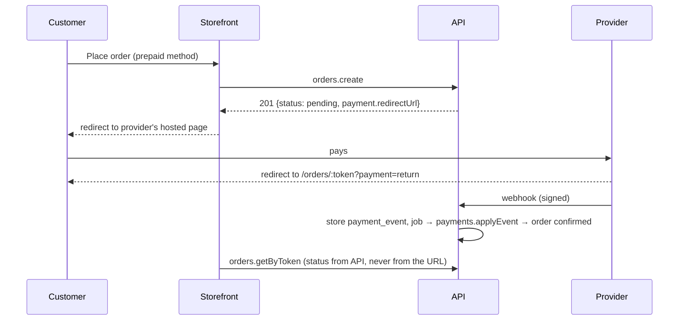

# 12 — Integrations

| Field | Value |
|---|---|
| ID | DOC-12 |
| Title | Payments, couriers, customer and staff messaging (WhatsApp, SMS, email), analytics |
| Status | Draft |
| Owner | Tech lead |
| Last updated | 2026-10-02 |
| Depends on | DOC-08 §8–9, DOC-09.7, DOC-09.8, DOC-09.9, DOC-10.3, DOC-11, README (A-06, A-07, A-08) |
| Decisions used | ADR-0009, ADR-0012, ADR-0017, ADR-0018, ADR-0019 |

## 1. Purpose and scope

**Governs:** every connection to a system we do not run: what is built for launch, what is specified for later, the interface each adapter implements, message templates, and the checks required before any adapter is written.
**Does not govern:** the order and payment state machines (DOC-09.7), secrets handling (DOC-11 §7), the screens.

### 1.1 What launch needs (README A-07, A-08: cash on delivery only, built and run locally first)

| Area | At launch | Later (specified here, not scheduled) |
|---|---|---|
| Payments | `cod` and `manual` adapters (no external system) | Bank transfer (manual proof), then JazzCash, Easypaisa, a card gateway |
| Couriers | Staff type a courier and tracking number | Booking and status sync by API |
| Customer messages | Staff send from their own WhatsApp using prefilled `wa.me` links; every message is rendered and logged as `skipped` so it can be copied | WhatsApp Business Cloud API, SMS |
| Staff messages | Admin badges; email through SMTP when configured (Mailpit locally) | — |
| Analytics | First-party order and search data in the admin dashboard; `web-vitals` to our own endpoint | GA4 and Meta Pixel, behind consent |

**No third-party account, key or network call is required to build, run or test the whole product locally.** Every external adapter below has a no-op or local stand-in.

## 2. Rules for every adapter

| Rule | Detail |
|---|---|
| Location | `apps/api/src/modules/<payments\|notifications\|shipping>/adapters/<name>.ts`, implementing that module's interface (§3.1, §4.3, §5.2). Nothing outside the module imports an adapter |
| Selection | By configuration (`MAIL_URL`, `WHATSAPP_*`, …) validated at boot; an adapter with missing configuration reports `configured: false` and is never called |
| Where calls happen | Only in jobs, never inside a request transaction (DOC-08 §7). Timeout 10 s, no automatic retry inside the adapter (the job system retries) |
| Idempotency | Every outbound call carries our own stable reference (`payments.id`, `notification_log.unique_key`) so a retry cannot charge or send twice |
| Inbound | Webhooks verify the signature over the **raw** body, store the payload, answer 2xx fast and process in a job (ADR-0017) |
| Secrets | Environment only; never in the database, the contract, logs or the admin UI (DOC-11 §7) |
| Logging | Provider, operation, our reference, outcome, duration. Never the request or response body, phone numbers or message text |
| Tests | Each adapter has a contract test against recorded fixtures and is replaceable by an in-memory fake; no test calls a real provider |
| Before writing one | The **verification checklist** of §8 is completed and recorded in this document |

## 3. Payments (ADR-0017)

### 3.1 Interface

```ts
// modules/payments/provider.ts
export interface PaymentProvider {
  readonly id: 'cod' | 'manual' | 'bank_transfer' | 'jazzcash' | 'easypaisa' | 'card'
  readonly configured: boolean
  /** Start collecting money for an order. Called in a job after the order commits (hosted providers), or inline for cod/manual. */
  createSession(input: { paymentId: string; orderNumber: string; amount: Money; customer: { phone: string; email?: string }; returnUrl: string; locale: 'en' | 'ur' }):
    Promise<{ kind: 'none' } | { kind: 'instructions'; text: string } | { kind: 'redirect'; url: string; expiresAt: Date; providerRef?: string }>
  /** Verify and translate an inbound callback. Throws on a bad signature. */
  parseWebhook?(rawBody: Buffer, headers: Record<string, string>): { providerEventId: string; paymentId: string; state: 'authorized' | 'captured' | 'failed' | 'expired'; amount: Money; providerRef: string }
  /** Ask the provider for the truth (reconciliation job, and after the customer returns). */
  getStatus?(paymentId: string, providerRef?: string): Promise<{ state: PaymentState; amount?: Money }>
  refund?(input: { paymentId: string; refundId: string; amount: Money }): Promise<{ providerRef: string }>
}
```

### 3.2 Launch adapters

| Adapter | Behaviour |
|---|---|
| `cod` | `createSession` → `{ kind: 'none' }`. The payment row is created `pending_confirmation` with the order; captured by "Mark delivered" with cash received (DOC-09.7 §5.2). No webhook, no status call |
| `manual` | Not selectable by customers. Used by `admin.orders.recordPayment` for money staff received outside the system (deposit by transfer, cash at the shop, refund paid by hand). Rows are created `captured` |

### 3.3 Bank transfer (first prepaid method to enable)

Enabled from `settings/payments` once account details are entered (DOC-07.10 §3). `createSession` → `{ kind: 'instructions' }` with account title, bank, account number and "Send the receipt on WhatsApp with your order number". The order waits in `pending`; staff verify the transfer in their banking app, attach the screenshot as proof and record the payment (`manual`, method `bank_transfer`), which satisfies the order's payment policy and lets it be confirmed. No automation, no API.

When any prepaid method is enabled, two jobs become active: `inventory.expire_reservations` and `payments.reconcile` (DOC-08 §9.2). For bank transfer the reservation window is 48 hours instead of 30 minutes (a setting on the method).

### 3.4 Online gateways (later)

What research found (all secondary unless stated; **nothing below was read from a merchant portal**):

| Provider | Found | Source and confidence |
|---|---|---|
| JazzCash | Hosted checkout by redirect/form post. Requests and responses carry `pp_SecureHash`: HMAC-SHA256, keyed with the merchant's integrity salt, over the salt plus the alphabetically sorted non-empty `pp_*` values joined with `&`. Configuration: merchant id, password, integrity salt, sandbox vs production base URL (`sandbox.jazzcash.com.pk` / `payments.jazzcash.com.pk`). A public sandbox documentation site exists | sandbox.jazzcash.com.pk documentation (seen via search), third-party libraries; S |
| Easypaisa (Easypay) | Two modes: hosted checkout (redirect) and direct REST. Instant Payment Notification (IPN): the merchant registers a listener URL in the merchant portal; Easypaisa calls it when a transaction becomes paid | "Easypaisa Merchant Integration Guide v4.1.x" copies on document-sharing sites (**older than 12 months**), a 2026 integration blog; S (weak) |
| PayFast (GoPayFast) | A Pakistani aggregator offering cards, wallets, bank transfer and Raast QR through one integration by redirect or API; documentation at gopayfast.com/docs | gopayfast.com (seen via search); S. Not to be confused with the South African payfast.co.za |
| Raast P2M | Offered through aggregators such as PayFast | Profit/Pakistan Today, May 2024 (**older than 12 months**); S |

Recommendation for when online payment is wanted: evaluate **one aggregator** (one contract, one adapter covering cards, both wallets and Raast) against direct JazzCash and Easypaisa integrations (two contracts, two adapters, lower fees per transaction possible). The choice depends on the owner's merchant-account options and fees, which are unknown. It is recorded as an amendment to ADR-0017 when made.

Flow for any hosted provider (already supported by the data model and state machines):



Rules specific to gateways: amounts are sent in the provider's unit by an adapter function with its own test (most Pakistani gateways expect paisa or rupees as strings; getting this wrong charges 100× or 1/100); the return URL is display-only; the webhook or `getStatus` is the only thing that marks a payment captured; card data never touches our pages (hosted redirect only), which keeps us out of card-data compliance scope.

## 4. Messaging

### 4.1 Channels at launch

| Channel | How | Cost |
|---|---|---|
| WhatsApp, manual | Staff press the WhatsApp button on an order: opens `https://wa.me/<customer digits>?text=<rendered template>` in their own WhatsApp (phone or WhatsApp Web). The system records a `confirmation_attempt` or `note` event when staff log it | None |
| Message log | Every customer template is rendered and stored in `notification_log` with status `skipped` (DOC-09.8 §3.1), visible on the order with a Copy button | None |
| Email | SMTP through `MAIL_URL` (`nodemailer`). Locally: Mailpit catches everything. Customer emails are sent only when the customer gave an email | Provider-dependent |

This is deliberate: it needs no account, works on day one, and matches how small Pakistani shops already confirm COD orders. Automation is added when volume justifies it (trigger: more than 50 orders a day, or confirmation delays over 2 hours on the dashboard).

### 4.2 Automated channels (later)

| Channel | Found | Decision |
|---|---|---|
| WhatsApp Business Cloud API (Meta) | Outbound business-initiated messages must use pre-approved **templates** in categories marketing, utility or authentication. A customer message opens a 24-hour service window in which free-form replies and utility templates are free. Published rate for Pakistan from 1 Oct 2026: about US$0.015 per utility template message (several pricing pages; one local outlet reports this as a sharp increase). Sources: provider pricing pages (secondary), Oct 2026 | **Preferred** automated channel for order updates (customers are on WhatsApp; delivery receipts; reply-to-confirm). Needs a Meta Business account, a verified business, a dedicated number and template approval. At 150 orders/day × 3 messages ≈ US$7/day at that rate |
| SMS | Local aggregators (examples seen: SendPK, BrainTEL BSMS, Robo SMS, SMS2Connect) offer REST APIs and branded sender names ("masking"). Masks are registered with the PTA; one provider quotes a Rs 5,000 one-time and Rs 5,000 annual fee. Sources: the providers' own sites (**vendor**), Oct 2026 | **Fallback** for customers not on WhatsApp and for OTP if ever added. One aggregator, chosen when needed |
| Inbound WhatsApp replies ("YES" to confirm) | Possible through the Cloud API webhook | Off at launch (DOC-07.5 §5.1). When enabled: a reply of an allowed word to the confirmation template, from the order's phone, within 48 hours, moves the order to `confirmed` with actor `storefront` and `via: customer_message`; anything else is shown to staff |

### 4.3 Interface

```ts
// modules/notifications/channel.ts
export interface NotificationChannel {
  readonly id: 'log' | 'smtp' | 'whatsapp_cloud' | 'sms'
  readonly configured: boolean
  send(msg: { uniqueKey: string; to: string; locale: 'en' | 'ur'; template: TemplateId; vars: Record<string, string>; rendered: { subject?: string; body: string } }):
    Promise<{ providerRef?: string }>
}
```

Routing (`modules/notifications/route.ts`), first configured channel wins:

| Audience | Template group | Order of channels |
|---|---|---|
| Customer | Order updates, back-in-stock | `whatsapp_cloud` → `sms` → `log` (skipped). Plus `smtp` in parallel when the customer has an email |
| Staff | New order, low stock, job failure | `smtp` to `store.notifications.staffEmails` → `log` |
| Staff | Invite, password reset | `smtp` → none (link shown once in the UI, DOC-07.12 §4) |

The `log` channel always exists, writes the `skipped` row, and is the launch path.

### 4.4 Templates

Stored as message keys in `@noor/i18n` (`notifications` namespace, ICU), one text per locale; WhatsApp Cloud templates, when used, must be registered at Meta with the same wording and variables. Variables are limited to the list below so the same text works on every channel.

| Template id | Sent when | Variables | English text |
|---|---|---|---|
| `order.placed` | `order.placed` (COD) | `name`, `orderNo`, `total`, `link` | `Hi {name}, we received your order {orderNo} for {total}. We will contact you shortly to confirm it. Track it here: {link}` |
| `order.confirm_request` | Staff WhatsApp button on a `pending_confirmation` order | `name`, `orderNo`, `items`, `total`, `city` | `Hi {name}, this is {store}. Please confirm your order {orderNo}: {items}. Total {total}, cash on delivery to {city}. Reply YES to confirm.` |
| `order.confirmed` | `order.confirmed` | `name`, `orderNo`, `eta`, `link` | `Thank you {name}. Order {orderNo} is confirmed and will be dispatched soon. Expected delivery: {eta}. {link}` |
| `order.confirmed_mto` | `order.confirmed` with made-to-order lines | `name`, `orderNo`, `leadDays`, `link` | `Thank you {name}. Order {orderNo} is confirmed. Your piece will be made in about {leadDays} days. {link}` |
| `order.dispatched` | `order.dispatched` | `orderNo`, `courier`, `tracking`, `amountDue`, `link` | `Order {orderNo} is on its way with {courier}, tracking no. {tracking}. Please keep {amountDue} ready for the rider. {link}` |
| `order.delivered` | `order.delivered` | `name`, `orderNo`, `link` | `Hi {name}, order {orderNo} was delivered. We hope you love it. Tell us what you think: {link}` |
| `order.cancelled` | `order.cancelled` | `orderNo` | `Order {orderNo} has been cancelled. If this is a mistake, reply to this message.` |
| `order.returned` | `order.returned` | `orderNo` | `We have received order {orderNo} back. Contact us if you would like to reorder.` |
| `order.bank_details` | Order placed with bank transfer | `orderNo`, `total`, `account` | `Order {orderNo}: please transfer {total} to {account} and send the receipt here with your order number.` |
| `stock.back` | `variant.back_in_stock` | `title`, `link` | `{title} is back in stock: {link}` |
| `staff.new_order` | `order.placed` | `orderNo`, `total`, `city`, `adminLink` | Email: subject `New order {orderNo} ({total})` |
| `staff.low_stock` | `inventory.changed` crossing the threshold | `title`, `sku`, `available`, `adminLink` | Email |
| `staff.job_failed` | Job dead-lettered | `jobType`, `adminLink` | Email |
| `staff.invite`, `staff.password_reset` | `staff.invited`, `staff.password_reset_requested` | `name`, `link` | Email; body stored with the link redacted |

Rendering rules: `total`/`amountDue` through `formatMoney` (`Rs. 7,240`); `link` is the storefront order URL with the derived token (DOC-10.3 §4); `items` is at most three item names then "+N more"; messages stay under 600 characters; no message includes the address or the full phone number; Urdu texts are added when Urdu is enabled, with order numbers and amounts kept in Latin digits.

Marketing messages are out of scope: nothing here sends promotions. `customers.marketing_consent` is only stored (DOC-06.7 §2).

## 5. Couriers

### 5.1 Launch: manual

Couriers are rows in `couriers` (DOC-09.9 §4.5) seeded with TCS, Leopards, M&P, Trax, PostEx and "Own rider". Staff enter the tracking number at dispatch. The customer's "Track with courier" link is `tracking_url_pattern` with `{tracking}` replaced; **patterns are seeded empty** because none was verified against a courier's own site, so the link is hidden until staff enter a pattern in settings.

### 5.2 Later: booking and status sync

Found: PostEx publishes a merchant API (operational cities, pickup addresses, create order, track, cancel) in an integration guide; Leopards has a COD API (book packet, track) used by community wrappers; TCS is described as offering shipment creation, label, tracking and cancellation APIs. All from third-party pages, wrappers and document copies (**secondary; no courier's own developer documentation was read**). "Trax" could not be confirmed at all: search results were for unrelated companies of the same name.

```ts
// modules/shipping/courier.ts
export interface CourierAdapter {
  readonly courierId: string
  readonly configured: boolean
  book(input: { orderNumber: string; consignee: { name: string; phone: string; address: string; city: string }; codAmount: Money; pieces: number; weightGrams: number; note?: string }):
    Promise<{ trackingNumber: string; labelUrl?: string }>
  track(trackingNumber: string): Promise<{ status: 'booked' | 'in_transit' | 'out_for_delivery' | 'delivered' | 'returned' | 'unknown'; at?: Date; raw: string }>
  cancel?(trackingNumber: string): Promise<void>
}
```

When built: "Mark dispatched" gains a "Book with courier" option; a `courier.sync_status` job polls `track` for dispatched orders every 2 hours and **suggests** "Mark delivered" / "Mark returned" to staff (a chip on the order). It never transitions an order by itself in the first version, because a wrong automatic "delivered" would record COD cash that was not received. Each courier's city names must be mapped to our `cities` table (a `courier_city_codes` table added with the first adapter). Trigger to build: more than 30 dispatches a day, or the owner signs with one courier.

## 6. Analytics

### 6.1 Launch: first-party only

| Need | Source |
|---|---|
| Sales, orders, delivery and cancellation rates, top products | Admin dashboard, computed from our tables (DOC-07.2, DOC-10.8) |
| Searches with no results | `search_misses` (DOC-09.5) |
| Page performance | `web-vitals` in the storefront posts LCP, INP, CLS with route name to `POST /api/v1/vitals` (public, bucket `default`, body `{ name, value, route, navigationType }`, no identifiers); stored as daily aggregates per route (DOC-13 owns the table and thresholds) |

No third-party script runs on the storefront at launch (DOC-06.10 §7), so there is no cookie banner to build and the CSP stays `'self'`.

### 6.2 Later: GA4 and Meta Pixel

Needed once the owner runs ads. Specified so it can be added without touching page code:

| Rule | Detail |
|---|---|
| One module | `apps/storefront/app/features/analytics/track.ts` exports `track(event)`; components call only this. With nothing configured it is a no-op |
| Events (GA4 ecommerce names) | `view_item_list`, `view_item`, `add_to_cart`, `remove_from_cart`, `begin_checkout`, `add_shipping_info`, `add_payment_info`, `purchase`, `search`. `purchase` requires `transaction_id` (our order number), `value`, `currency: "PKR"`, `items[]` with `item_id` (SKU), `item_name`, `price`, `quantity` (as documented for GA4 ecommerce; secondary sources, Oct 2026) |
| Values | Converted from paisa to a decimal number **only at this boundary** by `moneyToDecimalString` (ADR-0013) |
| Purchase from the server | The reliable `purchase` (and Meta `Purchase`) is sent by a worker job on `order.placed` through GA4 Measurement Protocol and Meta Conversions API, so ad blockers and closed tabs do not lose it. The browser sends the same event with the same id; Meta deduplicates on identical `event_name` + `event_id` within 48 hours. `event_id` = order number |
| COD caveat | A COD "purchase" is an order, not money. A second event `purchase_delivered` is sent on `order.delivered` so ad platforms can optimise for delivered orders rather than fake ones (DOC-06.5 §1) |
| Consent | Scripts load only after the visitor accepts, through a small first-party banner; the choice is stored in a first-party cookie `nc_consent`. Server-side events are sent only for orders placed with consent recorded on the order |
| Performance | Loaded after `load`, never in `<head>`; must fit the third-party budget (DOC-06.10 §7). CSP `script-src`/`connect-src` gain exactly the hosts needed (DOC-11 §5.3) |
| Personal data | No name, phone, email or address in any browser event. Conversions API user data, if sent, is SHA-256 hashed as the platform requires and only with consent |
| Product feed | A Google Merchant Center / Meta catalog feed is a resource route `/feeds/products.xml` generated from the catalog API when needed |

## 7. Email delivery details

| Topic | Rule |
|---|---|
| Transport | `nodemailer` SMTP from `MAIL_URL`; `From: "<store name>" <no-reply@rubaya.pk>` configurable as `MAIL_FROM` |
| Content | Plain text plus a minimal HTML version generated from the same template text; no images; store name and the order link |
| Deliverability (production phase) | SPF, DKIM and DMARC records for the sending domain are a go-live task (`LAUNCH` list, DOC-16); without them order emails land in spam |
| Bounces | Not processed in v1; a failed SMTP send marks the log row `failed` and the job retries per DOC-08 §9 |
| Local | Mailpit at :8025 shows every message (DOC-14 §3.2) |

## 8. Verification checklist (complete before writing any external adapter)

Recorded per provider in §11 with the date and the document version read.

1. Read the provider's **own current** documentation (merchant portal or official developer site), not a blog or a wrapper library.
2. Sandbox credentials obtained; one full happy path and one failure path run by hand.
3. Request signing and webhook verification algorithm confirmed with a test vector from the provider's docs.
4. Amount unit and format confirmed (paisa vs rupees, integer vs decimal string).
5. Idempotency behaviour confirmed: what happens when the same merchant reference is sent twice.
6. Webhook retry policy, timeout and source IPs noted; our endpoint returns 2xx within that timeout.
7. Refund, expiry and reconciliation (status query) endpoints identified.
8. Rate limits, fees, settlement time and go-live requirements (business verification, contracts) noted for the owner.
9. Failure modes mapped to our stable error codes.
10. Secrets added to DOC-11 §7 and DOC-14 §4; hosts added to the CSP where a browser redirect or script is involved.

## 9. Rules

**Always:** keep the product fully working with zero external accounts; call providers from jobs with our own idempotent reference; trust only signed webhooks or a status query for payment results; render messages from templates with the allowed variables; complete §8 before writing an adapter.
**Never:** mark a payment captured from a browser return URL; send card data through our servers or pages; auto-transition an order from a courier status in the first version; put a provider secret in settings, the admin UI or a log; add a third-party script outside `features/analytics`; send a marketing message.
**Common mistakes:** sending rupees where a provider expects paisa; building an adapter from a blog post; a webhook handler that does the work before answering 2xx; a template with an address or full phone number in it; counting COD orders as revenue in ad platforms.

## 10. Acceptance checklist

- [x] With no provider environment variables set, the full flow works locally: place a COD order, see `skipped` messages on the order, confirm, dispatch with a typed tracking number, deliver. (`notifications.int.test.js`: placed, confirmed, dispatched, delivered, each once as `skipped`; the typed tracking number and the order page are M6.)
- [x] Every template renders in English with sample variables under 600 characters and contains no address or full phone (snapshot test). (`notification-templates.test.js`.)
- [x] A repeated `notify.customer` job produces one `notification_log` row and (with a fake channel) one send. (`notifications.int.test.js`; the job is `notify.order`; with a fake mailer, a failed send is retried and sent once.)
- [x] The fake payment provider's webhook with a bad signature is rejected and stored nowhere; a valid duplicate is a no-op.
- [ ] `track()` is a no-op and loads no script when analytics is not configured; a Playwright run asserts zero third-party requests.
- [x] Enabling bank transfer shows instructions on the order page and activates the reservation-expiry job with the 48-hour window. (The instructions come back in the `orders.create` answer; the order page that shows them again is M4-07 and M5-07. `payments.int.test.js`.)
- [ ] No adapter file is merged without its §11 record.

## 11. Verification records

| Provider | Verified on | Document/version read | By | Notes |
|---|---|---|---|---|
| (none yet) | | | | No external adapter is built for launch |

## 12. Open questions and assumptions

| # | Item | Assumption | Revisit trigger |
|---|---|---|---|
| Q-12-1 | Online payment provider | None at launch (A-07). Aggregator vs direct wallets decided when the owner has merchant-account options | Owner wants online payment |
| Q-12-2 | WhatsApp Cloud API pricing and eligibility | Figures in §4.2 are from secondary pricing pages dated Oct 2026; Meta's own rate card was not read | Before enabling it |
| Q-12-3 | SMS aggregator | Not chosen; the names in §4.2 are examples found, not evaluated | SMS needed |
| Q-12-4 | Courier tracking URL patterns and APIs | Unverified; seeded empty | Staff enter patterns; adapter trigger in §5.2 |
| Q-12-5 | Consent requirements for analytics in Pakistan | Not researched; opt-in consent is used as the safe default | Legal advice (DOC-11 Q-11-1) |
| Q-12-6 | Sending domain for email | `rubaya.pk` at go-live | Production phase |
| Q-12-7 | `nodemailer` version | Current major at implementation; not version-checked | — |

## 13. Changelog

| Date | Change |
|---|---|
| 2026-10-06 | M4-08: `modules/notifications` (`templates.js` renders the `notifications` namespace of `@noor/i18n`; `mailer.js` is `nodemailer` over `MAIL_URL`, none when unset; `service.js` writes and sends). One job, `notify.order`, handles the six order events (`order.placed`, `confirmed`, `dispatched`, `delivered`, `cancelled`, `returned`) and replaces `notify.customer` and `notify.staff`. A message is rendered from the order **as it is when the job runs**. `notification_log.channel` is the channel the message was meant for (`whatsapp`, `email`): with no WhatsApp provider the row is `skipped` and keeps its text; email is `sent`, `failed` (the job fails and is retried) or `skipped` without `MAIL_URL`. A bank transfer order gets `order.bank_details` instead of `order.placed`. Staff get `staff.new_order` by email at `store.notifications.staffEmails` (a row per address). Money in messages is `Rs 7,240` with an ordinary space. Not wired yet: `order.confirm_request` (text exists; used by the staff WhatsApp button in M4-10 through `notifications.preview`), `stock.back`, `staff.low_stock`, `staff.job_failed`, `staff.invite`, `staff.password_reset`; Urdu texts (a missing key falls back to English). The delivered message carries the order link; the review link comes with M4-09. Rows older than 90 days are deleted by the daily job `notifications.cleanup`. |
| 2026-10-06 | M4-06: the provider registry (`createProviders`) holds `cod`, `manual`, `bank_transfer` and, for tests, a `fake` gateway registered under the method it stands in for. The webhook route is `POST /api/v1/webhooks/:provider`: it reads the raw bytes (the JSON parser is removed in that scope), verifies the signature, stores the event once (unique per provider and event id), answers 200, and a job applies it. A provider with no verifier (`cod`, `bank_transfer`) answers 404. |
| 2026-10-02 | Initial version (Phase 5, part 3) |
