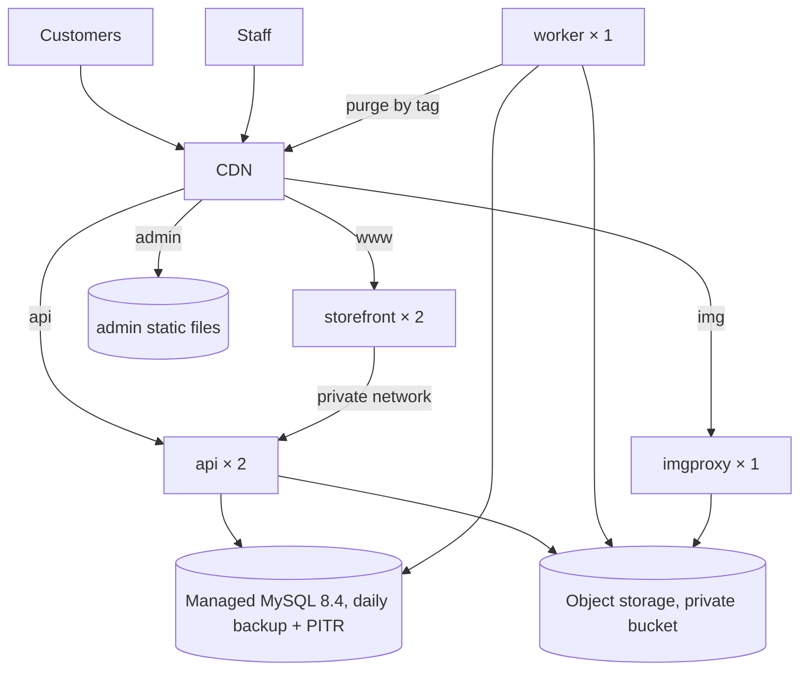

# 14 — DevOps

| Field | Value |
|---|---|
| ID | DOC-14 |
| Title | Environments, local setup, configuration, migrations, seed data, CI/CD, deployment topology, backups, runbooks |
| Status | Draft |
| Owner | Tech lead |
| Last updated | 2026-10-02 |
| Depends on | DOC-03, DOC-08, DOC-11, README (A-02, A-03, A-08) |
| Decisions used | ADR-0003, ADR-0008, ADR-0009, ADR-0011, ADR-0019 |

## 1. Purpose and scope

**Governs:** how the system is run: on a developer machine, in CI, and (later) in staging and production; configuration variables; database migration and seed workflow; pipelines; backups; operational runbooks.
**Does not govern:** application structure (DOC-08), security rules (DOC-11), test content, performance budgets and alert thresholds (DOC-13), the build order of features (DOC-16).

**Status of production (README A-08):** the owner has set the domain `rubaya.pk` and said production comes later. §2–§7 (local, config, migrations, seed, CI) are needed from the first day of building. §8–§11 (hosting, deploy, backups, runbooks) are specified now so nothing is designed in a way that blocks them, but **no provider is chosen and no deploy task is scheduled** until the owner sets a go-live date and answers README CQ-2 (budget and ability to pay foreign providers).

## 2. Environments

| Environment | Purpose | Data | URL | Exists from |
|---|---|---|---|---|
| `local` | Development | Seed data, disposable | `localhost` ports (DOC-03 §10) | M0 |
| `ci` | Automated checks | Fresh database per run | — | M0 |
| `staging` | Owner review, release rehearsal | Seed + test orders; never real customer data | `staging.rubaya.pk` (+ `admin-staging`, `api-staging`, `img-staging`) | When go-live is scheduled |
| `production` | Customers | Real | `www.rubaya.pk`, `admin.rubaya.pk`, `api.rubaya.pk`, `img.rubaya.pk` | Go-live |

Rules: environments differ **only** by configuration (same images, same migrations); staging and local always send `X-Robots-Tag: noindex` (DOC-06.9 §3) and show the admin environment banner (DOC-07.1 §4); production data is never copied to another environment without anonymisation.

## 3. Local development

### 3.1 Prerequisites

| Tool | Version | Note |
|---|---|---|
| Node.js | 22.22 (`.nvmrc`) | On Windows use `nvm-windows` or `fnm` |
| pnpm | 11.x | `corepack enable` picks the version from `packageManager` |
| Docker Desktop (or Docker Engine) | current | Runs MySQL, MinIO, imgproxy, Mailpit. Alternative without Docker: §3.4 |
| Git | current | |

The project is developed on Windows 11 (the owner's machine) and must also run on macOS and Linux: no bash-only scripts in `package.json` (Node scripts in `scripts/*.mjs` instead), no hard-coded path separators.

### 3.2 Services (`docker-compose.yml` at the repo root)

```yaml
services:
  mysql:
    image: mysql:8.4
    command: >
      --character-set-server=utf8mb4 --collation-server=utf8mb4_0900_ai_ci
      --default-time-zone=+00:00 --innodb-ft-min-token-size=2
    environment:
      MYSQL_ROOT_PASSWORD: root
      MYSQL_DATABASE: rubaya
    ports: ["3306:3306"]
    volumes: ["mysql-data:/var/lib/mysql", "./infra/mysql/init:/docker-entrypoint-initdb.d:ro"]
    healthcheck: { test: ["CMD", "mysqladmin", "ping", "-proot"], interval: 5s, retries: 20 }

  minio:
    image: minio/minio
    command: server /data --console-address ":9001"
    environment: { MINIO_ROOT_USER: minio, MINIO_ROOT_PASSWORD: minio12345 }
    ports: ["9000:9000", "9001:9001"]
    volumes: ["minio-data:/data"]

  imgproxy:
    image: darthsim/imgproxy
    environment:
      IMGPROXY_KEY: ${IMG_SIGNING_KEY}
      IMGPROXY_SALT: ${IMG_SIGNING_SALT}
      IMGPROXY_USE_S3: "true"
      IMGPROXY_S3_ENDPOINT: http://minio:9000
      AWS_ACCESS_KEY_ID: minio
      AWS_SECRET_ACCESS_KEY: minio12345
      IMGPROXY_ALLOWED_SOURCES: s3://rubaya-media/
    ports: ["8080:8080"]

  mailpit:
    image: axllent/mailpit
    ports: ["1025:1025", "8025:8025"]

volumes: { mysql-data: {}, minio-data: {} }
```

`infra/mysql/init/01-users.sql` creates the two database users of DOC-11 §6: `rubaya_app` (DML on all tables; `INSERT, SELECT` only on `audit_log`) and `rubaya_migrate` (DDL + DML). Image tags are pinned to exact versions when the file is first committed.

`--innodb-ft-min-token-size=2` lets full-text search match two-letter words (the default 3 would drop sizes and short Roman-Urdu words, ADR-0010); it must be set the same way in every environment because changing it requires rebuilding the index.

### 3.3 First run

| Step | Command |
|---|---|
| 1 | `corepack enable && pnpm install` |
| 2 | `node scripts/setup-env.mjs` — copies each `.env.example` to `.env` if missing and generates random local secrets |
| 3 | `docker compose up -d` |
| 4 | `pnpm --filter @noor/api db:migrate` |
| 5 | `pnpm --filter @noor/api db:seed` — prints the local owner login once |
| 6 | `pnpm dev` → API http://localhost:3000, admin http://localhost:5173, storefront http://localhost:5174, MinIO console :9001, Mailpit :8025 |

`pnpm dev` checks that MySQL is reachable and migrations are at head, and stops with the exact command to run if not.

### 3.4 Without Docker

**This is the setup used locally (decision of 2 Oct 2026: no Docker).** `node scripts/setup-env.mjs` creates `apps/api/.env` and `apps/storefront/.env` from the `.env.example` files (it replaces `__NAME__` tokens with generated secrets, keeps earlier secrets in `.data/local-secrets.json`, never overwrites an existing `.env`) and writes `.data/mysql-init.sql` from `infra/mysql/init/01-users.sql`. Run that SQL once as the MySQL administrator: `mysql -u root -p < .data/mysql-init.sql`. It creates the databases `rubaya` and `rubaya_test`, and the users `rubaya_app` and `rubaya_migrate` with the generated passwords. On this machine MySQL **8.4.11** (the MSI from dev.mysql.com, which only copies files) was set up by hand beside the older 8.0: config `C:\ProgramData\MySQL\MySQL Server 8.4\my.ini` (port **3307**, `127.0.0.1` only, `mysqlx=OFF`, `innodb_ft_min_token_size=2`), data in `...\Data`, initialised with `mysqld --initialize-insecure`, root password set afterwards and saved in `.data/mysql-root.txt` (gitignored). It runs as a plain process, started with `"C:\Program Files\MySQL\MySQL Server 8.4\bin\mysqld.exe" --defaults-file="C:\ProgramData\MySQL\MySQL Server 8.4\my.ini"`. To start it at boot, run once in an **administrator** terminal: `mysqld --install MySQL84 --defaults-file=<the my.ini>` then `net start MySQL84`. `apps/api/.env` points at `127.0.0.1:3307`.

Install MySQL 8.4 natively (the MySQL Installer on Windows; XAMPP ships MariaDB, which is **not** supported, ADR-0008). Create the database and the two users with `infra/mysql/init/01-users.sql`. Set `IMAGE_TRANSFORM=none` and `STORAGE_DRIVER=local` in `apps/api/.env`: media is then written under `apps/api/.data/media` and renditions are pre-generated with `sharp` (DOC-08 §11 fallback). `STORAGE_DRIVER=local` is refused at boot unless `NODE_ENV=development`. Emails are written to the console.

## 4. Configuration

All variables are read once by `platform/config.ts` (DOC-08 §12). "Secret" values follow DOC-11 §7.

### 4.1 API and worker (`apps/api/.env`)

| Variable | Example (local) | Secret | Notes |
|---|---|---|---|
| `NODE_ENV` | `development` | | `development` / `test` / `production` |
| `APP_ENV` | `local` | | `local` / `ci` / `staging` / `production`; drives the environment banner and `noindex` |
| `PORT` | `3000` | | |
| `DATABASE_URL` | `mysql://rubaya_app:…@localhost:3306/rubaya` | yes | App user. Production adds `?ssl=…` |
| `DATABASE_MIGRATION_URL` | `mysql://rubaya_migrate:…@localhost:3306/rubaya` | yes | Used only by `db:migrate`, `db:seed` and the retention job |
| `DB_POOL_SIZE` | `10` | | Per process. 2 API + 1 worker = 30 connections; keep under the provider's limit |
| `ADMIN_ORIGIN` | `http://localhost:5173` | | Exact origin for CORS and CSRF |
| `STOREFRONT_ORIGIN` | `http://localhost:5174` | | Links in notifications, preview links |
| `INTERNAL_API_KEY` | generated | yes | Storefront → API |
| `TRUST_PROXY_HOPS` | `0` | | Number of proxies in front of the API (F-19) |
| `DATA_ENCRYPTION_KEY` | generated (32 bytes base64) | yes | TOTP secrets |
| `PREVIEW_SIGNING_KEY` | generated | yes | |
| `TRACKING_KEY` | generated (32 bytes base64) | yes | Order tracking tokens (DOC-10.3 §4). Never rotated routinely |
| `SESSION_COOKIE_NAME` | `__Host-rb_admin` | | DOC-11 §3.4 |
| `STORAGE_DRIVER` | `s3` | | `s3` / `local` (development only) |
| `S3_ENDPOINT`, `S3_REGION`, `S3_BUCKET` | `http://localhost:9000`, `auto`, `rubaya-media` | | |
| `S3_ACCESS_KEY_ID`, `S3_SECRET_ACCESS_KEY` | `minio`, `minio12345` | yes | |
| `S3_FORCE_PATH_STYLE` | `true` | | MinIO needs it |
| `IMAGE_TRANSFORM` | `imgproxy` | | `imgproxy` / `none` |
| `IMG_BASE_URL` | `http://localhost:8080` | | Public base of the image host |
| `IMG_SIGNING_KEY`, `IMG_SIGNING_SALT` | generated hex | yes | Shared with imgproxy |
| `CDN_PURGE_URL`, `CDN_PURGE_TOKEN` | empty | yes | Empty = purge jobs are no-ops |
| `MAIL_URL` | `smtp://localhost:1025` | yes (prod) | Empty = email disabled (DOC-12) |
| `LOG_LEVEL` | `debug` | | `info` in production |
| `DEV_INLINE_WORKER` | `1` | | Run the worker inside the API process (local only) |

### 4.2 Storefront and admin

Storefront (`apps/storefront/.env`): `API_INTERNAL_URL`, `INTERNAL_API_KEY`, `PUBLIC_SITE_URL`, `PUBLIC_IMG_URL`, `PREVIEW_SIGNING_KEY`, `APP_ENV`, `PORT` (DOC-03 §10).
Admin (`apps/admin/.env`): `VITE_API_URL` only.

Each app has a committed `.env.example` with names, comments and no real values. `scripts/setup-env.mjs` is the only supported way to create local `.env` files.

## 5. Migrations and seed data

### 5.1 Migrations (ADR-0008)

| Rule | Detail |
|---|---|
| Authoring | Change a module's `schema.ts` → `pnpm --filter @noor/api db:generate -- --name <snake_case>` → review the generated SQL in `apps/api/drizzle/` → commit it as its own `db(api): …` commit (DOC-15 §4) |
| Applying | `db:migrate` runs `drizzle-kit migrate` with `DATABASE_MIGRATION_URL`. `drizzle-kit push` is not in any script and is forbidden outside a scratch database |
| Not transactional | MySQL DDL auto-commits. **One schema change per migration file**; each file must be safe to re-run after a partial failure (`CREATE TABLE IF NOT EXISTS`, or a guard query before `ALTER`) |
| Never edit an applied migration | Fix forward with a new one. CI fails if a committed migration file's hash changes |
| Expand / contract | A breaking change ships in three releases: (1) add the new column/table, code writes both; (2) backfill by a job, code reads the new; (3) drop the old. Renames are add + backfill + drop, never `RENAME COLUMN` in one step while two instances run different code |
| Backfills | In the job system (batched, resumable), not inside a migration file |
| Large tables | `ALTER … ALGORITHM=INSTANT` or `INPLACE, LOCK=NONE` where MySQL 8.4 supports it; otherwise scheduled in a low-traffic window (runbook R-3) |
| Order of deploy | Migrate first, then roll out code. Therefore every migration must be compatible with the **previous** code version |
| Down migrations | Not written. Recovery from a bad migration is fix-forward or restore (R-5) |
| CI check | On an empty database: apply all migrations, then `drizzle-kit generate` must report no diff (schema files and migrations agree) |

### 5.2 Seed (`db:seed`)

Idempotent (upserts by natural key); refuses to run when `APP_ENV=production` unless `--base-only`.

| Layer | Contents | Environments |
|---|---|---|
| Base (`--base-only`) | Roles; `counters` rows (`order_number` 10000, `invoice_<year>`); store settings with name "Rubaya", `storefront-gold` theme, PKR, English; payment method `cod` enabled, others disabled (A-07); required CMS pages with the drafted policy texts (A-09); city master list; default couriers; two shipping zones with placeholder fees flagged "review before launch"; size systems (Women's stitched XS–XXL, Footwear EU 36–41) | All, including production's first deploy |
| Demo | The product, category, collection, attribute, size-chart, promo, review and order fixtures from `admin-panel/src/contract/fixtures.js`, converted to the new schema; demo images uploaded to the bucket | local, ci, staging |
| Owner account | `owner:create --email <e>` CLI prompts for a password (or, with `--generate`, prints a random one once). Local seed creates `owner@rubaya.test` and prints the password once | all |

Tests do not depend on the demo seed: each integration test builds its own data with factory helpers (DOC-13).

## 6. Continuous integration

GitHub Actions (DOC-15 Q-15-1). One workflow, `.github/workflows/ci.yml`, on every pull request and on pushes to `master`.

| Job | Steps | Blocks merge |
|---|---|---|
| `check` | checkout → Node 22.22 + pnpm (cached store) → `pnpm install --frozen-lockfile` → `pnpm turbo run typecheck lint test build` → `node scripts/check-logical.mjs` → contrast gate → `node scripts/ts-ratio.mjs` | yes |
| `api-integration` | MySQL 8.4 service container (same flags as §3.2) → `db:migrate` → migration drift check (§5.1) → API integration tests → OpenAPI snapshot diff | yes |
| `e2e` | Build all → start API, storefront, admin against a seeded database → Playwright smoke suite (DOC-13) | yes, for PRs touching `apps/` or `packages/` |
| `lighthouse` | Storefront budgets (DOC-06.10 §9) | yes, for PRs touching `apps/storefront` or `packages/ui` |
| `security` | gitleaks; `pnpm audit --prod` (high/critical fail); dependency-cruiser module rules | yes |
| `pr-title` | Conventional-commit lint on the PR title (DOC-15 §4) | yes |

Turborepo's cache is stored in the Actions cache keyed by lockfile hash, so unchanged workspaces are skipped. Target: under 10 minutes for a typical PR (ADR-0003 revisit trigger). Detailed test contents are DOC-13.

## 7. Build artefacts

| Artefact | Built by | Contents |
|---|---|---|
| `api` image | `apps/api/Dockerfile` (multi-stage, `node:22-slim`, non-root user) | Compiled API; entrypoints `main.js`, `worker.js`, `cli.js`. One image, three commands |
| `storefront` image | `apps/storefront/Dockerfile` | React Router server build |
| `admin` static bundle | `pnpm --filter @noor/admin build` | Uploaded to the static host / CDN |

Images are tagged with the git SHA; a release tag (`v2026.10.02.1`, DOC-15 §3) points at an existing SHA-tagged image, so what was tested on staging is byte-for-byte what runs in production. Until a registry is chosen, CI only verifies that the images build.

## 8. Deployment topology (specified; not scheduled, see §1)

ADR-0019: single region, always-on containers, managed MySQL, CDN.



| Requirement on the provider(s) | Why |
|---|---|
| Always-on containers, at least 2 instances per web service, rolling deploys with health checks | No cold starts; zero-downtime deploys (ADR-0019) |
| Private networking between services | Storefront → API, API → MySQL |
| Managed **MySQL 8.4** (not MariaDB) with automated daily backups, point-in-time recovery ≥ 7 days, TLS, and the server flags of §3.2 settable | ADR-0008; MySQL 8.4 LTS is supported to April 2032 |
| S3-compatible object storage with private buckets and presigned URLs | ADR-0011 |
| CDN with custom `Cache-Control` honouring, purge by tag (or by URL prefix as a fallback), Brotli, HTTP/2 or 3 | ADR-0004, DOC-08 §10 |
| Region with measured p95 TTFB ≤ 600 ms from Karachi and Lahore | ADR-0019, DOC-06.10 |
| Payable by the owner | README CQ-2 (unanswered) |

Candidates seen in research (not evaluated against the table above, prices as published on 2 Oct 2026 and unverified): DigitalOcean managed MySQL from US$15/month single node with daily backups and 7-day point-in-time recovery; Aiven managed MySQL with point-in-time recovery up to 30 days. Compute, storage and CDN candidates are not researched. **Decision task `LAUNCH-01`** (DOC-16): measure latency from Pakistan for 2–3 candidate regions, confirm payment method, fill this table, and record the choice as an amendment to ADR-0019.

Budget lever if A-02 (≤ US$150/month) cannot be met: one VPS running the same containers with Docker Compose plus managed or self-hosted MySQL with off-site backups (ADR-0019 option B). The application needs no change for that.

### 8.1 Release procedure (once environments exist)

| Step | Action |
|---|---|
| 1 | Merge to `master` → CI green → images built and pushed with the SHA tag → **automatic deploy to staging** |
| 2 | Staging deploy = run `cli db:migrate` as a one-off task → roll `api`, `worker`, `storefront` → upload admin bundle → smoke tests against staging |
| 3 | Owner or tech lead checks staging |
| 4 | Create release tag → **production deploy** (same steps, same images), requires a manual approval in the pipeline |
| 5 | Post-deploy: health checks, smoke tests (place and cancel a test COD order with a reserved test phone number), watch error rate for 15 minutes |
| Rollback | Redeploy the previous tag's images (R-2). Safe because migrations are backward-compatible with the previous code (§5.1) |
| Freeze | No production deploys during a declared drop/sale window except fixes (R-8) |

## 9. Backups and recovery

| Item | Policy |
|---|---|
| Database | Provider automated daily backups + point-in-time recovery (≥ 7 days). In addition a nightly logical dump (`mysqldump --single-transaction`) encrypted and written to a **different** provider or account's object storage, kept 30 days (protects against account loss) |
| Object storage (media) | Bucket versioning on; lifecycle rule deletes non-current versions after 30 days. Originals are never overwritten (keys are unique) |
| Configuration and secrets | Stored in the host's secret manager; an offline encrypted copy held by the owner |
| Code and migrations | Git |
| Targets | RPO ≤ 15 minutes (point-in-time recovery), RTO ≤ 2 hours |
| Rehearsal | Restore to a scratch database and run the smoke suite **before launch** and every 6 months; date and duration recorded in §13 (ADR-0019 acceptance) |
| Who can access backups | Owner account at the provider only (DOC-11 §8.2) |
| Local/staging | No backups; data is disposable |

## 10. Logs and operational access

| Topic | Rule |
|---|---|
| Logs | stdout JSON collected by the host; retained 30 days; searchable by `requestId` |
| Database access | No direct production access from developer machines by default. When needed: a time-limited read-only user through the provider's secure tunnel, logged in the incident note |
| Shell access | `cli` commands run as one-off tasks through the host, not by SSH into a running container |
| Monitoring and alerts | DOC-13 |
| Uptime check | External check on `/healthz` (storefront) and `/readyz` (API) every minute |

## 11. Runbooks

Each is a short checklist kept in `plan/runbooks/` when production exists; the content is fixed here.

| ID | Situation | Steps |
|---|---|---|
| R-1 | Deploy | §8.1 |
| R-2 | Roll back a release | Redeploy previous tag → confirm `/readyz` → if a migration from the bad release is incompatible with the old code (should not happen, §5.1), fix forward instead → write an incident note |
| R-3 | Risky migration (large table, long lock) | Test on a staging copy with production-size data → schedule after 2 am PKT → announce → run with the migration user → watch replication/locks → verify → note duration |
| R-4 | Migration failed halfway | Do not re-run blindly. Read the failed statement → because each file holds one change and is re-runnable, fix the cause and re-run; if the file is wrong, add a corrective migration → never edit the applied file |
| R-5 | Restore the database | Declare the incident → stop `api` and `worker` (maintenance page from the CDN) → point-in-time restore to a new instance at the chosen timestamp → run `db:migrate` → repoint `DATABASE_URL` → start services → smoke test → reconcile orders placed after the restore point from notification logs and courier records |
| R-6 | Rotate a secret | Add the new value alongside the old where dual keys are supported (`INTERNAL_API_KEY`, `DATA_ENCRYPTION_KEY` key ids) → deploy → remove the old → for database passwords: create new user/password, deploy, drop the old |
| R-7 | Jobs stuck or dead-lettered | Check worker logs by job type → fix the cause → `cli jobs:retry <id>` or `--type <type>` → confirm the queue drains; if notifications were skipped, staff resend from the order page |
| R-8 | Sale / drop day | 48 h before: freeze deploys; load-test the listing and checkout path at 3× expected peak (DOC-13); confirm DB connection headroom; raise API instances to 3; verify CDN cache hit ratio. During: watch lock wait time, 5xx rate, queue latency, order rate; no schema changes. After: scale back, review metrics against ADR-0020's revisit trigger |
| R-9 | Database unreachable | `/readyz` fails → host stops routing → CDN serves stale cached pages (`stale-while-revalidate`, `stale-if-error`) for catalog browsing; checkout shows the 503 state (DOC-06.1 §6) → check provider status → fail over or restore (R-5) |
| R-10 | Suspected account compromise | Deactivate the staff user (ends sessions) → rotate anything they could read → review the audit log by actor and IP → reset 2FA for affected users → incident note |
| R-11 | CDN serving stale or wrong content | `cli cache:purge <tag>` or purge all → confirm `Cache-Control` and tags on the origin response → check that no private route became cacheable |
| R-12 | Lost owner access (2FA device and recovery codes) | `cli owner:reset-2fa --email <e>` run through the host by whoever holds provider access; audited as `system` |

## 12. Rules

**Always:** keep environments identical except for configuration; migrate before deploying code and keep migrations compatible with the previous release; one schema change per migration; rehearse restores; pin image and tool versions.
**Never:** run `drizzle-kit push` against a shared database; edit an applied migration; seed demo data or reset data in production; deploy on a sleeping free tier (ADR-0019); copy production data to staging or local without anonymising; SSH-edit a running container.
**Common mistakes:** a migration that only works with the new code; forgetting `--innodb-ft-min-token-size` on a new database (search silently drops short words); a `.env` committed "temporarily"; choosing a region by price without measuring latency.

## 13. Acceptance checklist

- [ ] On a clean Windows machine and a clean Linux machine, §3.3 goes from clone to a working `pnpm dev` with no manual steps beyond those listed.
- [ ] `docker compose down -v && docker compose up -d && db:migrate && db:seed` rebuilds a working local stack; running `db:seed` twice changes nothing the second time.
- [ ] CI applies all migrations to an empty MySQL 8.4 and reports no schema drift.
- [ ] The API refuses to boot with `STORAGE_DRIVER=local` and `NODE_ENV=production`, and with any missing variable in §4.1.
- [ ] The `rubaya_app` user cannot run DDL or modify `audit_log`.
- [ ] CI completes in under 10 minutes on a typical PR.
- [ ] (At launch) Restore rehearsal completed and recorded below; p95 TTFB from Karachi and Lahore measured and recorded (ADR-0019).

| Rehearsal / measurement | Date | Result |
|---|---|---|
| Restore rehearsal | not yet | — |
| TTFB from Pakistan | not yet | — |

## 14. Open questions and assumptions

| # | Item | Assumption | Revisit trigger |
|---|---|---|---|
| Q-14-1 | Hosting, database, storage and CDN providers | Not chosen (§8); README CQ-2 unanswered | Go-live date set → task `LAUNCH-01` |
| Q-14-2 | Docker on the development machine | **Answered at M0-01: not installed.** §3.4 (native MySQL 8.4, `STORAGE_DRIVER=local`, `IMAGE_TRANSFORM=none`) is the path for this machine unless Docker Desktop is installed; spike M0-08 (MinIO + imgproxy) then waits for Docker | Docker installed |
| Q-14-3 | imgproxy and MinIO image tags and environment variable names | As used in §3.2 from general knowledge; verified in `M0-API-SPIKE-4` | Spike |
| Q-14-4 | CDN purge-by-tag API | Provider-specific; `cache.purge` job has one adapter function | Provider choice |
| Q-14-5 | Managed MySQL allows setting `innodb_ft_min_token_size` | Yes; if not, short-word search relies on the synonyms table and prefix matching only | Provider choice |
| Q-14-6 | Published prices in §8 | From a search summary on 2 Oct 2026, not from the providers' pricing pages | `LAUNCH-01` |

## 15. Changelog

| Date | Change |
|---|---|
| 2026-10-02 | Initial version (Phase 4). Production sections specified but unscheduled per README A-08 |
| 2026-10-02 | Phase 5: `TRACKING_KEY` added to §4.1 |
| 2026-10-02 | M0-01: Docker is not installed on the development machine (Q-14-2) |
| 2026-10-02 | M0-03 (no-Docker form): `scripts/setup-env.mjs`, `scripts/lib/env-file.mjs` (4 tests), `infra/mysql/init/01-users.sql`, DB variables in `apps/api/.env.example`. Not done: the readiness check in `pnpm dev` (needs the db pool, M0-06) and running the SQL (needs the administrator password) |
| 2026-10-04 | Local MySQL is 8.4.11 on port 3307 (manual setup, no Windows service yet); `db:migrate`, the two spikes and `/readyz` work against it |
